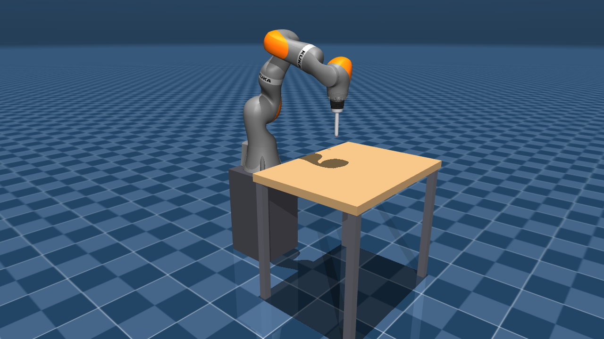
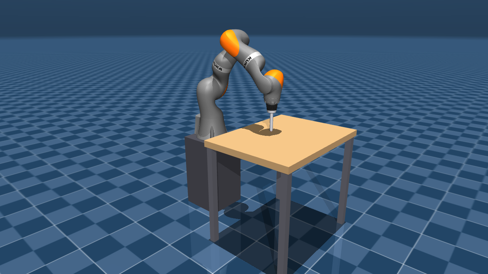
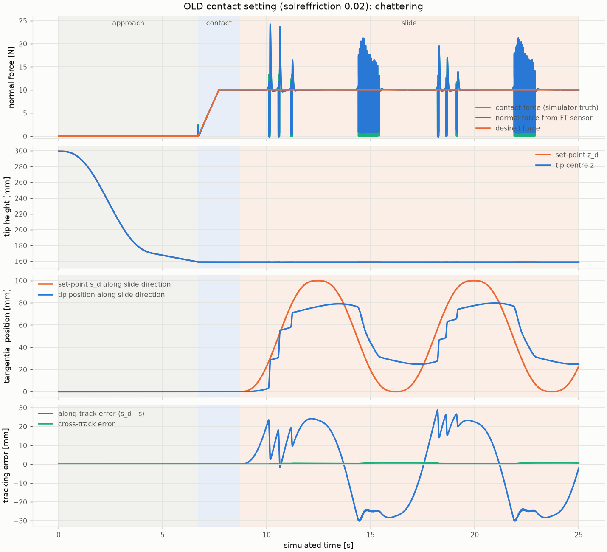
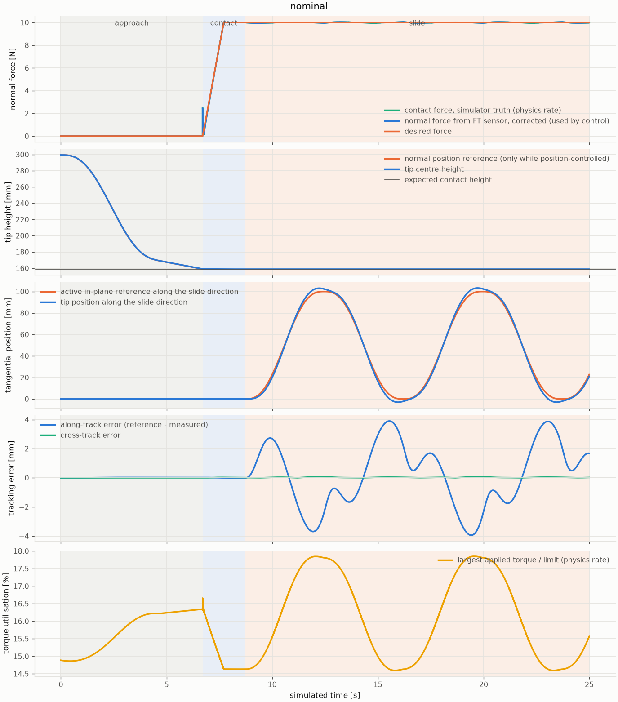
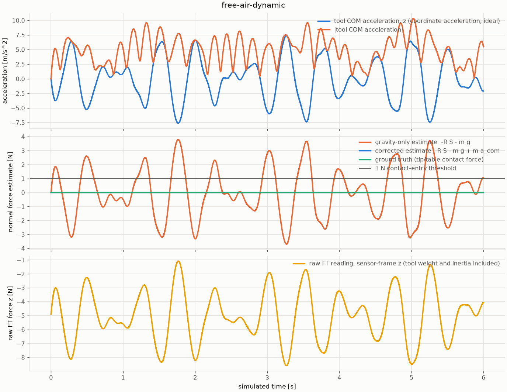
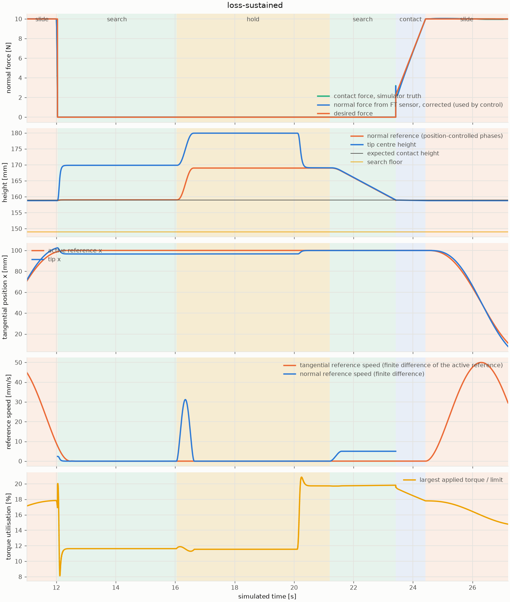

# KUKA iiwa14 table scene (MuJoCo)

**Oracle joint-torque QP experiment:** [report and acceptance evidence](docs/oracle_joint_qp/report.md),
[中文摘要](docs/oracle_joint_qp/morning_summary_zh.md). The optional implementation
uses the same nominal controller/plant, a known forearm force point, isolated
MuJoCo predictions and seven joint torque corrections. Shadow/replay and a
specific active net-energy limit are validated; contact preservation and some
held-out active cases fail, so the overall delivery is explicitly **partial**.

```bash
python -m kuka_table_sim.oracle_experiments case --name resistance --mode active --budget .12 --task-weight 1 --out results/oracle/single
python -m kuka_table_sim.oracle_experiments matrix --out results/oracle/final
```

Install the optional solver/plot dependencies with `pip install -e '.[oracle,test]'`
or use the pinned `requirements.txt`. Failed trials exit 2 and preserve logs/state;
the matrix continues through its remaining cases. See the report for full reproduction.

Milestone 1 of the contact-passivity simulation rebuild: a KUKA LBR iiwa 14
standing above a stationary table in MuJoCo, driven by seven joint-torque
actuators. The spherical polishing tool from the MEAM 6230 Panda project is
mounted on the flange, with a force/torque (FT) sensor at its base. Two
controllers are provided: a gravity-compensated joint PD hold, and an
operational-space **force controller** that approaches the table, holds a
constant normal force from the FT reading, slides back and forth along a chosen
direction, and recovers from contact loss. A stage-coherent recorder logs the
contact force, tool motion and signed contact work for a later shadow
predictor. There is no object, energy tank, QP, predictor or hardware
interface yet.



**Previous research work** (planar sliding PoC, Franka Panda selective
passivation, paper sources, results) lives on the `proposal` branch. It is still
present in this branch's history and tree (`mujoco_sliding/`, `mujoco_panda/`,
`paper*/`, `results*/`), but nothing here imports it and its original
`requirements.txt` is the one on `proposal`.

## Installation

Tested on macOS 26.2 (arm64) with Python 3.13.5, `mujoco==3.15.0`,
`numpy==2.5.4` (project `.venv`), and also with Python 3.12.2,
`mujoco==3.3.7`, `numpy==2.3.4` (conda base: headless validation passes,
viewer launches and exits cleanly). `mj_fullM` changed signature between
those releases; `holding.full_mass_matrix` handles both.

```bash
git clone git@github.com:ROBOWA/Contact-Passivity.git && cd Contact-Passivity
python3 -m venv .venv && source .venv/bin/activate
pip install -r requirements.txt        # pinned, tested versions (matplotlib: plots only, pytest: tests only)
python -m pytest -q                    # 50 tests, about 70 s
```

Robot meshes and the MJCF are vendored under `assets/kuka_iiwa_14/`, so no
download happens at launch. The pinned upstream commit and the re-vendoring
recipe are in [assets/kuka_iiwa_14/SOURCE.md](assets/kuka_iiwa_14/SOURCE.md).
The tool meshes are under `assets/polishing_tool/` with their own
[SOURCE.md](assets/polishing_tool/SOURCE.md).

## Running

```bash
# Headless validation: 10 s of simulated time, prints a report, exit code 0 on PASS.
python -m kuka_table_sim.run headless --duration 10

# Same, plus an offscreen PNG from the "overview" camera (needs a GL backend).
python -m kuka_table_sim.run headless --duration 10 --render docs/kuka_table_scene.png

# Interactive viewer. macOS needs the mjpython launcher shipped with the mujoco wheel:
mjpython -m kuka_table_sim.run viewer
# Linux / Windows:
python -m kuka_table_sim.run viewer

# Approach the table, hold 10 N and slide (headless validation, stage-coherent RunLog, plot; or live):
python   -m kuka_table_sim.run --controller force headless --duration 25 --log run.npz --plot run.png
python   -m kuka_table_sim.plot run.npz --kind force --out run.png      # kinds: force, free-air, recovery, work
mjpython -m kuka_table_sim.run --controller force viewer
python   -m kuka_table_sim.run --controller force --slide-distance 0 headless --duration 15          # approach + hold only
python   -m kuka_table_sim.run --controller force --slide-direction 0 1 0 --slide-distance 0.15 --slide-speed 0.08 --slide-cycles 2 headless --duration 30

# Reproduction scenarios of the contact-baseline repairs (see "Scenarios and reproduction")
python -m kuka_table_sim.scenarios nominal                 # also: free-air-static, free-air-dynamic, fast-approach,
python -m kuka_table_sim.scenarios loss-reacquire --plot r.png --log r.npz   # loss-short, loss-reacquire, loss-sustained,
python -m kuka_table_sim.scenarios timestep-study          # removal-stress, timestep-study

# Initial state from a site pose (IK): any command accepts --init-site/--init-pos + --init-rpy or --init-quat
mjpython -m kuka_table_sim.run --init-site tcp --init-pos 0.6 0.15 0.3 --init-rpy 0 180 0 viewer
python   -m kuka_table_sim.run --controller force --init-pos 0.6 0.15 0.3 --init-rpy 0 180 0 headless
python   -m kuka_table_sim.run ik --site flange --pos 0.5 -0.1 0.45 --quat 0 0 1 0 --render pose.png
python   -m kuka_table_sim.run ik --self-test
```

Viewer controls: the viewer starts on MuJoCo's free camera, so the mouse
works immediately (left drag orbits, right drag pans, scroll zooms, double
click selects a body). `R` or `Backspace` resets the scene (home pose, zero
velocity, `t = 0`, holding target re-armed). `Ctrl-Q` or closing the window
quits, and `Ctrl-C` in the terminal also quits cleanly. `--camera overview`
starts on the fixed scene camera instead; a fixed camera ignores mouse orbiting
until `Esc` switches back to the free camera (`[` and `]` cycle cameras).

All timing and controller parameters are command-line options (`--timestep`,
`--control-period`, `--render-hz`, `--hold-freq-hz`, `--hold-zeta`,
`--controller`, `--force`, `--approach-speed`, `--creep-speed`,
`--creep-distance`, `--kp-force`, `--ki-force`, `--slide-*`, `--motion-freq`,
`--rotation-freq`, `--ki-tangential`, `--ki-rotation`, `--friction-ff`,
`--friction-viscous-ff`); see
`python -m kuka_table_sim.run --help`. Run the commands from the repository
root so that `kuka_table_sim` is importable; the package locates `assets/`
relative to its own files.

On macOS the passive viewer must run under `mjpython` (see
<https://mujoco.readthedocs.io/en/stable/python.html>). The headless path never
imports `mujoco.viewer`.

## Scene definition

| Item | Value |
| --- | --- |
| World frame | right-handed, z up, origin at the centre of the robot mounting plate, +x toward the table, SI units |
| Robot base pose | `base` body at the world origin, identity orientation, mounted on a 0.30 x 0.30 x 0.55 m pedestal box |
| Floor | plane at z = -0.55 m |
| Tabletop | box 0.60 (x) x 0.80 (y) x 0.04 m, centred at (0.65, 0, 0.13) m, **top surface z = +0.15 m**, spans x in [0.35, 0.95] m, y in [-0.40, 0.40] m |
| Table legs | four 0.04 x 0.04 m boxes from the floor to the tabletop underside, at (0.65 +/- 0.27, +/- 0.37) m |
| Collision | floor, pedestal and all table geoms collide with the robot's collision spheres; the seven upstream adjacent-link `<exclude>` pairs are kept, nothing else is disabled |
| Initial pose `q_home` (rad) | `[0, 0.43, 0, -1.51, 0, 1.2, 0]` (keyframe `home`) |
| Flange at `q_home` | position (0.5483, 0, 0.4714) m, z-axis (0, 0, -1) within 2e-3, i.e. tool pointing straight down |
| TCP (tool tip centre) at `q_home` | (0.5486, 0, 0.2994) m; tip surface 0.140 m above the tabletop, 0.20 m inside the near table edge |
| Joint-limit margin at `q_home` | min 0.584 rad (joint 4) |
| Contacts at `q_home` | none |
| `flange` site | on `link7` at (0, 0, 0.045) m, same frame as the upstream `attachment_site`: origin at the flange face centre, z-axis along the joint-7 axis pointing out of the flange, x/y parallel to the `link7` frame |
| `tcp` site | centre of the 9 mm tip sphere, 0.172 m from the flange along its z-axis (see Tool below); contact point with a flat surface is 0.009 m further along the surface normal |
| Cameras | free camera framed by `<statistic center="0.35 0 0.05" extent="1.6">` and `<visual><global azimuth="140" elevation="-20">` (viewer default); fixed `overview` camera at (1.75, -1.65, 0.80) m looking at (0.35, 0, 0.05) m (used for offscreen renders and `--camera overview`) |

Files: `assets/kuka_table_scene.xml` (world, table, lights, camera),
`assets/iiwa14_torque.xml` (robot, derived from upstream, changes listed in its
header comment), `assets/polishing_tool.xml` (tool stack, included inside
`link7`), `assets/kuka_iiwa_14/` (verbatim upstream copy plus license).

## Tool

The end-effector is the spherical polishing tool from the MEAM 6230 Panda
polishing project, re-mounted on the iiwa14 flange with the same offsets it had
beyond the Panda flange ([assets/polishing_tool/SOURCE.md](assets/polishing_tool/SOURCE.md)):

| Body / element | Position along flange z | Notes |
| --- | --- | --- |
| `tool_mount` | 0 | flange frame |
| `ft_sensor`, site `ft_site` | +0.035 m (sensor top face) | housing mesh (visual), collision cylinder r = 0.0375 m, h = 0.035 m below the top face; welded to `link7`, so it never self-collides with it |
| `sphere_tool` | +0.035 m | shaft mesh, visual only (as in the original) |
| `tool_tip` geom, site `tcp` | +0.172 m | sphere r = 0.009 m, friction `0.8 0.005 0.0001` from the original, collides with the table like every other geom |
| shaft collision | +0.035 to +0.160 m | holder cylinder r = 0.028 m (20 mm) and capsule r = 0.008 m ending 13 mm before the tip sphere; inside the visual mesh |

Masses are assumed (0.30 kg sensor, 0.20 kg shaft; the original used 0) so
gravity compensation and the mass matrix include the tool. The Panda demo's
intermediate `attachment` body with its 45 degree z-rotation was flattened into
a plain offset; a sphere tip has no orientation.

**FT sensor.** `<force name="ft_force">` and `<torque name="ft_torque">` are
attached to `ft_site`. MuJoCo reports the wrench the parent applies to the
`ft_sensor` subtree (housing + shaft + tip, 0.50 kg) in the site frame, so at
rest the force reads +4.905 N along world z and the environment force on the
tool is `F_ext = -R S - m_tool g` (quasi-static; the tool's own acceleration is
not compensated). The reading available to the controller is the one computed
at the end of the previous physics step (0.25 ms of latency). The tabletop's
contact parameters (`solref="0.02 1"`, MuJoCo defaults) are written out in the
scene file because they set the stiffness the force loop works against.

## Model source

[MuJoCo Menagerie](https://github.com/google-deepmind/mujoco_menagerie)
`kuka_iiwa_14`, commit `0059d4335f8156206f63a35662313385f7ad6d74` (2026-10-07),
BSD-3-Clause (Drake-derived). License and attribution files are kept in
`assets/kuka_iiwa_14/`.

## Actuators

The upstream model ships position servos (`<general>` with
`gainprm="2000" biasprm="0 -2000 -200"`, angle-valued `ctrlrange`, and a
keyframe `ctrl` holding target angles). `assets/iiwa14_torque.xml` replaces them
with seven `<motor>` actuators:

| Actuator | Joint | `gear` | `ctrlrange` (N m) |
| --- | --- | --- | --- |
| `joint1_torque` | `joint1` | 1 | +/- 320 |
| `joint2_torque` | `joint2` | 1 | +/- 320 |
| `joint3_torque` | `joint3` | 1 | +/- 176 |
| `joint4_torque` | `joint4` | 1 | +/- 176 |
| `joint5_torque` | `joint5` | 1 | +/- 110 |
| `joint6_torque` | `joint6` | 1 | +/- 40 |
| `joint7_torque` | `joint7` | 1 | +/- 40 |

`data.ctrl[i]` is the torque applied to joint `i+1` in N m. The limits are the
KUKA LBR iiwa 14 R820 joint torque figures from the spec sheet the upstream
README cites; here they are **simulation settings only**, with no claim of
hardware certification. MuJoCo clamps `ctrl` to `ctrlrange`; the controller also
clips to the same values so saturation can be reported. The servo gains, the
angle `ctrlrange` defaults and the keyframe `ctrl` were removed, so the
keyframe stores only `qpos`. `ArmIndex.from_model` verifies all of this at load
time (hinge joints, one-to-one joint mapping, gear 1, fixed unit gain, no bias,
symmetric limits).

## Holding controller (scene infrastructure only)

```
tau = qfrc_bias + Kp * (q_home - q) - Kd * qvel
```

* `qfrc_bias` is MuJoCo's `C(q, qvel) qvel + g(q)` for the state about to be
  integrated. The control step calls `mj_step1` (kinematics, bias forces,
  contacts), computes `tau` from those quantities, writes `ctrl`, then calls
  `mj_step2`. Compensation is applied once, here, and nowhere else.
* Default gains are scaled by the mass-matrix diagonal at `q_home`:
  `Kp_i = M_ii wn^2`, `Kd_i = 2 zeta M_ii wn` with `wn = 2 pi * 2 Hz`,
  `zeta = 1` (`--hold-freq-hz`, `--hold-zeta`). This matters because joint 7's
  modelled inertia is 0.001 kg m^2 while joint 2's is about 2.9; a fixed gain
  vector either chatters on the wrist or is sluggish on the shoulder. Explicit
  `Kp`/`Kd` vectors can be passed to `HoldingController` from Python.
* Torques are clipped to the actuator limits.
* Gravity stays on, joints are free, nothing writes `qpos` during stepping.
  `Simulation.reset()` restores the `home` keyframe, zero velocity, `t = 0`, the
  step counters and the holding target.

This is only there to keep the arm still while the scene is checked. It is not
the hybrid controller of the later milestones.

## Force controller (`--controller force`)



`kuka_table_sim/force_control.py` is an operational-space controller at the
`tcp` site (tool tip centre). It uses the FT sensor only; contact truth
(`mj_contactForce`, contacts, constraint forces) is recorded for validation and
is never read by the controller (a test greps the source for it).

| Phase | Entered when | Normal channel | Tangential / orientation |
| --- | --- | --- | --- |
| APPROACH | start | position: quintic descent to a creep point 10 mm above the expected surface (peak 0.05 m/s), then 5 mm/s creep | PD holds the start pose |
| CONTACT | corrected `f_n` > 1 N for 3 updates, from APPROACH or SEARCH | force control; `f_d` ramps for 1 s (from 0 at the first touchdown, from the measured force after a reacquisition) | PD, integrators |
| SLIDE | ramp done (the first stroke waits 1 s more) | force control | plus rest-to-rest quintic strokes |
| SEARCH | force deficit `f_d - f_n` > max(1 N, 0.5 `f_d`) for 10 updates | position: bounded creep from the last healthy contact height, progress governor | stroke stopped, PD hold |
| HOLD | SEARCH exhausted its time/distance budget | position: standoff 10 mm above the expected surface | PD hold |

* **Position loops** (tangential translation and orientation, and the normal
  direction while position-controlled): inertia-weighted PD with unit-mass gains
  and full reference feedforward, `F = Lambda (a_d + Kp e + Kd (v_d - v))`,
  `Lambda = (J M^-1 J^T + lambda I)^-1`, `Kp = wn^2`, `Kd = 2 zeta wn`; 4 Hz for
  translation (`--motion-freq`), 6 Hz for orientation (`--rotation-freq`).
  In contact, integrators on the in-plane position and the orientation
  (`--ki-tangential`, `--ki-rotation`, 300 1/s^3, clamped) absorb the friction
  force and moment.
* **Normal force law:** `f_cmd = f_d + kp_f (f_d - f_n) + ki_f * integral(f_d - f_n) - d_n v_n`
  with `kp_f = 0.5`, `ki_f = 5 /s` (integral contribution clamped to +/- 10 N),
  `d_n = 40 N s/m`. `f_n` is the corrected estimate below. The normal channel
  blends between force and position control with a smootherstep weight over
  0.1 s, so entering SEARCH causes no command step.
* **Sliding** (`--slide-distance` 0.10 m): rest-to-rest quintic strokes along
  `--slide-direction` (projected onto the table plane), stroke time
  `1.875 D / v_peak` (`--slide-speed` 0.05 m/s), so position, velocity and
  acceleration of the reference are continuous. Nominal friction feedforward
  along the commanded velocity: viscous `c_hat * v_d` (`--friction-viscous-ff`,
  80 N s/m, see the contact note below) and optionally Coulomb
  `mu_hat * f_n * tanh(v_d / 5 mm/s)` (`--friction-ff`, off). This is the declared
  nominal friction baseline of the simulation (`solreffriction 0.5 1`), not
  experimentally validated hardware friction.
* **Null space:** posture spring/damper toward `q_home` (1 Hz) through
  `N^T = I - J^T Jbar^T`, built from the *regularised* `Lambda`. The projector is
  therefore only approximately dynamically consistent,
  `J M^-1 N^T = lambda Lambda J M^-1 != 0`; the task-space acceleration the
  posture torque leaks into is logged (`null_leak`) and no exact decoupling is
  claimed. A projector redesign is deferred.
* **Torques:** `qfrc_bias` (gravity and Coriolis) compensation once; the
  command is clipped to the actuator limits; the full applied torque is
  logged next to its components (`tau_cmd = tau_bias + tau_task + tau_null`,
  `tau_ctrl` after clipping, `tau_applied` per substep).
* **Anti-windup:** every integrator is also frozen on the update that follows
  an update whose *final clipped torque* saturated any actuator (conditional
  integration); the integral clamps alone do not establish this.

**Sliding contact model (important for the research).** MuJoCo's soft
contacts implement friction as constraint rows whose reference acceleration
is `-b v_t` with `b = 2 / (d * timeconst)`. Below the cone limit the friction
force is therefore *viscous*, `~ m_eff * b * d * v_t`, and it saturates at
`mu N` (Coulomb) above a speed that depends on the effective mass. With the
default reference (timeconst 0.02 s) and the arm's effective mass behind the
tip, saturation happens below 5 mm/s, and in the saturated regime the contact
chatters: micrometre lift-offs with the normal force flickering between 0 and
2 f_d at 50 to 250 Hz. This was reproduced with a bare 5 kg sphere pressed
with 10 N (47 % of samples without contact at 0.05 m/s) and is unaffected by
timestep, solver accuracy, integrator, friction cone or `noslip`. The scene
therefore uses `cone="elliptic"` and an explicit `tool_tip`/`tabletop`
`<pair>` with `solreffriction="0.5 1"`: the friction rows get a 25 x longer
time constant, sliding below ~0.11 m/s stays in the clean viscous regime
(0 % lift-offs on the probe, measured viscous coefficient on the arm
~88 N s/m, hence the 80 N s/m feedforward default), and the normal rows keep
`solref 0.02 1`. The cost is static creep under sub-limit tangential load
(25 mm/s per 5 N on the 5 kg probe; the tangential position loop cancels it
while holding). Anyone studying Coulomb-type friction should treat this as
a modelling choice and revisit it; the knob is in `assets/kuka_table_scene.xml`.
For reference, the same controller with the old friction-row reference
(`solreffriction 0.02 1`, Coulomb regime) looks like this: lift-off bursts
with the normal force flickering between 0 and 24 N, and stick-slip
staircases in the tangential motion.



## Signal timing and FT compensation

**MuJoCo stages, verified on the installed version** (3.15.0; the test
`tests/test_recorder_infra.py::test_mujoco_stage_semantics_on_the_installed_version`
fails if a release changes this). One physics step starting at time `t_k` with
state `x_k`:

```
mj_step1   position/velocity stage at x_k  (kinematics, site poses, cvel, bias forces, contacts)
[control]  the controller reads x_k and its latest FT sample, writes ctrl, held for the next control interval
mj_step2   actuation, qacc, constraint forces and every acceleration-stage sensor (the FT sensor, cacc) at x_k,
           THEN integration to x_{k+1}; data.time becomes t_k + dt
```

After `mj_step2` returns, `sensordata`, `qacc`, `cacc`, `contact`,
`qfrc_constraint`, `actuator_force`, `site_xpos/xmat` and `cvel` still describe
the evaluation at `(t_k, x_k)`, while `time`, `qpos` and `qvel` are already
`x_{k+1}`. After `mj_step1` at a control instant, `sensordata` still holds the
previous step's value. A logger that reads everything after `step()` therefore
mixed the stages (and one of the old fields, the controller's retained
`f_n`, was up to three steps older still). The repaired loop never does that:

| Quantity | Instant it describes | How it is obtained |
| --- | --- | --- |
| row time `t` of a physics row | `t_k`, start of the step | stored before the step; `data.time` after it is never used |
| `q`, `qvel`, tcp pose and velocity, tool velocity | `x_k` | read after `mj_step1` (before integration) |
| FT raw, site rotation, COM acceleration | `t_k` | read after `mj_step2` of the same step, together with the force |
| tip/table force, contact point, power, `qfrc_constraint`, applied torque | `t_k` | read after `mj_step2` of the same step |
| FT sample used by the control update at `t_k` | the step that started at `t_k - dt` (age one physics step, 0.25 ms; the first update uses the reset evaluation at `t = 0`) | logged as `t_ft`; rotation and acceleration come from that same sample |
| torque command computed at `t_k` | held for `[t_k, t_k + control period)`, i.e. 4 physics steps | `tau_ctrl` per control update, `tau_applied` (MuJoCo `actuator_force`) per substep |

The recorder never calls `mj_forward`/`mj_step` and never writes to `MjData`;
turning it on leaves the trajectory bitwise identical (tested, in contact and
sliding). `Simulation.step` uses `mj_step1` + `mj_step2` on every substep, which
is bitwise identical to `mj_step` (tested).

**Inertia-corrected force.** The FT sensor reports the force the parent applies
to the supported subtree (`ft_sensor` housing + `sphere_tool` shaft with tip,
0.50 kg, COM 17.5 mm from the site on the tool axis). Newton for that subtree:

```
m a_com = S_w + F_ext + m g        S_w = R S        (R: world <- sensor-site rotation)
F_gravity_only = -R S - m g                          (correct only when the tool is not accelerating)
F_external_est = F_gravity_only + m a_com            (used by the controller)
```

`a_com` is the mass-weighted acceleration of each supported body's own COM, so
the rotational terms of the offset COM are included. Two facts checked against
the model rather than assumed: (1) `mj_objectAcceleration` returns *proper*
acceleration (a body at rest reads `-g`), so the gravity vector is added back to
get the coordinate acceleration (verified against finite differences of the COM
velocity, error 0.006 m/s^2 at peaks of 11 m/s^2); (2) the TCP's acceleration is
not a substitute: compensating with it leaves up to 2.7 N of residual in the
dynamic free-air test while the COM-based estimate leaves 4e-14 N.

*Assumptions of this simulation stage, not a validated hardware estimator:*
the tool is rigid with exactly known mass and COM; `a_com` is an **ideal
accelerometer** (the exact acceleration the simulator computed for that
evaluation, same instant as the force); there is no noise, bias drift, latency
of the acceleration signal, or calibration error. No filter exists anywhere in
the measurement, control or plotting path (the plots draw the logged samples),
and none was added: filtering would not replace inertial compensation. No
geometric corroboration is used for contact entry; the controller only knows the
expected surface height from the model for the approach profile and the search
floor.

## Contact loss and recovery

Verified in the pre-repair code (and quantified in the table below): release
reset the stroke to its origin (a 100 mm reference jump), kept the tangential
and orientation integrators, clamped the normal reference to a fixed floor (a
246 mm position-loop activation error after the tool fell below it), re-entered
CONTACT from inertial force one control update after release, and saturated the
actuators. The policy now:

* **Entry (SEARCH):** a force deficit `f_d - f_n` > max(1 N, 0.5 `f_d`) for 10
  consecutive updates. The absolute 1 N keeps the first second of the ramp quiet
  (there `f_n` lags `f_d` by a few tenths of a newton). The stroke is stopped by a
  bounded quintic from its current `(s, v, a)`; the normal reference is planned
  from the **measured** state to the height of the last healthy contact sample,
  then creeps down at 5 mm/s; the normal channel blends from force to position
  control; integrators freeze.
* **LOST (escalation inside SEARCH):** `f_n <= 0.2 N` continuously for 0.3 s (the
  pre-existing persistence). `f_int` is reset; `tan_int` and `rot_int` are tapered
  to zero over 0.5 s with a smootherstep weight (no command step) and then reset.
  A short interruption that is recovered before this never loses its integrators.
* **Progress governor:** while SEARCH runs, the descent reference's clock slows
  (critically damped, so velocity and acceleration stay continuous) when the tool
  lags the reference by more than 0.5 mm and pauses at 3 mm. Without it, a
  disturbance holding the tool away let the reference creep 2.4 mm below the
  surface, and the released tool hit the table at about 0.1 m/s (31 N peak, three
  times the target); with it reacquisition peaks at 5.7 to 6.0 N.
* **Bounds:** SEARCH ends in HOLD after 4 s, or after resting 0.5 s at its floor
  (the higher of `surface - 10 mm` and `start - 30 mm`). HOLD retreats with a
  bounded quintic to a standoff 10 mm above the expected surface (never snapping
  to a fixed height) and stays there until `request_resume()`.
* **Exit:** contact is confirmed by the same test as the first touchdown (`f_n` >
  1 N for 3 updates); `f_int` restarts at 0, the force ramp restarts at the
  measured force, and sliding resumes toward the endpoint of the interrupted
  stroke once the ramp is complete. It never restarts the stroke.

Integral states:

| State | SEARCH, before LOST | LOST | New CONTACT | Saturated update |
| --- | --- | --- | --- | --- |
| `f_int` (normal force) | frozen | reset to 0 | starts at 0 | frozen |
| `tan_int`, `rot_int` | frozen (surface friction still valid) | tapered to 0 over 0.5 s, then reset | continue if not yet tapered, else from 0 | frozen |

**Declared limits** (set before any result was judged; `ForceControlConfig`):
reference speed <= 0.05 m/s, reference acceleration <= 0.30 m/s^2, stop time >=
0.6 s, search time <= 4 s, search distance <= 30 mm below its start, hold
standoff 10 mm. Continuity is judged on the *actual* active reference
sequence (`x_d`, `v_d`, `a_d` logged at every control update): finite-difference
position steps, finite-difference speed and acceleration, position and velocity
residuals against the reported fields, and the initial error when a position
loop activates.

## Diagnostics and logs

`Recorder` (attach with `sim.recorder = Recorder(sim, duration)`) buffers a
`RunLog` without touching the simulation; files are written and figures drawn
only afterwards (`RunLog.save` / `RunLog.load`, compressed `.npz`).

* **Physics rows** (every 0.25 ms step): time, `q`, `qvel`, tcp pose and
  velocity, **raw FT reading, gravity-only estimate, corrected estimate and COM
  acceleration**, ground-truth task-contact presence, force, moment, contact
  point and its coherent velocity, tool angular velocity, power `P`, `dW = P dt`,
  `P_constraint = qvel . qfrc_constraint`, unexpected-contact count and force,
  applied torque, the wrist-pull wrench.
* **Control rows** (every 1 ms update): phase, `t_ft` of the sample consumed,
  raw/gravity-only/corrected force and the normal force **actually used**,
  `f_d`, `f_cmd`, integrators and taper scale, the active reference
  `x_d, v_d, a_d` (normal component NaN while the normal channel is under pure
  force control), torque components, clipped command, saturation flags, null-space
  leakage, FSM counters, stroke state; plus `W_interval` (work per control
  interval) and the measured tcp pose/velocity of the same instant.
* **Metadata:** git commit and dirty flag, branch, MuJoCo/NumPy/Python versions,
  physics step and control period, the full controller config, SHA-256 prefixes of
  the model files, integrator/cone/gravity/pair friction settings, and the
  conventions text.

**Work convention.** Task contact is `tool_tip` <-> `tabletop` only. With `F_c`
and `M_c` the force and moment (about the contact point `p_c`) that the
environment applies **to the tool**, and `v_p` the velocity of the tool's material
point at `p_c`: `P = sum_c (F_c . v_p + M_c . omega)`, signed, positive when the
environment does work on the robot (the table is fixed, so nothing is done on
it). Because the contact Jacobian is evaluated at `p_c`, this equals
`qvel . qfrc_constraint` of the same evaluation to 5e-16 W when only the tip
contact is active; the identity is logged as an independent check. A moment
enters when the contact has more than three rows (here it does not: `condim 3`).
Unexpected contacts are counted and reported separately and never added to `P`.
Work is the left-endpoint rectangle `dW_k = P_k dt` per physics step; nothing is
absolute-valued, smoothed or clipped, and the compliant contact is not asserted
to be passive at every instant or the finite-step energy balance to be exact.

## Scenarios and reproduction

Fixtures are declared in `kuka_table_sim/scenarios.py` (and the comparison with
the pre-repair controller in `scripts/compare_baseline.py`):

```bash
python -m kuka_table_sim.scenarios nominal            # 25 s, 10 N, 0.10 m strokes at 0.05 m/s, acceptance gates
python -m kuka_table_sim.scenarios free-air-static
python -m kuka_table_sim.scenarios free-air-dynamic   # joint excitation of the tool, no contact, |a_com| up to 10 m/s^2
python -m kuka_table_sim.scenarios fast-approach      # 1 m/s free-air descent, then the genuine touchdown
python -m kuka_table_sim.scenarios loss-short         # 11 N wrist pull: SEARCH, no LOST escalation
python -m kuka_table_sim.scenarios loss-reacquire     # 40 N for 0.5 s: LOST, bounded SEARCH, reacquisition, sliding resumes
python -m kuka_table_sim.scenarios loss-sustained     # 40 N for 8 s: SEARCH -> HOLD, then request_resume() -> reacquisition
python -m kuka_table_sim.scenarios removal-stress     # STRESS TEST (table teleported away), not a benchmark
python -m kuka_table_sim.scenarios timestep-study     # dt vs dt/2 at a fixed control period
python scripts/compare_baseline.py                    # before/after table against the pre-repair commit
python scripts/make_artifacts.py                      # regenerate docs/baseline_repair/ (reports, plots, compact logs)
```

The loss fixture is physical: an operator pulls the **wrist** (link7, above the
FT sensor) upward with a smooth force (cosine ramps), so the sensor sees only
what a real sensor would. The table is never moved except in the clearly
labelled stress test. The pull envelopes are chosen by the physical outcome they
produce (calibrated once, not tuned afterwards): `short` keeps the tip off the
surface for 0.26 s (< the 0.3 s persistence), `reacquire` for 0.96 s, `sustained`
for longer than the search budget.

Evaluation windows: the nominal gates use the whole SLIDE phase; loss scenarios
use a pre-event window, the event window and a post-recovery window that starts
3 s after sliding resumed, so the approach and the force ramp are never
mislabelled as steady-contact failures. Geometric contact absence (no
tip/table contact in the physics evaluation), low normal load (true force < 0.5 N)
and the controller's own FSM counters (recoveries started, LOST escalations,
reacquisitions, HOLDs) are reported separately, each with fraction, event count and
longest duration.

Compact raw logs (windowed, strided, float32 except time and work) and figures are
in [docs/baseline_repair/](docs/baseline_repair/): `reports/*.txt` (full console
reports), `plots/*.png`, `logs/*.npz`, `before_after.md`.

## Results: before and after

Same stepping loop, recorder, fixtures and metric definitions for both columns;
only the controller differs (the pre-repair controller is extracted from commit
`132c14d`). "After" is this checkout.

| Mechanism / scenario | Metric | Before | After |
| --- | --- | --- | --- |
| A nominal sliding (25 s, 10 N) | mean absolute force error | 0.0186 N | 0.0186 N |
| A nominal sliding (25 s, 10 N) | max absolute force error | 0.0498 N | 0.0498 N |
| A nominal sliding (25 s, 10 N) | along-path error max | 3.95 mm | 3.95 mm |
| A nominal sliding (25 s, 10 N) | cross-path error max | 0.069 mm | 0.069 mm |
| A nominal sliding (25 s, 10 N) | saturated substeps | 0 | 0 |
| A nominal sliding (25 s, 10 N) | recovery/loss events | 0 | 0 |
| B free-air, 1 m/s descent | CONTACT entered at | 0.007 s (FALSE, before any contact) | 2.260 s (genuine) |
| B free-air, 1 m/s descent | peak force used by control before contact | 1.52 N | 3.82e-14 N |
| C short interruption | FSM transitions after the event | 0 | 3 |
| C short interruption | CONTACT entries without physical contact | 0 | 0 |
| C short interruption | physical absence: events / total | 0 / 0.00 s | 1 / 0.25 s |
| C short interruption | max in-plane reference step per 1 ms | 0.05 mm | 0.050 mm |
| C short interruption | normal position-loop activation error | 0.0 mm | 0.00 mm |
| C short interruption | peak true contact force after the event | 11.1 N | 10.0 N |
| C short interruption | peak applied torque / limit | 18 % | 20 % |
| C short interruption | saturated substeps (longest) | 0 (0.000 s) | 0 (0.000 s) |
| C short interruption | tip height after the event: max / min | 0.159 / 0.159 m | 0.160 / 0.159 m |
| C short interruption | final phase | slide | slide |
| C loss + reacquisition | FSM transitions after the event | 5 | 3 |
| C loss + reacquisition | CONTACT entries without physical contact | 1 | 0 |
| C loss + reacquisition | physical absence: events / total | 2 / 4.39 s | 1 / 0.96 s |
| C loss + reacquisition | max in-plane reference step per 1 ms | 99.98 mm | 0.050 mm |
| C loss + reacquisition | normal position-loop activation error | 0.0 mm | 0.00 mm |
| C loss + reacquisition | peak true contact force after the event | 10.0 N | 10.0 N |
| C loss + reacquisition | peak applied torque / limit | 69 % | 21 % |
| C loss + reacquisition | saturated substeps (longest) | 0 (0.000 s) | 0 (0.000 s) |
| C loss + reacquisition | tip height after the event: max / min | 0.469 / 0.159 m | 0.170 / 0.159 m |
| C loss + reacquisition | final phase | slide | slide |
| C sustained loss | FSM transitions after the event | 19 | 2 |
| C sustained loss | CONTACT entries without physical contact | 6 | 0 |
| C sustained loss | physical absence: events / total | 4 / 27.90 s | 1 / 27.95 s |
| C sustained loss | max in-plane reference step per 1 ms | 99.98 mm | 0.029 mm |
| C sustained loss | normal position-loop activation error | 0.0 mm | 0.00 mm |
| C sustained loss | peak true contact force after the event | 10.0 N | 10.0 N |
| C sustained loss | peak applied torque / limit | 100 % | 21 % |
| C sustained loss | saturated substeps (longest) | 472 (0.065 s) | 0 (0.000 s) |
| C sustained loss | tip height after the event: max / min | 0.647 / 0.159 m | 0.180 / 0.159 m |
| C sustained loss | final phase | approach | hold |
| C removal STRESS TEST | FSM transitions after the event | 3 | 2 |
| C removal STRESS TEST | CONTACT entries without physical contact | 1 | 0 |
| C removal STRESS TEST | physical absence: events / total | 1 / 12.00 s | 1 / 12.00 s |
| C removal STRESS TEST | max in-plane reference step per 1 ms | 99.78 mm | 0.029 mm |
| C removal STRESS TEST | normal position-loop activation error | 246.4 mm | 0.02 mm |
| C removal STRESS TEST | peak true contact force after the event | 10.0 N | 10.0 N |
| C removal STRESS TEST | peak applied torque / limit | 100 % | 20 % |
| C removal STRESS TEST | saturated substeps (longest) | 324 (0.081 s) | 0 (0.000 s) |
| C removal STRESS TEST | tip height after the event: max / min | 0.579 / -0.099 m | 0.169 / 0.149 m |
| C removal STRESS TEST | final phase | approach | hold |

Notes. (1) Row B: the physical first-contact time differs because the pre-repair controller's false CONTACT changed the motion. (2) C short interruption: the pre-repair controller keeps pushing and rides through this 11 N wrist pull without losing contact; the new policy treats a 5 N force deficit lasting 10 ms as a contact problem and backs off, so it loses contact for 0.25 s and spends about 1.3 s recovering. That is a deliberate sensitivity trade-off, not an improvement. (3) C sustained: neither run is given a resume request here (the pre-repair controller has none), so the new controller ends in HOLD; the full SEARCH -> HOLD -> resume -> reacquire sequence is in `reports/loss-sustained.txt`. (4) C removal is a STRESS TEST in which the table is teleported away, not a reacquisition benchmark.

Nominal sliding is unchanged to the printed precision (the 0.4 N difference
between commanded and measured force is the integral term working against the
coupling, as before). Nominal acceptance gates, current definitions: over the
whole SLIDE phase, mean |f_d - f| < 0.5 N (0.019 N), max < 3 N (0.050 N),
along-path error < max(5 mm, 0.1 s x slide speed) (3.95 mm), cross-path < 3 mm
(0.069 mm), orientation < 2 deg (0.36 deg), no unexpected contact, no
saturation, no recovery events, sensor estimate vs truth < 0.3 N (0.000 N).







**Discretisation (nominal sliding, dt = 0.25 ms vs 0.125 ms, control period fixed
at 1 ms, common window).** Contact work over the sliding window changes by
-3.2e-4 J of -1.389 J (0.023 %); tracking by < 0.003 mm, force errors by < 1e-4 N;
contact and slide times agree. At a fixed step the three quadratures (rectangle,
trapezoid, force(k) x velocity(k+1)) differ by 1.0e-4 J, which halves to 5.0e-5 J
with the step, i.e. the quadrature error is first order. The change with the step
(3e-4 J) is larger than that spread, so what remains is dominated by the
discretised soft-contact dynamics (semi-implicit integration, 1 kHz zero-order-hold
control sampled differently by 4 and 8 physics steps), not by the quadrature
rule. None of this is an energy-conservation claim.

## Limitations

* Simulation baseline only. The friction is the declared nominal baseline
  (`solreffriction 0.5 1`: viscous below ~0.11 m/s; see the contact note) and
  has not been validated against hardware. No friction-parameter sweep was run.
* The FT chain is ideal: exact tool inertia, ideal COM acceleration at the same
  instant, no noise, drift, latency or filtering. The true error of a hardware
  acceleration estimate is not represented.
* The recovery policy is more sensitive than the pre-repair controller: a 5 N
  force deficit lasting 10 ms starts a SEARCH even where the force loop could
  have ridden through (see the short-interruption note), costing about 1.3 s.
  HOLD waits for an explicit `request_resume()`; nothing retries automatically.
* One disturbance family (an upward wrist pull) and the labelled removal stress
  test were evaluated; this is not a general disturbance study.
* The power meter assumes the single `condim 3` tip/table contact of this scene;
  moments are handled in code but none occurs here. Work quadrature is first
  order and the energy balance is not exact.
* The null-space projector is approximate (regularised `Lambda`); its leakage is
  logged, not eliminated.
* Not implemented, by design: shadow predictor, passivity observer/tank, energy
  ledger policy, QP, Panda integration, controller redesign.

## Tests

`python -m pytest -q` (50 tests, about 70 s; also passes on MuJoCo 3.3.7):
`test_recorder_infra.py` (stage semantics on the installed MuJoCo, two-stage step
equals `mj_step` bitwise, logging parity in contact, work meter vs constraint
power on a joint-space press-and-slide, unexpected-contact separation, metadata),
`test_timing.py` (one-step-old sample alignment, one evaluation per row, signed
rectangle work, dt halving), `test_ft_compensation.py` (sensor audit, sign
convention, coordinate acceleration vs finite differences, dynamic free-air
identity, TCP-only insufficiency, no false CONTACT at 1 m/s, genuine touchdown
latency, no contact truth in the controller), `test_recovery.py` (event counts,
bounded hold, reference continuity from finite differences, activation error,
integrator policy, conditional integration with a saturating joint, force peaks,
the progress governor, the stress test), `test_profiles.py` (planners).

## Initial state from a site pose (IK API)

`kuka_table_sim/ik.py` solves joint angles for a 6-DoF (or position-only) pose
of any site (`tcp`, `flange`, `ft_site`, `attachment_site`), and
`Simulation.set_initial_pose` makes that solution the initial state:

```python
from kuka_table_sim import Simulation, load_model
from kuka_table_sim.ik import solve_site_ik, quat_from_rpy

sim = Simulation(load_model())
res = sim.set_initial_pose("tcp", [0.60, 0.15, 0.30], rpy_deg=(0, 180, 0))   # or quat=(w, x, y, z)
print(res.summary())      # q, residuals, iterations, joint-limit margin
sim.set_initial_pose("flange", [0.50, -0.10, 0.45], quat=[0, 0, 1, 0])
sim.set_initial_pose("tcp", [0.45, 0.20, 0.35])                                 # orientation free

res = solve_site_ik(sim.model, "tcp", [0.6, 0.0, 0.3], quat_from_rpy(0, 180, 0), q_seed=sim.q_home)  # solve only
sim.set_home(res.q)                                                             # or set joints directly
```

* **Conventions.** Positions in m, world frame (origin at the robot base
  plate, z up, +x toward the table). Quaternions are MuJoCo order (w, x, y, z).
  `rpy_deg = (roll, pitch, yaw)` in degrees builds `R = Rz(yaw) Ry(pitch) Rx(roll)`
  (fixed-axis x-y-z). The tool-down orientation of the default home is
  `quat = (0, 0, 1, 0)`, i.e. `rpy = (0, 180, 0)`: tool z-axis along world -z,
  tool x-axis along world -x.
* **Solver.** Damped least squares on the site Jacobian (`mj_jacSite`),
  joint-limit clamping, step limit 0.3 rad, a null-space pull toward the seed
  configuration through the exact kernel of the Jacobian (SVD), and up to 8
  deterministic random restarts if the seed does not converge. Tolerances
  1e-5 m / 1e-4 rad; after the task is met the redundant degree of freedom keeps
  settling toward the seed until its pull is below 1e-4 rad, so results are
  repeatable and close to the previous posture. Only kinematics are evaluated on
  a scratch `MjData`; the simulation state is untouched until `set_home`.
* **What `set_initial_pose` does.** Solves IK seeded at the current home,
  rejects non-converged solutions, writes the result into the `home` keyframe
  (so `reset()` and the viewer's `R` key return to it), re-tunes the
  inertia-scaled holding gains for the new configuration, resets, and rejects
  poses that start in contact (restoring the previous home). The force
  controller takes its tangential/orientation reference from the new pose at
  reset, so both controllers run unchanged from any valid initial pose.
* **CLI.** `--init-site`, `--init-pos`, `--init-quat`/`--init-rpy` on any
  command; `ik` prints the solution, the site pose it reaches, contacts, a
  ready-to-paste keyframe line, and can render the pose. `ik --self-test`
  checks a round trip to the home pose, 50 random reachable targets per site
  (100 % converged, residuals ~1e-6 m), a position-only solve, an unreachable
  target (reported as not converged), joint limits, `set_initial_pose`, and the
  contact rejection (a tip 5 mm into the tabletop is refused).

The tool shaft now carries a thin collision capsule and a holder cylinder, so a
pose that drives the shaft through the table is detected as a contact (the
Panda demo had a visual-only shaft). The capsule ends 13 mm short of the tip
sphere, so only the tip touches in normal operation.

## Timing

| Setting | Default | Note |
| --- | --- | --- |
| Physics timestep | 0.00025 s | `--timestep`; integrator `implicitfast` |
| Holding update period | 0.001 s simulated | `--control-period`; torque recomputed every 4 physics steps and held constant in between (1 kHz of **simulated** time, not a real-time claim) |
| Viewer frame | 67 physics steps (~59.7 Hz simulated) | `--render-hz`; `viewer.sync()` once per frame, independent of the control schedule |

Scheduling uses integer step counts (`n_steps % control_interval`); what each MuJoCo stage evaluates and how
every sample is timestamped is in "Signal timing and FT compensation". The viewer
sleeps the remainder of each frame's wall-clock budget purely for viewing
comfort; sleeping never changes how many physics steps are taken or the
timestep. Headless runs do not sleep at all.

## Validation

`python -m kuka_table_sim.run headless --duration 10` checks and prints:

* model structure: 7 hinge joints, 7 unit-gear torque motors mapped one-to-one,
  torque limits present;
* initial pose: no contacts, >= 0.1 rad from every joint limit, tool tip at
  least 0.05 m above the tabletop and inside its footprint;
* 10 s unperturbed hold with gravity on: finite state, no new MuJoCo warnings,
  no joint-limit hits, no robot contacts with anything, no sustained torque
  saturation, max `|q - q_home| < 0.01 rad`;
* physics sanity: with `ctrl = 0` the arm falls (> 0.05 rad in 0.5 s);
  starting 0.05 rad off `q_home` the controller returns it within 0.01 rad;
* reset: restores `q_home`, zero velocity, `t = 0`, zero contacts, and a replay
  after reset reproduces a fresh run exactly;
* optional offscreen render of the `overview` camera.

Results on the tested platform (2026-10-12):

| Check | Result |
| --- | --- |
| 10 s hold, max `|q - q_home|` | 0.0 rad (exact compensation from the same state gives zero acceleration) |
| 10 s hold, max `|tau|` | 47.6 N m on joint 2 (gravity), no saturation |
| Contacts / warnings / limit hits | none |
| Controller off, 0.5 s | max deviation 1.68 rad (arm falls) |
| Start +0.05 rad on all joints | within 0.01 rad after 0.330 s, final deviation 9e-9 rad, no contacts |
| Reset | `t = 0`, `q == q_home`, replay identical |
| Wall-clock | 10 s simulated in ~0.7 s |
| Viewer | launches under `mjpython` (mujoco 3.15.0 and 3.3.7), free camera, Ctrl-C exits cleanly |

## Layout

```
assets/kuka_table_scene.xml   world: floor, pedestal, table, lights, camera (includes the robot)
assets/iiwa14_torque.xml      iiwa14 with torque motors, flange site, home keyframe, tool include
assets/polishing_tool.xml     FT-sensor housing + shaft + 9 mm tip sphere (tcp site)
assets/kuka_iiwa_14/          vendored Menagerie model + LICENSE + SOURCE.md
assets/polishing_tool/        tool meshes + SOURCE.md
kuka_table_sim/scene.py       paths, TimingConfig, ArmIndex (joint/actuator mapping checks)
kuka_table_sim/holding.py     HoldingController, Simulation (reset, mj_step1/step2 scheduling)
kuka_table_sim/force_control.py  ForceApproachController: corrected FT force, phases, recovery policy
kuka_table_sim/trajectories.py   quintic planners, StrokeSequencer (suspend/resume), nominal closed forms
kuka_table_sim/ft_sensor.py   FTSample / FTSensor: time-aligned raw, gravity-only and corrected force
kuka_table_sim/recorder.py    stage-coherent Recorder, RunLog (physics + control rows, metadata), contact power/work
kuka_table_sim/metrics.py     windows, absence vs low load, tracking, reference continuity, torque, work, force peaks
kuka_table_sim/scenarios.py   nominal / free-air / loss / stress / timestep scenarios and their reports
kuka_table_sim/ik.py          solve_site_ik, quat_from_rpy, orientation helpers
kuka_table_sim/plot.py        force/position, free-air, recovery and work figures from a RunLog (matplotlib)
kuka_table_sim/run.py         CLI: headless validation / render / log, interactive viewer, ik
scripts/compare_baseline.py   before/after table against the pre-repair commit
scripts/make_artifacts.py     regenerate docs/baseline_repair/
tests/                        pytest suite
docs/kuka_table_scene.png     render from the holding validation
docs/kuka_force_hold.png      render at the end of a force-hold run
docs/kuka_contact_chatter_old_setting.png  the same run with the old friction-row reference (chatter)
docs/baseline_repair/         reports, plots, compact logs and the before/after table of the contact-baseline repairs
pyproject.toml, requirements.txt
```
