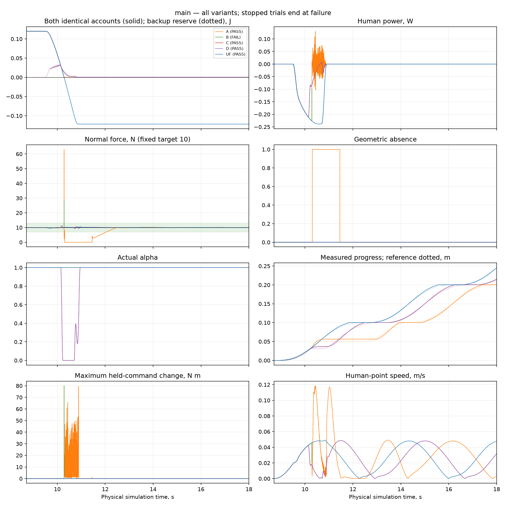
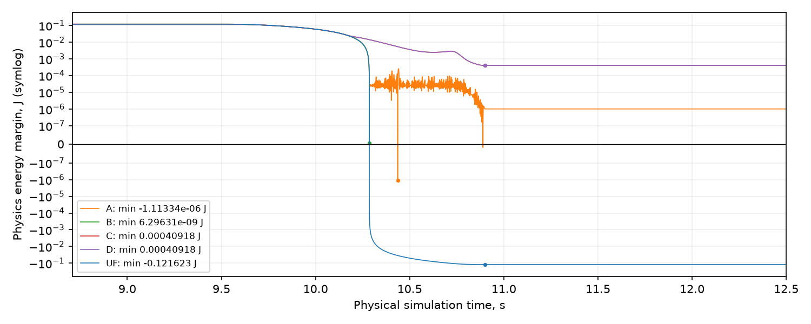
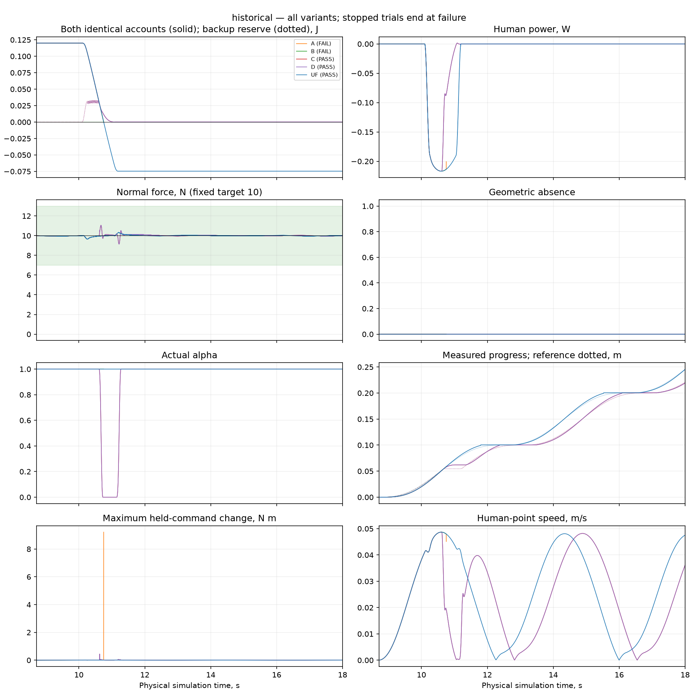
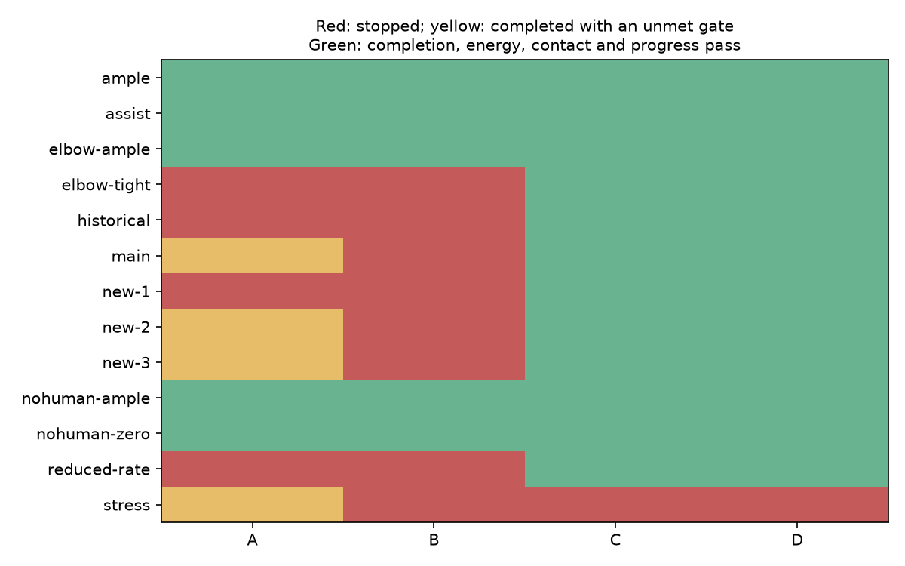

# KUKA energy guard Stage 2 — PASS

This opt-in implementation adds four-physics-prefix energy enforcement, a causal
closed-loop backup reserve, smooth path timing and explicit task constraints.
Original Stage 1 code, branch tips and results are preserved. No hardware was used.
Unmet gates: none.
Completion, energy, contact, progress and generalization are separate outcomes.
The 0.001 J D stress trial stops at 9.533 s: no_verified_reserve_candidate. Its observed energy/contact prefix remains valid; this is NOT a completed task.

## Provenance and preservation

Numerical source commit `81dffa64109752a9a027975e7b831daa4ff91e86`; package SHA256
`3662a23fbcf913f4047e66361072808c75f98465dacf763d3136b13700cec80b`. Configuration and new untouched fixtures were frozen
before final evaluation. Platform/config/assets are recorded per case. Reporting
commits may be later. Original worktree and branch remain at
`32c4866183b020c50724160749b588f140228db5`. The external verified backup contains
540 ignored/untracked files (5,238,703,332 bytes); 428 tracked files are hash checked.
See preservation manifest, final verification, reviews and raw manifest.

## Algorithm and information

The unchanged plant uses 1 ms control and four 0.25 ms split physics steps.
The complete seven-joint command includes the unchanged nominal bias/gravity
calculation once; actual applied torque is checked at every rollout/executed step.
The main known human point is link5 local (0,0.04,0.12) m; the second is link3
local (0.02,0.04,0.16) m. Main resistance is 5 N in -x, onset 9.5 s,
0.2 s cosine ramps and 1 s hold. Historical uses 4.5 N, onset 10.1 s,
0.15 s ramps and 0.8 s hold. Both primary budgets are 0.12 J.
The complete force/location/budget/rate case manifest is cases.json.
The only exogenous predictor input is the current measured WORLD force vector,
held throughout every rollout. The human point and Jacobian move every substep.
The real fixture is sampled once per control boundary. Future pulse onset,
release, phase and magnitude are never passed to candidate/backup prediction.
This exact held-force claim does not cover arbitrary within-tick force variation.

Each branch restores full `mjSTATE_INTEGRATION` plus serialized controller, FT
observer, integrators, FSM, stroke, clock, energy, prior executed torque and base
external force. Controller compute runs once per future control interval; observe
runs at every future physics step. Live compute state is installed once after
acceptance and real physics/observer updates run independently. Rejected branches
cannot change live state. Complete trusted-local failure snapshots retain this
hybrid state and counterfactual/cache configuration.

Signed work is `dW = force dot (J_point qdot) * h`; both accounts use the same
actual human work exactly. Every executed physics sample updates `E += dW`.
There is no clipping, recharge other than positive physical work, budget change,
or reserve addition. Gross outgoing is `sum(max(-dW,0))` and remains separate.

## QP

Decision is seven joint torques, with objective
`0.5*(tau-tau_nom)^T H*(tau-tau_nom)` anchored to the ORIGINAL nominal command
of that proposal. `H = diag(1/torque_scale^2) + S_nom^T W_y S_nom`, weight 1 in
every matched variant. Scales and original torque/rate/trust bounds are unchanged;
the reduced-rate challenge uses an explicitly labeled factor 0.02.
Torque scales are (20,20,10,10,5,2,2) N m; task output scales are
(1 N,0.01 m/s x3,0.1 rad/s x3). Motor limits are
(320,320,176,176,110,40,40) N m; trust halfwidths are
(80,80,60,60,40,20,20) N m, with rates equal to these halfwidths /0.001 s.
The central torque stencil is 0.02 N m and never clips an override. Four work
prefix rows per account replace the endpoint row. D also uses four-stage normal
force [7,13] N, normal speed +/-0.005 m/s, cross error +/-3 mm, and conservative
orientation component bounds +/-2/sqrt(3) degrees. Fresh nonlinear norm checking
uses the original 2 degree target. Contact presence and unexpected contacts are
checked nonlinearly. The fixed established-contact window is 8.71 s onward,
including all subsequent SEARCH/recovery and force reramping.

The new multi-row OSQP solver whitens the objective and scales rows; all original
N m/J/task-unit residuals decide acceptance, independently of solver status.
The old one-halfspace fallback is never called. Up to three relinearizations
(four solves) shrink trust regions while retaining the original objective. Affine infeasibility is
reported as local affine infeasibility, not global physical impossibility.
Every accepted action receives a fresh nonlinear interval check. Stage-zero
power can be torque insensitive: a depleted account may require stopping before
the next interval even though an endpoint-only QP previously returned a solution.

## Backup and governor

Backup target alpha is zero with a 0.1 s quintic transition and human-point
damping `tau = tau_governed_nom - J_H^T (40*v_H)`. Nominal force/posture/FSM and
observers continue evolving. The reserve is the worst cumulative outgoing
PHYSICS prefix of that specific backup, not an optimum or a new energy source.
A continued-progress proposal permits a declared 20 ms reaction delay before
the same brake; the entire delay is included in reserve, task and rate checks.
The bounded search favors targets (1,0.5,0), checking both account margins.
An ample continued-progress plan is reconsidered after at most 20 ms.

Horizon checkpoints are 20/50/100/250/500/1000/2000 ms, at the same physical
integration resolution. Unsettled tails are UNRESOLVED, never zero reserve.
Terminal checks require human speed <=0.001 m/s, abs human power <=0.002 W,
tool speed <=0.001 m/s, angular speed <=0.01 rad/s, alpha <=0.01 and alpha rate
<=0.1/s, plus contact/task and actuator/rate admissibility throughout. These
conditions persist for an additional 20 ms (21 consecutive control intervals).
They provide empirical evidence only, not an invariant terminal set.

Acceptance requires available energy to cover the whole plan's worst prefix plus
1e-5 J reserve guard, and every first-interval physics prefix >= -1e-10 J.
The one-interval QP uses a 1e-8 J numerical guard for nonzero force. Independent
held-force replay errors are reported in acceptance.json; these guards are
conservative resolutions for deterministic replay, not bounds on unknown future
force. The old affine Stage 1 margin is not reused for multi-step forecasting.
With current measured force exactly zero, the held-zero forecast has identically
zero human work for any motion, so a zero-reserve shortcut skips the long backup.
The logged held_zero status describes that forecast assumption; it does not claim
the person will keep applying zero force. This shortcut does not establish a
settled backup or recursive task feasibility. D still freshly checks every first
interval's task and energy prefixes; changed measurements are reconsidered next tick.
Cached suffixes require exact full dynamic-value state and exact force equality;
both account margins are rechecked. Each cached first command is replayed fresh.

The clock obeys `sigma_dot=alpha`, with `v=X'(sigma)*alpha` and
`a=X''(sigma)*alpha^2+X'(sigma)*alpha_dot`. Physical sensor/integrator/FSM timers
remain physical. Energy pause does not trigger SEARCH or reduce the 10 N target.
Reference progress accumulates only virtual time, with unchanged spatial strokes
and no catch-up. Measured progress advances ordered endpoint frontiers, not
absolute jitter. Original and governed torques/references are logged via an
isolated ungoverned controller counterfactual, including its actual observations.

## Matched results

UF is the matched unfiltered reference. A is frozen Stage 1; B changes only
prefix enforcement and the validated multi-row solver; C adds reserve/governor;
D adds explicit per-stage task protection. Historical is a known regression.
New cases were untouched until the frozen-source evaluation. Stopped trials
retain their full prefix and failure snapshots; their energy status does not
imply task completion.

| case | variant | completion | end s | net out J | gross out J | min physics E J | MAE / max error N | absence s | measured progress / UF | pause s |
|---|---|---|---:|---:|---:|---:|---:|---:|---:|---:|
| ample | A | PASS | 18.000 | 0.241623266 | 0.241623266 | 0.758 | 0.040 / 0.397 | 0.00000 | 1.000 | 0.000 |
| ample | B | PASS | 18.000 | 0.241623266 | 0.241623266 | 0.758 | 0.040 / 0.397 | 0.00000 | 1.000 | 0.000 |
| ample | C | PASS | 18.000 | 0.241623266 | 0.241623266 | 0.758 | 0.040 / 0.397 | 0.00000 | 1.000 | 0.000 |
| ample | D | PASS | 18.000 | 0.241623266 | 0.241623266 | 0.758 | 0.040 / 0.397 | 0.00000 | 1.000 | 0.000 |
| ample | UF | PASS | 18.000 | 0.241623266 | 0.241623266 | 0.758 | 0.040 / 0.397 | 0.00000 | 1.000 | 0.000 |
| assist | A | PASS | 18.000 | -0.242016041 | 0.000000000 | 0.12 | 0.035 / 0.332 | 0.00000 | 1.000 | 0.000 |
| assist | B | PASS | 18.000 | -0.242016041 | 0.000000000 | 0.12 | 0.035 / 0.332 | 0.00000 | 1.000 | 0.000 |
| assist | C | PASS | 18.000 | -0.242016041 | 0.000000000 | 0.12 | 0.035 / 0.332 | 0.00000 | 1.000 | 0.000 |
| assist | D | PASS | 18.000 | -0.242016041 | 0.000000000 | 0.12 | 0.035 / 0.332 | 0.00000 | 1.000 | 0.000 |
| assist | UF | PASS | 18.000 | -0.242016041 | 0.000000000 | 0.12 | 0.035 / 0.332 | 0.00000 | 1.000 | 0.000 |
| elbow-ample | A | PASS | 18.000 | 0.141353740 | 0.141353740 | 0.859 | 0.096 / 1.130 | 0.00000 | 1.000 | 0.000 |
| elbow-ample | B | PASS | 18.000 | 0.141353740 | 0.141353740 | 0.859 | 0.096 / 1.130 | 0.00000 | 1.000 | 0.000 |
| elbow-ample | C | PASS | 18.000 | 0.141353740 | 0.141353740 | 0.859 | 0.096 / 1.130 | 0.00000 | 1.000 | 0.000 |
| elbow-ample | D | PASS | 18.000 | 0.141353740 | 0.141353740 | 0.859 | 0.096 / 1.130 | 0.00000 | 1.000 | 0.000 |
| elbow-ample | UF | PASS | 18.000 | 0.141353740 | 0.141353740 | 0.859 | 0.096 / 1.130 | 0.00000 | 1.000 | 0.000 |
| elbow-tight | A | FAIL | 10.813 | 0.119989135 | 0.121452939 | 4.62e-06 | 1.067 / 188.191 | 0.15275 | 0.268 | 0.000 |
| elbow-tight | B | FAIL | 10.658 | 0.119999990 | 0.120148523 | 1.04e-08 | 0.337 / 139.669 | 0.00500 | 0.219 | 0.000 |
| elbow-tight | C | PASS | 18.000 | 0.118951788 | 0.118951788 | 0.00105 | 0.104 / 1.146 | 0.00000 | 0.941 | 0.148 |
| elbow-tight | D | PASS | 18.000 | 0.118951788 | 0.118951788 | 0.00105 | 0.104 / 1.146 | 0.00000 | 0.941 | 0.148 |
| elbow-tight | UF | PASS | 18.000 | 0.141353740 | 0.141353740 | -0.0214 | 0.096 / 1.130 | 0.00000 | 1.000 | 0.000 |
| historical | A | FAIL | 10.753 | 0.119977500 | 0.119977500 | 2.25e-05 | 0.059 / 0.353 | 0.00000 | 0.240 | 0.000 |
| historical | B | FAIL | 10.753 | 0.119983974 | 0.119983974 | 1.6e-05 | 0.059 / 0.353 | 0.00000 | 0.240 | 0.000 |
| historical | C | PASS | 18.000 | 0.119869446 | 0.119926596 | 8.77e-05 | 0.053 / 1.045 | 0.00000 | 0.894 | 0.446 |
| historical | D | PASS | 18.000 | 0.119869446 | 0.119926596 | 8.77e-05 | 0.053 / 1.045 | 0.00000 | 0.894 | 0.446 |
| historical | UF | PASS | 18.000 | 0.194653917 | 0.194653917 | -0.0747 | 0.034 / 0.353 | 0.00000 | 1.000 | 0.000 |
| main | A | PASS | 18.000 | 0.119998983 | 0.124647681 | -1.11e-06 | 1.691 / 53.104 | 1.14975 | 0.817 | 0.000 |
| main | B | FAIL | 10.286 | 0.119999994 | 0.119999994 | 6.3e-09 | 0.103 / 18.439 | 0.00000 | 0.138 | 0.000 |
| main | C | PASS | 18.000 | 0.119590820 | 0.120003817 | 0.000409 | 0.063 / 1.241 | 0.00000 | 0.875 | 0.482 |
| main | D | PASS | 18.000 | 0.119590820 | 0.120003817 | 0.000409 | 0.063 / 1.241 | 0.00000 | 0.875 | 0.482 |
| main | UF | PASS | 18.000 | 0.241623266 | 0.241623266 | -0.122 | 0.040 / 0.397 | 0.00000 | 1.000 | 0.000 |
| new-1 | A | FAIL | 10.613 | 0.119972978 | 0.119972978 | 2.7e-05 | 0.066 / 0.328 | 0.00000 | 0.209 | 0.000 |
| new-1 | B | FAIL | 10.613 | 0.119972978 | 0.119972978 | 2.7e-05 | 0.066 / 0.328 | 0.00000 | 0.209 | 0.000 |
| new-1 | C | PASS | 18.000 | 0.119548157 | 0.119548157 | 0.000452 | 0.051 / 1.056 | 0.00000 | 0.911 | 0.238 |
| new-1 | D | PASS | 18.000 | 0.119548157 | 0.119548157 | 0.000452 | 0.051 / 1.056 | 0.00000 | 0.911 | 0.238 |
| new-1 | UF | PASS | 18.000 | 0.182454156 | 0.182454156 | -0.0625 | 0.036 / 0.328 | 0.00000 | 1.000 | 0.000 |
| new-2 | A | PASS | 18.000 | 0.119999995 | 0.126077044 | -1.86e-05 | 1.584 / 148.965 | 1.08275 | 0.824 | 0.000 |
| new-2 | B | FAIL | 10.983 | 0.119999990 | 0.119999990 | 1e-08 | 0.046 / 0.225 | 0.00000 | 0.289 | 0.000 |
| new-2 | C | PASS | 18.000 | 0.119780701 | 0.121410466 | 0.000219 | 0.059 / 1.229 | 0.00000 | 0.869 | 0.501 |
| new-2 | D | PASS | 18.000 | 0.119780701 | 0.121410466 | 0.000219 | 0.059 / 1.229 | 0.00000 | 0.869 | 0.501 |
| new-2 | UF | PASS | 18.000 | 0.197364689 | 0.197364689 | -0.0774 | 0.030 / 0.225 | 0.00000 | 1.000 | 0.000 |
| new-3 | A | PASS | 18.000 | 0.119999993 | 0.120876724 | 6.53e-09 | 1.038 / 149.265 | 0.47600 | 0.872 | 0.000 |
| new-3 | B | FAIL | 11.318 | 0.119999413 | 0.119999413 | 5.87e-07 | 0.134 / 17.021 | 0.00000 | 0.350 | 0.000 |
| new-3 | C | PASS | 18.000 | 0.119210542 | 0.119210542 | 0.000789 | 0.082 / 0.928 | 0.00000 | 0.955 | 0.088 |
| new-3 | D | PASS | 18.000 | 0.119210542 | 0.119210542 | 0.000789 | 0.082 / 0.928 | 0.00000 | 0.955 | 0.088 |
| new-3 | UF | PASS | 18.000 | 0.129055097 | 0.129055097 | -0.00906 | 0.077 / 0.894 | 0.00000 | 1.000 | 0.000 |
| nohuman-ample | A | PASS | 18.000 | -0.000000000 | 0.000000000 | 1 | 0.019 / 0.050 | 0.00000 | 1.000 | 0.000 |
| nohuman-ample | B | PASS | 18.000 | -0.000000000 | 0.000000000 | 1 | 0.019 / 0.050 | 0.00000 | 1.000 | 0.000 |
| nohuman-ample | C | PASS | 18.000 | -0.000000000 | 0.000000000 | 1 | 0.019 / 0.050 | 0.00000 | 1.000 | 0.000 |
| nohuman-ample | D | PASS | 18.000 | -0.000000000 | 0.000000000 | 1 | 0.019 / 0.050 | 0.00000 | 1.000 | 0.000 |
| nohuman-ample | UF | PASS | 18.000 | -0.000000000 | 0.000000000 | 1 | 0.019 / 0.050 | 0.00000 | 1.000 | 0.000 |
| nohuman-zero | A | PASS | 18.000 | -0.000000000 | 0.000000000 | 0 | 0.019 / 0.050 | 0.00000 | 1.000 | 0.000 |
| nohuman-zero | B | PASS | 18.000 | -0.000000000 | 0.000000000 | 0 | 0.019 / 0.050 | 0.00000 | 1.000 | 0.000 |
| nohuman-zero | C | PASS | 18.000 | -0.000000000 | 0.000000000 | 0 | 0.019 / 0.050 | 0.00000 | 1.000 | 0.000 |
| nohuman-zero | D | PASS | 18.000 | -0.000000000 | 0.000000000 | 0 | 0.019 / 0.050 | 0.00000 | 1.000 | 0.000 |
| nohuman-zero | UF | PASS | 18.000 | -0.000000000 | 0.000000000 | 0 | 0.019 / 0.050 | 0.00000 | 1.000 | 0.000 |
| reduced-rate | A | FAIL | 10.285 | 0.119838095 | 0.119838095 | 0.000162 | 0.091 / 0.397 | 0.00000 | 0.138 | 0.000 |
| reduced-rate | B | FAIL | 10.285 | 0.119838095 | 0.119838095 | 0.000162 | 0.091 / 0.397 | 0.00000 | 0.138 | 0.000 |
| reduced-rate | C | PASS | 18.000 | 0.119590820 | 0.120003817 | 0.000409 | 0.063 / 1.241 | 0.00000 | 0.875 | 0.482 |
| reduced-rate | D | PASS | 18.000 | 0.119590820 | 0.120003817 | 0.000409 | 0.063 / 1.241 | 0.00000 | 0.875 | 0.482 |
| reduced-rate | UF | PASS | 18.000 | 0.241623266 | 0.241623266 | -0.122 | 0.040 / 0.397 | 0.00000 | 1.000 | 0.000 |
| stress | A | PASS | 18.000 | 0.000999680 | 0.011556787 | -3.13e-06 | 1.924 / 18.068 | 1.46850 | 0.795 | 0.000 |
| stress | B | FAIL | 9.581 | 0.000999991 | 0.000999991 | 9.37e-09 | 0.042 / 4.443 | 0.00000 | 0.026 | 0.000 |
| stress | C | FAIL | 9.533 | 0.000068620 | 0.000068620 | 0.000931 | 0.036 / 0.066 | 0.00000 | 0.022 | 0.000 |
| stress | D | FAIL | 9.533 | 0.000068620 | 0.000068620 | 0.000931 | 0.036 / 0.066 | 0.00000 | 0.022 | 0.000 |
| stress | UF | PASS | 18.000 | 0.241623266 | 0.241623266 | -0.241 | 0.040 / 0.397 | 0.00000 | 1.000 | 0.000 |

All case details, orientation/cross errors, reference progress, completed strokes,
release recovery, QP/candidate rejection history and runtime quantiles are in
metrics.json and raw artifacts. Figures use physical time and retain every peak.
Both accounts coincide by construction; they do not test account mismatch.
Main D first intervenes at 10.140 s with
0.031941223 J remaining, versus
10.285 s and
0.000161905 J for A.
Its maximum total joint-torque difference from the isolated ungoverned controller
is 65.546 N m; the maximum correction
from its governed nominal is 0.369 N m.
Small per-tick command changes therefore do not mean a small total governor effect.

Continuation experiments through 20 s measure the extra physical time needed to
reach the matched UF run's 18 s measured amount, without resetting the clock,
controller or accounts: {"results/energy_guard_stage2/20261015-c5601e5e/extension_main_D_01": {"extra_physical_time_s": 0.6679999999981234, "achieved": true}, "results/energy_guard_stage2/20261015-c5601e5e/extension_historical_D_01": {"extra_physical_time_s": 0.5459999999975409, "achieved": true}}.

## Engineering gates

| gate | status |
|---|---|
| preservation | PASS |
| frozen_numerical_provenance | PASS |
| unchanged_plant_assets | PASS |
| frozen_settings_and_holdouts | PASS |
| existing_and_new_tests | PASS |
| independent_power_work_accounts | PASS |
| independent_reserve_accounts | PASS |
| logged_multirow_physical_residuals | PASS |
| independent_closed_loop_backup | PASS |
| transparency | PASS |
| final_executed_torque_rate | PASS |
| final_energy_all_physics | PASS |
| final_original_force_target | PASS |
| primary_completion | PASS |
| primary_contact | PASS |
| primary_progress | PASS |
| primary_recovery | PASS |
| generalization | PASS |
| fresh_process_repeats | PASS |

Runtime includes Python allocation, serialization, isolated prediction and
buffered logging. Whole tick and component quantiles, deadline misses and
wall/simulation factors are logged. Tick quantiles describe accepted/completed
ticks; a stopped tick's duration is separately retained as seconds_failed_tick,
and total wall time includes it. Final matrix jobs may share the CPU; fresh
repeats provide an additional execution check. This implementation does not
establish 1 kHz execution; reserve forecasts can take orders of magnitude longer.

## Evidence, reproduction and limits

The preliminary same-policy 0/20/50/100 ms hindsight diagnostic is frozen in
../early_diagnosis.md. Earlier action improved contact but did not alone meet the
force band; outcomes were not monotonic. It supports a limited braking-reserve
hypothesis, not a universal cause. Online policy uses no hindsight timing.

Full logs remain at paths and SHA256 hashes in raw_manifest.json. Committed
compact traces retain EVERY physics sample from 8.71 s onward and every nonzero
human-power sample, all control/constraint events and complete failure states.
Omitted human power is exactly zero; no float32 conversion or extrema striding.
Regenerate results in NEW output directories; commands are in ../reproduction.md.
Final tests are copied beside this report. Three review/fix/retest rounds are in
../reviews.md. Unmet gates remain explicit. Finite held-current-force reserve and
terminal persistence do not prove safety against a changing future human force,
recursive feasibility, global viability or hardware performance.

The next technical question is whether a task-preserving backup with a robust
force-change envelope and useful progress can remain feasible across the tested
budgets, rather than spending additional effort on an unvalidated local margin.
