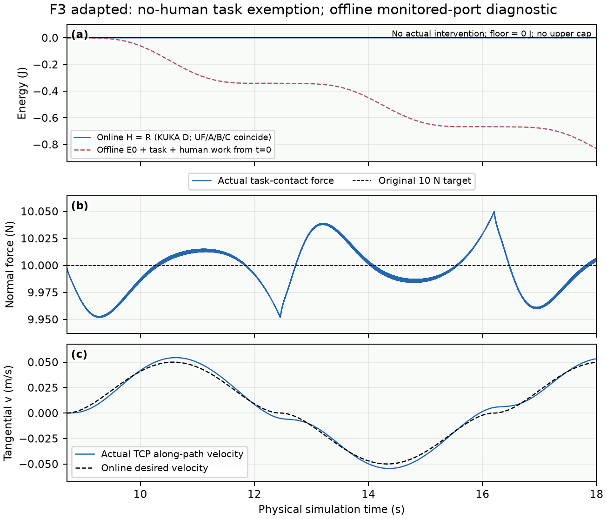
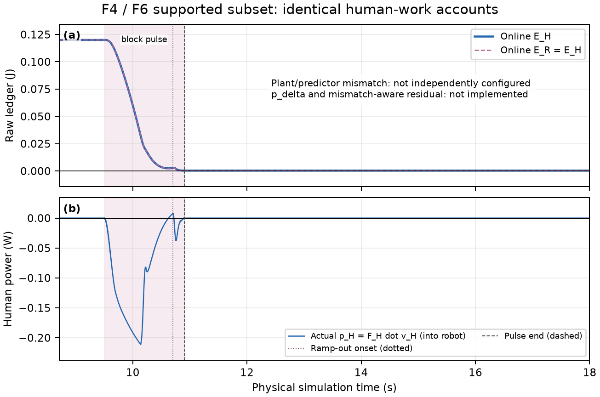
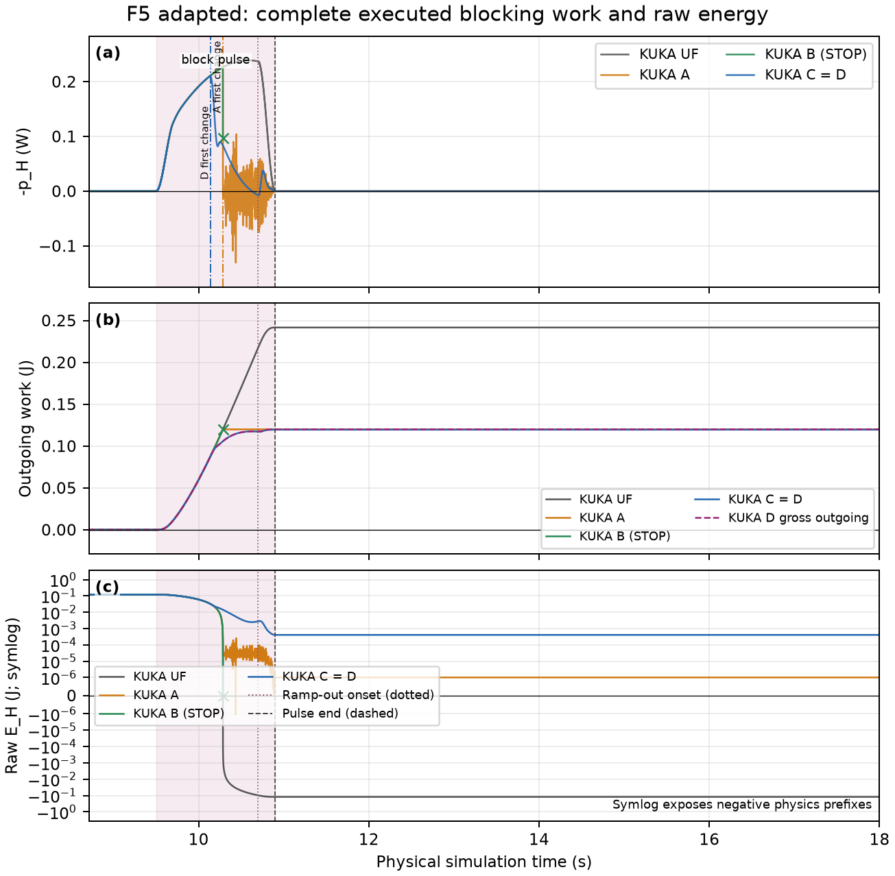
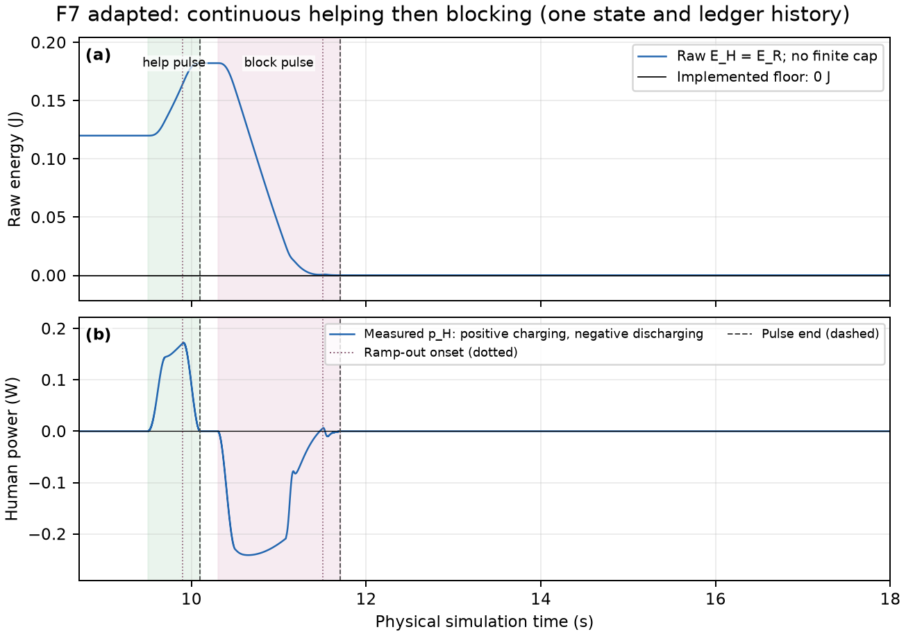
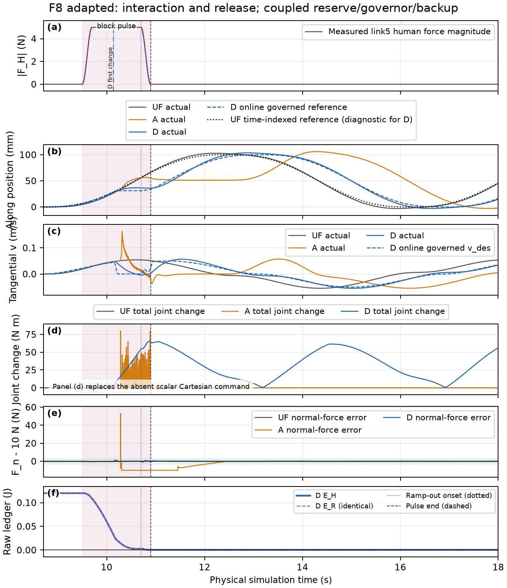
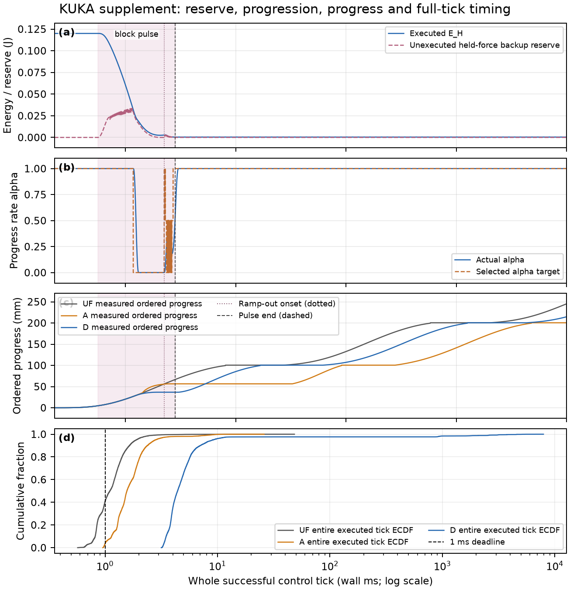

# KUKA adaptation of the 2-DOF PoC result figures

## KUKA contact-energy guard: what the traces establish

Results-first adaptation of the original 2-DOF PoC Figures 3–8. The current KUKA reserve/governor policy completes the main blocking fixture and preserves contact, while the frozen endpoint filter exhibits a negative physics energy prefix and substantial contact disturbance. This is a report about the existing implementation; no controller, gains, energy rules or plant parameters were redesigned.

| Run | End [s] | Net out [J] | Min raw E [J] | Force peak error [N] | Outcome |
| --- | --- | --- | --- | --- | --- |
| Main UF | 18 | 0.241623 | -0.1216233 | 0.397 | complete |
| Main A | 18 | 0.119999 | -1.11e-06 | 53.104 | complete |
| Main D | 18 | 0.119591 | 0.0004092 | 1.241 | complete |
| Historical D | 18 | 0.119869 | 8.77e-05 | 1.045 | complete |
| Tiny budget D | 9.533 | 6.86e-05 | 0.0009314 | 0.066 | stopped |

Energy minima include every executed 0.25 ms physics increment. Force errors use the original 10 N tool/table task target and the declared task window, beginning at 8.71 s. A stopped run contributes only its executed samples; it has no inferred release or recovery.

| KUKA label | Actual role |
| --- | --- |
| UF | Matched unfiltered reference; work accounts monitored |
| A | Frozen Stage 1 endpoint joint-torque energy QP |
| B | Physics-prefix energy checks and nonlinear replay |
| C | B plus finite backup reserve, virtual progression and backup selection |
| D | C plus explicit per-stage task acceptance and QP task rows |

H and R receive the same human work. Archived C and D coincide, and D performs zero recorded QP solves across the 13-case matrix. The supported improvement is therefore evidence for the coupled reserve/governor/backup policy in these fixtures, without establishing active task-QP superiority, independent mismatch accounting or global robot passivity.

| 13-case matrix | Completed | Stopped | Energy-invalid | Recorded QP calls |
| --- | --- | --- | --- | --- |
| UF | 13 | 0 | 8 | 0 |
| A | 9 | 4 | 3 | 1354 |
| B | 5 | 8 | 0 | 10 |
| C | 12 | 1 | 0 | 0 |
| D | 12 | 1 | 0 | 0 |


## Original scientific questions and KUKA coverage

| Family | Status | Supported result and missing comparison |
| --- | --- | --- |
| F3 | Adapted | No-human task-work exemption/transparency; no closed-loop whole-port baseline |
| F4 | Unsupported | No independently configured mismatch residual; show existing-account identity only |
| F5 | Adapted | Executed blocking power, net/gross work and raw energy for actual KUKA policies |
| F6 | Unsupported | No implemented p_delta separation; combine the supported identity diagnostic with F4 |
| F7 | Adapted | One continuous help-then-block history; uncapped charging |
| F8 | Adapted | Full coupled-policy interaction/recovery; joint-torque intervention replaces scalar command |

No family is an exact controller/scenario reproduction. The original 2-DOF plots and raw data establish each question and panel meaning; every result curve here is KUKA data. The complete file/function, signal, units, configuration, adaptation and source-line mapping is recorded in figure_crosswalk.csv.

| 2-DOF paper label | Actual implementation and relation to KUKA |
| --- | --- |
| C0 | Nominal; closest experimental role is KUKA UF |
| C1 | Whole-port QP; no KUKA closed-loop equivalent |
| C2 | Residual-only QP; no independent KUKA mismatch/residual equivalent |
| C3 | C3_dual_ledger_qp with governor OFF |
| C4 | The same C3_dual_ledger_qp with governor ON |

The historical code mode C4_dual_ledger_safe_scalar is a separate diagnostic and is not paper C4. KUKA C/D labels are unrelated to that naming system. KUKA B versus D changes reserve/governor, backup selection and task protection; it cannot isolate a governor effect.

The main human force acts at a body-fixed link5 point; elbow fixtures use link3. Human power uses velocity at that actual moving point. Tool/table normal contact, its 10 N target and TCP tracking are separate task signals. Positive human power enters the robot; negative power is robot-to-human output. Known force, simulated contact and finite sampled tests remain explicit assumptions.


## F3 — Task work is exempted, with the causal gap visible



The matched no-human traces show actual ledgers, tool/table normal force and along-path velocity with their implemented floor and references. The offline monitored-port integral starts at t = 0 and includes startup task/contact work before the displayed sliding window, so its initial offset is not attributed solely to useful sliding.

Zero-initial-energy D preserves the task with E_H = E_R = 0 and no actual intervention. The offline diagnostic is not a command-generating whole-port controller, so the original causal claim that useful friction would stop such a controller remains untested for KUKA.


## F4 and F6 — The current residual account is a copy



Blocking traces, together with no-human F3, expose E_H = E_R because both executed accounts receive the same human work. The predictor shares the immutable plant model and holds the currently measured force at its known application point; mismatch power p_delta is not implemented or replaced with a zero-valued measurement.

The coincident accounts do not demonstrate mismatch accounting or the original p_R = p_H + p_delta decomposition. Reproducing F4/F6 requires future controller/model work on a physically consistent residual-work meter and independently configured plant/predictor parameters.


## F5 — Blocking limits signed output, with failures retained



The panels show positive human-directed output -p_H, signed NET work with gross output identified separately, and raw energy against the implemented zero floor. Ramp-out onset, pulse end, actual intervention and premature termination are distinct events; no unenforced peak-power threshold is drawn.

Main D finishes with net output 0.119591 J, gross output 0.120004 J and minimum raw energy 0.0004092 J. A reaches a negative physics minimum of -1.11e-06 J despite endpoint checks, while B stops at 10.286 s; these are signed-energy results rather than peak-power, force or gross-work guarantees.


## F7 — Charging and discharging in one continuous run



The frozen help-then-block profile runs continuously with the same plant, controller, reference history and uncapped ledgers, retaining the implemented zero floor.

Measured helping work is 0.062228 J, raising energy from 0.12 J to 0.182228 J without clipping; the repeated run matches all executed signals and initial/final states exactly. The run completes at 18 s with net outgoing 0.119849 J, gross outgoing 0.182297 J and minimum raw energy 0.000150544 J. Gross output can exceed the initial budget because measured positive human-point work recharges it, while the implemented constraint concerns signed net work; phase interpretation uses measured power rather than force direction alone.


## F8 — Complete interaction and recovery of the current policy



Six panels retain force/events, actual and online governed position/velocity, original-target force error and raw H/R accounts, with any original-time reference marked diagnostic; panel (d) replaces the absent scalar Cartesian command with joint-torque intervention in N m.

D starts intervening at 10.14 s; A first intervenes at 10.285 s. Main D sustained force recovery takes 0.262 s from ramp-out onset, or 0.062 s from full force removal, using a full 0.5 s all-good window and explicitly distinguishing the old paper's ramp-out release anchor.

KUKA's virtual clock preserves stroke endpoints rather than capturing the old spatial anchor, and this coupled reserve/governor/backup comparison does not isolate a governor effect.


## Quantitative task, interaction and recovery outcomes

| Main policy | Force RMSE [N] | MAE [N] | Max error [N] | Absent [s] | End [s] |
| --- | --- | --- | --- | --- | --- |
| UF | 0.074 | 0.04 | 0.397 | 0 | 18 |
| A | 3.838 | 1.691 | 53.104 | 1.14975 | 18 |
| B | 0.482 | 0.103 | 18.439 | 0 | 10.286 |
| C | 0.129 | 0.063 | 1.241 | 0 | 18 |
| D | 0.129 | 0.063 | 1.241 | 0 | 18 |

These force statistics use each run's executed task interval [8.71 s, actual end). Equal-duration main UF/A/D rows support full-task comparisons; B ends early and its full-run aggregate has a shorter window. No samples are repeated after termination. Maximum errors and contact absence retain the original 10 N target during controller recovery.

| Common window | Force RMSE [N] | Force MAE [N] | Tangent RMSE [m/s] |
| --- | --- | --- | --- |
| UF | 0.133 | 0.091 | 0.00257 |
| A | 1.341 | 0.125 | 0.00257 |
| B | 0.482 | 0.103 | 0.00257 |
| C | 0.231 | 0.129 | 0.00918 |
| D | 0.231 | 0.129 | 0.00918 |

The equal-support table ends at 10.286 s for every main policy. It does not replace the full-run completion and violation outcomes.

| Run | Tangent RMSE [m/s] | Peak speed [m/s] | Online debt [mm] | Force recovery [s] |
| --- | --- | --- | --- | --- |
| Main A | 0.00893 | 0.163 | 5.976 | 1.49 |
| Main D | 0.00756 | 0.0567 | 5.62 | 0.062 |
| Historical D | 0.00826 | 0.0552 | 7.45 | 0.078 |

| Run | Peak original-reference debt [mm] | Progress / matched UF [%] |
| --- | --- | --- |
| Main A | 77.982 | 81.73 |
| Main D | 32.756 | 87.526 |
| Historical D | 26.974 | 89.363 |

| Run | Net / gross [J] | Peak output [W] | Progress [m] | Outcome |
| --- | --- | --- | --- | --- |
| Main A | 0.119999 / 0.124648 | 0.226 | 0.2005 | complete |
| Main D | 0.119591 / 0.120004 | 0.211 | 0.2147 | complete |
| Historical A | 0.119977 / 0.119977 | 0.217 | 0.0588 | stopped |
| Historical D | 0.119869 / 0.119927 | 0.217 | 0.2192 | complete |
| Tiny budget D | 6.86e-05 / 6.86e-05 | 0.006 | 0.0054 | stopped |

Tangential tracking compares actual TCP velocity with the online governed reference at control samples; the peak-speed metric uses physics samples. Online tracking debt, original-reference debt and ordered task-progress loss are distinct declared metrics. Force recovery is measured from pulse end and requires 0.5 s of sustained recovery. The historical A stop and tiny-budget D stop remain failures to complete, even when their executed prefixes satisfy a subset of constraints.


## KUKA supplement — Reserve, progression, completion and runtime



Available actual energy and the unexecuted current-held-force backup reserve have different provenance. Alpha target and actual alpha expose transition dynamics. Ordered progress avoids treating back-and-forth displacement as completed work. Whole successful control-tick timing is compared with the 1 ms simulated deadline; timing distributions are not a real-time certificate.

| Main policy | Recorded QP calls | Torque correction ticks | Intervention ticks |
| --- | --- | --- | --- |
| UF | 0 | 0 | 0 |
| A | 334 | 334 | 334 |
| B | 2 | 1 | 1 |
| C | 0 | 626 | 705 |
| D | 0 | 626 | 705 |

Zero recorded C/D solves or active rows on selected executed paths does not prove that no solver work occurred inside rejected plans: the existing guard discards some attempted-plan timing/diagnostics after a reserve or reaction-path rejection. No active task-QP advantage is inferred from this record.

Main D pauses for 0.482 s and accumulates maximum virtual-time delay 0.669 s. Its ordered measured progress at 18 s is 0.2147 m versus matched UF 0.2453 m. Preserved continuous extensions measure equal-progress completion without resetting the clock, ledgers or controller history.

Additional physical time to reach the matched UF 18 s task amount is main 0.668 s and historical 0.546 s; the reference amount and crossing rule are recorded in the manifest.

Main D successful whole-tick wall time: median 0.004415 s, p99 2.544035 s, maximum 7.916327 s; 18000 measured successful ticks exceed 1 ms. Full forecasts are offline computations, and failures are reported separately. Current measured force is held throughout each prediction; future scripted pulse values are not supplied to the guard.


## Four-round verification, provenance and remaining limits

| Round | Verdict | Recorded evidence |
| --- | --- | --- |
| 1 | PASS | Canonical mapping and independent raw metrics passed; elapsed-zero timestamps, curve provenance and PDF legibility corrected. F7 was pending at this round and completed in Round 3. |
| 2 | PASS | All 13 matched fixtures and five transparent fixture families verified; 26 focused tests passed. F3 startup accounting and release-anchor labels corrected. |
| 3 | PASS | Reused exact-source main repeat and fresh no-human, stop and repeated continuous runs verified; 597 headline and 30 common-window checks passed. Charging coverage and torque mapping corrected. |
| 4 | PASS | Clean build and all 10 PDF pages inspected; four legend/annotation occlusions corrected. Metrics and curve contracts unchanged; scientific claims and preservation verified. |

Detailed findings, justified corrections, commands, true subprocess exit status and structured test counts are in reviews/round_01.md through round_04.md and review_summary.json. Report correctness is assessed separately from scientific success: an unsupported mismatch mechanism, an inactive task-QP comparison and an explicit stop can be reported correctly.

| Proposal component | Coverage |
| --- | --- |
| Known-point signed work; task exemption; finite fixture reserve/recovery | Demonstrated on reported fixtures |
| Continuous bidirectional charging without an upper cap | Demonstrated on the frozen continuous fixture and exact repeat |
| Per-stage task QP | Partially tested; no selected accepted task-QP rows in archived D matrix |
| Whole-port causal baseline; independent mismatch/residual account | Missing |
| Isolated governor ablation; finite ledger cap; peak-power/force protection | Missing |
| Global passivity; arbitrary-force robustness; recursive feasibility; 1 kHz hardware | Not established |

All plotted physics powers and work increments remain unsmoothed. Actual raw ledgers are never lower-clamped; rejected candidates and unexecuted backup predictions are separated from executed trajectories. The complete manifest maps every curve to its preserved raw file/hash, source/configuration, units, sampling stage, transform and window. Original source, results and reports remain preserved in their prior worktrees.

Starting synchronized Stage 2 source: 41359f20430c930eec5afaebffa2cfbc482f07da. Numerical-source archive: 81dffa64109752a9a027975e7b831daa4ff91e86. New plotting branch: feature/kuka-poc-figures-20261016-41359f2. Final artifact/source hashes and the final Git revision are recorded in the reproducibility and preservation records, avoiding a self-referential commit hash in the PDF.

Reproduction: use the exact single-entry build command in reproduction.md with preserved inputs, a clean new output directory and the four review records. Simulation generation is separate and uses the frozen run configuration. The editable Markdown also preserves the complete command.

```sh
PYTHONDONTWRITEBYTECODE=1 /Users/carl/code/contactSimulation/.venv/bin/python scripts/kuka_poc_figures.py --inputs docs/kuka_poc_figures/20261016-41359f2/inputs --out NEW_OUTPUT --reviews docs/kuka_poc_figures/20261016-41359f2/reviews
```
