# 报告 / Report — human_contact_uncertainty_2d_v1

平面 PoC：阻抗-意图型人类不确定性、风险敏感选择与 Ec + BH 账户。
Planar PoC: impedance-informed human uncertainty, risk-sensitive selection, and Ec + BH accounts.

**仅为研究仿真；不构成硬件执行或部署的授权或证据。**
*Research simulation only; this is neither authorisation for nor evidence about hardware execution or deployment.*

Folder: `/Users/carl/code/contactPassivity/experiments/human_contact_uncertainty_2d_v1/`. Base commit:
`5e792cf7157449a9806c9c3aeb6e3b5464780b3a`. Mathematics: `formulation.md`. Sources and adaptations:
`literature_mapping.md`.

## 中文执行摘要

**做了什么。** 在一个隔离文件夹中实现了一个平面刚体工具，`q = (x, y, θ)`，沿柔性墙擦拭：
* 偏心工具尖端；
* 法向力目标 10 N；
* 切向进给 8 cm/s；
* 姿态调节。

模拟人类在机器人上一个已知接触片（顶边）的**未知坐标 s** 处施力。人力由隐藏的阻抗模型产生，
包括潜在意图轨迹、速度相关残差和 OU 生理噪声。实现了以下部件：
* 完整的 Ec + 净 BH 账户与 `BH ≥ S` 被动后备储备；
* P1 式结构化"阻抗-潜在意图"高斯过程，在固定增益与已条件化轨迹下是精确的联合高斯条件化，
  联合推断意图、位置、残差权重、力传感器偏置与 OU 状态；
* Gauss–Markov 与朴素 GP 基线；
* 闭环信念传播：Monte Carlo（每次 rollout 抽取一个一致的函数样本）与一阶传播（含反馈雅可比与跨时协方差）；
* 风险中性/熵风险（β>0 为风险规避，β = −θ/2 与 P3/P4 对应）的有限候选策略规划；
* 按"单拍预测功"施加约束的 1 kHz 伺服能量滤波；
* 独立的真值审计器。

所有闭环结论来自冻结代码与独立种子（≥100）：
* 主比较 4000 回合；
* 不可行初始化 150 回合；
* 消融、位置扫描与步长细化 3040 回合；
* 分叉真值校准 200 回合（每个预测器 4244 次分叉）；
* 事后（post-hoc）鲁棒界 800 回合（新种子）。

**主要结论（数字见正文）。**

1. **能量层本身有效（tier C 证据，tier A 构造）。**
   * 无保护的 C0 在所有人机交互场景中 100% 违反真账户，每回合机器人对人的净功 1.1–2.1 J（BH0 = 0.15 J）。
   * 带滤波的 C1–C4 净功 0.003–0.12 J；在全部 7050 个带滤波的独立回合中，Ec 从未违规。
2. **采样数据实现很关键。**
   * 朴素的"瞬时功率"条件在 1 ms 零阶保持内泄漏能量，最坏真 BH −80 mJ。
   * 改为约束"单拍预测功"后，以**真值账户**驱动的参考滤波（ORACLE）在 50 回合中最坏只有 −21 µJ 的数值亏欠，约为 BH0 的 1e-4。这是数值验证，不是采样间证明。
3. **最受证据支持的升级是"与位置相关的历史功误差信念"。**
   * 分布内 5 个场景合计，无裕度的 C1 有 7/500 回合违反 `h_H = BH − S`（最坏 −7 mJ）。带协方差裕度的 C2/C3/C4 为 0/500（单侧 95% 上界 0.60%）。
   * 在"相同名义力、不同力臂 × 位置不确定性"扫描中：C3（力 + 位置不确定性）0/270，仅考虑力不确定性 12/270，C1 20/270。
   * 记账误差随位置不确定性从 1.7 增至 10.4 mJ。
4. **结构化 GP：离线预测明显更好，闭环却没有改善。**
   * 离线，分布内：0.3 s 力 RMSE 0.83–1.0 N，基线为 1.5–1.9 N；功预测已校准（z 标准差 1.0–1.2）。
   * 对候选运动的反事实响应斜率为 0.84–0.95，朴素 GP 约 0.05，Gauss–Markov 为 0。
   * 闭环中，与运动无关的 Gauss–Markov 预测器（C2）在所有交互场景都更好：
     * 对人正功少 0.01–0.03 J；
     * 法向力 RMSE 更低；
     * 后备裕度更大；
     * 伺服滤波介入少约 2.5 倍。
   * 原因：C3 预测更"尖锐"，规划更贴近 `h_H` 边界，而目标函数并不奖励保留 BH。
   * 分叉真值校准表明，闭环 0.3 s 裕度预测对 C3 过度自信（分布内 `h_H` z 标准差 2.25，C2 为 1.39），离线校准不能直接迁移到闭环。
5. **失败。**
   * 未见过的振荡意图（OOD）下，结构化 GP 严重过度自信（离线 NLPD 8.7）。闭环完成率降为 93–95/100，法向力 RMSE 约 2.4 N。
   * 力/位置传感器偏置超出先验（0.8 N、6 cm）时，所有滤波控制器都失败：`h_H` 违规 75–98/100，C3 真 BH 违规 26/100。记账 BH 乐观约 80 mJ，即偏置 × 人引起的接触点位移，力数据本身无法辨识。
   * 事后（post-hoc）在新种子上加入区间鲁棒界（假设 |b_f| ≤ 1 N、位置误差 ≤ 8 cm，**覆盖**了真实偏置）后，偏置场景的 `h_H` 违规从 33/50（C2）、48/50（C3）降为 0/50。代价是分布内任务性能下降，例如块释放覆盖率 0.98→0.94、法向力 RMSE 约翻倍。界本身错误时会怎样，未被检验（§6.7）。
6. **风险敏感目标作用很小且方向与 P3/P4 一致。** β 增大时选择的刚度略升（1–2%）、速度略降，即"更刚而非更柔顺"。β 较大时指数权重的有效样本数降到 1–2/48，估计不可靠。
7. **`BH ≥ S` 很保守。** 低 BH（0.02 J）时账户保持，但几乎无法完成任务（1–2/100）。不可行初始化（`h_H(0) < 0`）时，滤波在 0.1 s 内卸载接触回到集合内，此后任务不可行。

**建议。**
1. 采用"单拍预测功"的采样数据滤波。
2. 采用"与位置/偏置相关、跨时保留"的历史功误差信念，并配以**经过校准的**偏置区间界。
3. **不建议**以当前形式把结构化 GP 规划或熵风险目标作为主线升级。结构化 GP 可作为预测与监测模块；在用于闭环之前需要：
   * 在线校准，即新息监测或方差膨胀；
   * 包含预测模型误差的协方差；
   * 一个真正奖励保留人类预算的目标。

**理论缺口**见 §9。所有统计结果属于 tier C（经验），高斯收紧属于 tier B（近似），都**不是**确定性安全证明。

## Executive summary (English)

| question | answer (held-out seeds; tier) |
|---|---|
| Does the Ec + BH tick-work filter bound robot→human energy? | Yes in simulation (C). C0: 100% account violations, 1.1-2.1 J net work. Filtered: ≤ 0.12 J, no Ec violation in 7050 filtered episodes. The ORACLE reference shows µJ-level sampled-data deficits; the instantaneous filter leaks up to 80 mJ. |
| Is location uncertainty non-degenerate and does modelling it matter? | Yes (C). The past-work error grows 1.7 → 10.4 mJ with sensor uncertainty. h_H violations: C1 20/270, force-only 12/270, C3 0/270. |
| Does the structured (P1-style) GP predict better? | Offline, in distribution, yes: 2× lower force RMSE, calibrated work, correct response to motion. Out of distribution or with gain mismatch it is over-confident. |
| Does it improve closed-loop outcomes? | **No.** C2 (Gauss–Markov) is better on interaction, force tracking and margins. C3 is over-confident in forked-truth calibration and regresses on OOD intent. |
| Does risk-sensitivity (β>0) produce compliance? | **No.** It produces slightly *stiffer*/slower selections (1-2%), consistent with P3/P4; practically negligible. |
| Biggest failure | Persistent sensor bias outside the prior: the ledger is optimistic by ≈ 80 mJ, with 75-98% h_H violations. A post-hoc interval bound that covers the true bias removes them on fresh seeds (33/50 and 48/50 → 0/50), at a task cost (§6.7). |
| Recommendation | Adopt the tick-work filter and the location/bias-correlated past-work error belief with a **calibrated bound**. Do not adopt the structured-GP planner or the entropic objective without online calibration and an objective that values the human budget. |

## 1. What was built

The task was an isolated planar PoC. The robot is a rigid tool with `q = (x, y, θ)` and
`M = diag(m, m, I)`. It wipes along a compliant wall with an off-centre tip, under three
constraints:
* a 10 N normal-force target;
* tangential progress at 8 cm/s;
* orientation regulation.

A simulated human grasps a known patch (the top edge) at a coordinate `s` that is **uncertain to
the robot**. The human force follows a hidden impedance model with a latent intended contact-point
trajectory, a velocity-dependent residual, and physical OU force variability. Everything below lives
in `experiments/human_contact_uncertainty_2d_v1/`.

| component | file | status |
|---|---|---|
| plant, passive unilateral contact (S_T, D_T), human truth | `hcu2d/truth.py` | implemented, tested |
| Ec + net BH accounts, exact actuator work from encoder increments (ZOH), conservative credit | `hcu2d/servo.py`, `episode.py` | implemented, audited |
| past-work (BH) error model, correlated with location/bias posterior | `hcu2d/servo.py::Ledger` | implemented; first-order |
| servo energy filter (sampled-data, tick-work projection) | `hcu2d/servo.py` | implemented; an instantaneous version leaks energy (kept as ablation) |
| structured latent-intention GP (P1 specialisation), joint conditioning over intention, location, residual weights, force bias and OU state | `hcu2d/gp.py`, `kernels.py` | implemented; brute-force-verified |
| naive force GP (P1 Alg. 1 step 1 analogue), Gauss–Markov force predictor | `hcu2d/gp.py` | implemented (naive GP offline only) |
| Monte Carlo and first-order closed-loop belief propagation (feedback Jacobians, full cross-time covariance) | `hcu2d/belief.py` | implemented |
| finite-candidate planners C1-C4, entropic objective, Gaussian-tightened `h_H`/Ec prefix constraints | `hcu2d/planner.py` | implemented |
| independent truth auditor | `hcu2d/auditor.py` | implemented (no shared code with the plant) |
| forked-truth calibration of predicted margins | `scripts/calibration_fork.py` | implemented |

**Deferred (not done):**
* P4-inspired reference adaptation;
* joint online gain inference;
* human inertia;
* unknown-link mixtures and multiple human contacts;
* KUKA/VLA;
* sigma-point propagation (Monte Carlo is the nonlinear check);
* a closed-loop planner using the naive GP (the naive GP is compared offline only, under matched data);
* a less conservative braking reserve;
* any real-time implementation;
* any certified probabilistic claim.

## 2. Guarantee tiers used in this report

* **(A) Proven** for the stated model (`formulation.md` §2-§5, §7.3):
  * the contact identity `p_T = Ṡ_T + D_T` (including unloading and transitions);
  * the composite balance;
  * `V̇ ≤ −p_H` for `V = S + Ec − E_min`;
  * the zero-input backup lemma `∫p_H ≤ S(t₀)`, which makes `BH ≥ S` sufficient;
  * the continuous-time reference-filter proposition with exact accounts;
  * the exactness of the conditional Gaussian under fixed gains and a conditioned trajectory.
* **(B) Approximate:**
  * belief propagation through feedback (Monte Carlo / first order);
  * Gaussian tightening `mean − κ σ`;
  * the finite-feature residual;
  * the stage-Taylor intention;
  * the local Gaussian location prior on a bounded patch.
* **(C) Empirical:**
  * per-episode violation frequencies (Wilson / exact Clopper–Pearson bounds over independent
    episodes, never time steps);
  * energy audits and step refinement;
  * forked-truth calibration.

Nothing in (C) is presented as a deterministic safety proof.

## 3. Deterministic physics and energy checks (tier A identities, tier C numerics)

`python -m pytest tests -q`: **14 passed**. The tests that check non-trivial mathematics:

* **Contact power identity.** It holds pointwise for 4000 random states: compression, unloading and
  separation, with `|p_T − Ṡ_T − D_T| ≤ 1e-10 W`. The force is never adhesive.
* **Composite balance under refinement.** The residual of `ΔS − W_a + W_H + ∫D_R + ∫D_T` falls from
  5e-4 J (h = 2 ms) to 3e-8 J (h = 0.125 ms) on an aggressive scripted run with lift-off and
  re-contact (`W_a ≈ 5 J`). Convergence is non-monotone near contact kinks.
* **Location Jacobian.** `J_H(q, s)` matches central differences. `∂τ_H/∂s = (0, 0, (R e₂)ᵀ f)`.
  At fixed q, s changes the moment for normal and oblique forces but not for forces along the edge,
  and it changes human power when `θ̇ ≠ 0`.
* **Kernel derivative blocks.** They match finite differences, and they transform correctly under a
  s→ms unit change (×10⁻³ for ∂, ×10⁻⁶ for ∂₁∂₂).
* **Joint covariance.** The joint prior covariance `[K_YY, C; Cᵀ, Σ_ζ]` is symmetric and PSD, and the
  posterior covariance is ≼ the prior.
* **Independent brute-force construction.** A dense time grid with finite-difference
  `L_t = K + D d/dt` reproduces the posterior mean and covariance of the intention, its derivative,
  and location (rtol ≤ 5e-3). This verifies the P1 Eq. (25)-(26) signs and transposes that P2
  prints inconsistently.
* **Zero-covariance limit.** With all prior variances → 0, the posterior force equals the
  deterministic impedance model, with s.d. < 1e-4 N.
* **Temporal work covariance.** `Var(ΣW_i) = Σ_ij Cov(W_i, W_j)` matches 40 000 MC samples within
  3%. It exceeds the independent-step sum by more than 1.5×.
* **Risk conventions.**
  * `ρ_0 = E[J]`;
  * `ρ_β ≈ E[J] + βVar(J)/2` for small β;
  * `ρ_β > E[J]` for β > 0 and `ρ_β < E[J]` for β < 0;
  * `ρ_{−θ/2} = γ(θ)` of P3/P4.
* **Zero-input backup lemma.** It is satisfied for 6 adversarial humans: random gains 50-600 N/m,
  moving and oscillating intentions, preloaded contact, initial velocity. `max_t ∫p_H − S(t₀) ≤ 1e-7 J`.
* **ORACLE reference filter (true BH).** It keeps `h_H`, `BH` and `Ec ≥ −1e-5 J` on block-release
  episodes. This is a numerical validation of §5.2, not an intersample proof.
* **Filter projection.** The tick-work projection is feasible and matches an SLSQP optimum.
* **Exact booked work and BH error model.** Booked actuator work equals the plant's RK4 work to 1e-9 J.
  The past-work error model `e_BH = G s − Γ − b_fᵀΔp̂ − n_e`, evaluated with the true `s`, explains
  the auditor's true-minus-booked BH.

## 4. Offline predictor evaluation (held-out by trajectory seed, intent family, location and gains)

Splits:
* training: 30 episodes with `g = 0` plus 50 with the residual;
* validation: 25;
* tests: in-distribution 30, `g = 0` 25, held-out families (oscillating, fast assist) 20,
  gain mismatch ×2 20.

All splits use the unprotected explorer controller, so robot motion is exogenous to the intention.
Hyperparameters were fitted by maximum likelihood on the training splits and **frozen before any test
evaluation**. They were not retuned after seeing test results, including the failures below.

Fitted population gains are K = 135 N/m and D = 13.4 N s/m (truth: lognormal around 150 / 15). The
profile likelihood on a 3×3 grid peaks at (150, 15), so the gains are identifiable **only because the
training data contain exogenous robot excitation**.

Main findings (table T15, figures `offline_calibration.png`, `offline_response_to_motion.png`,
`gp_inference_example.png`):

* **In distribution**, the structured GP is calibrated:
  * 0.3 s force RMSE 0.83-1.0 N, versus 1.5-1.9 N for the naive GP, Gauss–Markov and hold-last;
  * best NLPD;
  * 90% intervals cover 90-93%;
  * integrated-work RMSE 15-18 mJ versus 47-67 mJ, with work z s.d. 1.0-1.2;
  * intention inference: posterior s.d. ≈ 15 mm against a 102 mm prior, z s.d. 0.88-1.0, 95%
    coverage 0.92-0.96.
* **It responds correctly to candidate robot motion.** For a counterfactual +2 cm tangential ramp, or a
  +0.05 rad rotation, the predicted force change follows the true counterfactual change: slope 0.84-0.95
  translational, 0.84-0.89 rotational. The rotational response depends on `s`. The naive GP's slope is
  0.02-0.17, and the Gauss–Markov slope is 0 by construction.
* **Temporal covariance is essential.** Dropping cross-time covariance (independent-step approximation)
  makes work predictions about **3× over-confident**: z s.d. 3.0-3.5, 90% work coverage 0.43-0.49.
* **Location is not learned from force.** The posterior error of `s` equals the location-sensor-only
  error (≈ 21-24 mm), which is the bias floor. This matches the identifiability analysis:
  * `s` and an intention offset are confounded except through rotation;
  * the persistent sensor bias does not average out.
* **Residual confounding.**
  * Normal axis: the learned residual has the right shape.
  * Tangential axis: it does not. During wiping the tangential patch velocity is nearly constant, so
    the residual is confounded with the intention offset and OU noise (`offline_residual.png`).
  * Within an episode the posterior intention-residual correlation is moderate (median max |corr|
    ≈ 0.19).
* **Failures:**
  * **Held-out oscillating / fast intentions:** the structured GP is badly **over-confident**:
    NLPD 8.7, 90% coverage 0.54, work z s.d. ≈ 5. It is worse than the motion-blind Gauss–Markov
    predictor (NLPD 3.2). The impedance structure still predicts the correct response to motion
    (slope 0.88). Only the intention extrapolation is wrong.
  * **Gain mismatch ×2:** the structured GP stays best in RMSE (1.77 N) but is over-confident:
    90% coverage 0.74, intention 95% coverage 0.59, response slope 0.46 instead of 1.

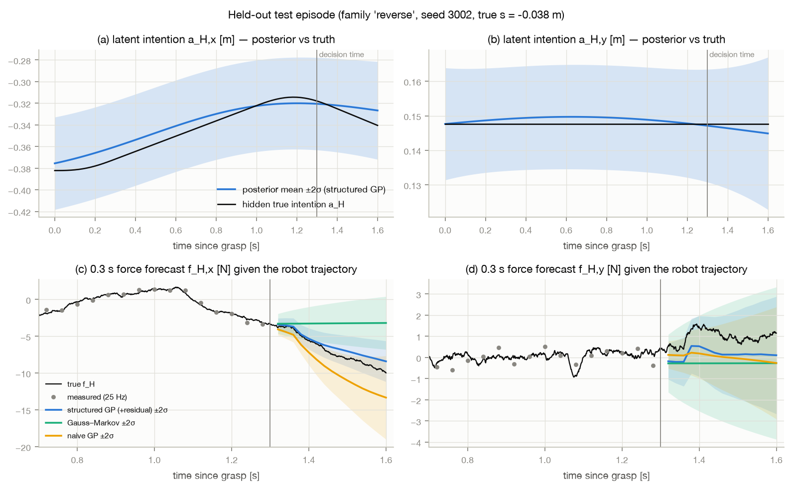

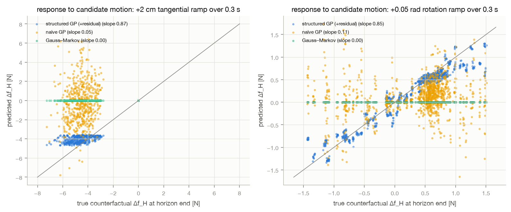

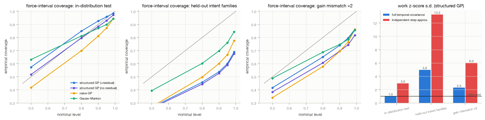

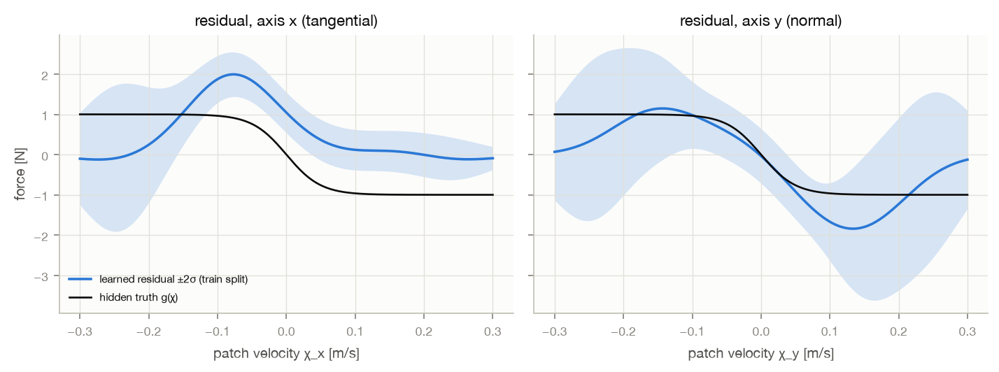

## 5a. Closed-loop design (applies to §5-§8)

* **Controllers.** All share the nominal hybrid policy, the actuator box, the observation information,
  the budgets (`Ec0 = 0.6 J`, `BH0 = 0.15 J`) and the 1 kHz servo.
  * **C0:** nominal, **no energy filter (unprotected reference)**.
  * **C1:** deterministic held-force predictor, mean-only constraints, booked-ledger servo filter
    without margin.
  * **C2:** Gauss–Markov (motion-blind) force with Gaussian location; Gaussian-tightened constraints;
    servo filter with the past-work-error margin.
  * **C3:** structured latent-intention GP, otherwise as C2, risk-neutral.
  * **C4:** C3 with the entropic objective, β = 2 (risk-averse in our convention; θ = −4 in P3/P4).

  C1-C4 share the 18 candidates, N = 15 stages × 20 ms, the constraints and the energy-margin cost.
* **Seeds.**
  * Hidden human intention, gains, location, sensor biases and noise are **paired** across
    controllers.
  * Forces are regenerated from the hidden intention and the actual state; force traces are never
    replayed.
  * Reported runs use seeds ≥ 100. Debugging used seeds 0-29.
* **Statistics.**
  * Rates are per **episode**, with Wilson 95% intervals; pooled rates also get exact one-sided
    Clopper–Pearson 95% upper bounds.
  * Time steps are never counted as trials.
  * A violation is a true-account minimum below −1e-6 J. Raw minima are also reported.
* **Truth side.** The auditor recomputes the true BH, `S`, `h_H = BH − S`, the identities and credit
  validity independently. The controllers never see these values.

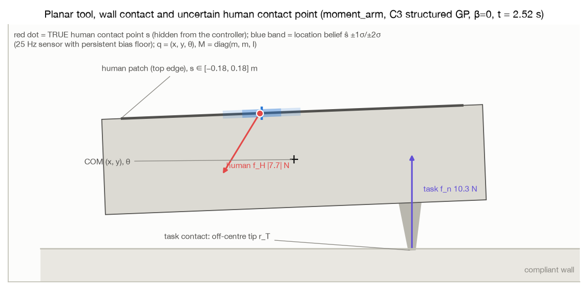

## 5. Closed-loop main comparison (tables T1-T5; figures `violations_main.png`, `completion_main.png`, `tradeoff_main.png`, `accounts_*.png`)

Setup: 8 scenarios × 5 controllers × 100 paired held-out seeds = 4000 episodes, 0 run errors.
Infeasible initialisation is reported separately (T6).

**5.1 The energy layer does what it is designed to do (tier C evidence for the tier A construction).**
* **C0 (unprotected).** It violates the true accounts in every episode of every human scenario. Net
  robot→human work is 1.1-2.1 J per episode (mean), against `BH0 = 0.15 J`, and peak human force is
  20-29 N.
* **C1-C4 (all with the Ec + BH tick-work filter).** Mean net work is 0.001-0.12 J and peak human force
  is 2-16 N.
* **Domain.** No body corner left the domain, except 2 low-BH episodes under C2.
* **Ec.** No Ec violation occurred in any of the 7050 filtered held-out episodes (all tags except smoke). Some of those runs used deliberately invalid credit, so this alone says nothing about the theorem's preconditions.
* **Energy audit.** The worst residual of `ΔS − W_a + W_H + ∫D_R + ∫D_T` over all 4000 episodes is
  given in T5. Booked credit never exceeded the true `∫D_T` (max excess in T5).

**5.2 Covariance-aware past-work accounting removes the residual violations of the deterministic ledger.**
Pooled over the five in-distribution scenarios (no human, block/release, assist/reverse,
normal/oblique, moment arm), 500 episodes per controller:

| | episodes with any true-account violation | one-sided 95% upper bound |
|---|---|---|
| C1 (no margin) | **7/500** (Wilson 0.7-2.9%): all `h_H` = BH − S, in normal/oblique 4 and moment-arm 3 | 2.6% |
| C2 | **0/500** | 0.60% |
| C3 | **0/500** | 0.60% |
| C4 | **0/500** | 0.60% |

C1's failures occur in the scenarios where the human pushes normally at an off-centre, uncertain
location. The booked BH then uses `ŝ`, and the true BH is lower by `G·(s − ŝ)`. C2-C4 carry that
error in their belief (`e_BH`, formulation §4.2) and tighten by `κσ_e`.

**This is the most clearly supported upgrade: an explicit, location-correlated past-work error
belief.** All three margin-carrying controllers deliver it, whether or not the structured GP is used.

**5.3 The structured GP does not improve closed-loop outcomes here; the simpler Gauss–Markov predictor is better.**
Paired differences (T3; s.e. over 100 paired seeds) show C2 beats C3 in every interaction scenario:
* lower positive robot→human work: −0.003 to −0.033 J (low BH −0.003, others −0.011 to −0.033; except OOD intent, +0.003 ± 0.003 J, i.e. equal within noise);
* lower normal-force RMSE: −0.06 to −0.30 N in distribution; −1.8 N in OOD intent; −1.5 N in low BH;
* equal or larger true minimum backup margin.

C3 hands about 2.5× more ticks to the servo filter (block/release: 20% vs 8%), with a higher
command-increment RMS.

The mechanism is visible in the logged predictions (seeds 100-101, all engaged calls). C3's predicted `h_H` s.d. is 10-35%
and its MC work s.d. 32-51% smaller than C2's (e.g. block/release: 4.4 vs 5.8 mJ for `h_H`; 4.1 vs 8.4 mJ for work). The
planner therefore operates closer to the backup boundary, without any gain in progress or coverage.
Sharper (and, in distribution, calibrated: §4, §7) predictions **spend** the human budget under this
objective, because only the constraints, not the objective, value BH. The reactive filter then
intervenes more.

A planner that should *exploit* better prediction would need an objective that values interaction
energy or margin (for example a larger `w_res`, or a work cost). That is a design choice, not
something the evidence here supports by default.

**5.4 Out-of-distribution intent (held-out oscillating family).**
* No account violations for C2-C4; C1 had 1/100.
* C3/C4 lose task quality: completion 95/100 and 93/100 (vs 100/100 for C1/C2); normal-force RMSE
  2.4 N (vs 0.6 N for C2); wiping coverage 0.96/0.94.
* The structured GP is over-confident on this family (offline NLPD 8.7). Its wrong extrapolations
  make most active candidates look infeasible, so it selects the brake (7.5%) or passive backup (2%)
  candidates during contact.
* **This is a regression of the proposed predictor**, and the main argument for an online
  calibration/innovation monitor (not implemented).

**5.5 Persistent sensor bias outside the calibrated prior (failure, all filtered controllers).**
In this scenario the force sensor is biased by (0.8, −0.5) N and the location sensor by 6 cm. The
priors assume 0.1 N and 2 cm.

The booked BH is optimistic by up to ≈ 81-84 mJ: the bias times the human-driven contact-point
displacement, which the force data cannot reveal because it is confounded with an intention
offset. After the human releases, the robot resumes wiping with `S ≈ 16-25 mJ` while the true BH is
far lower than booked.

| | true `h_H` violated | true BH violated |
|---|---|---|
| C1 | 95/100 | 9/100 |
| C2 | 75/100 | 0/100 |
| C3 | 98/100 | 26/100 |
| C4 | 98/100 | 17/100 |

C2 is least bad, most plausibly because its predicted uncertainty is wider (median predicted `h_H` s.d. 20 vs 13 mJ for
C3 in this scenario). None of the margins is calibrated for this error (`accounts_sensor_bias_100.png`). Section 6.7 tests a robust interval bound as a remedy
(post-hoc).

**5.6 Deliberately insufficient BH and infeasible initialisation.**

*Low BH* (`BH0 = 0.02 J`, while wiping needs `S ≈ 0.016 J`):
* All filtered controllers keep the accounts (only C1 has 1 `h_H` violation).
* Almost none can finish: 1-2/100 completed.
* Coverage: C2 0.86, C4 0.52, C3 0.40, C1 0.32.
* C2 had 2 domain exits (body corner below the wall).

*Infeasible initialisation* (preloaded 10 N contact, `BH0 = 0.004 J < S0 = 0.010 J`, so
`h_H(0) = −6 mJ`):
* This lies **outside the theorem's initial-condition requirement**. The 30/30 `h_H` "violations"
  are this initial state.
* The filter immediately extracts energy: it unloads the contact, so `S` drops from 10 to 0.9 mJ
  within 0.1 s and `h_H` becomes positive.
* After that the robot can only hold about 5 N.
* True BH and Ec never went negative. The task is infeasible under `BH ≥ S` (0/30 completed).

C0 shows the unprotected alternative (1.8 J of human work).

**5.7 Risk-sensitive objective (C4, β = 2) vs risk-neutral (C3).**
* Paired differences are negligible in distribution: |Δ W_H⁺| ≤ 0.002 J, Δ force RMSE within
  ±0.01 N, identical violation counts.
* C4 completes 2 fewer OOD episodes, and has 9 fewer true-BH violations under sensor bias (17 vs 26),
  but **neither difference is significant**: Wilson intervals overlap.
* In low BH, C4 improves coverage by +0.12 ± 0.03.

The β sweep (§6.2) shows the direction of the effect on stiffness and speed.

**5.8 Timing.** Wall-clock times come from 9 parallel workers on a 4P+6E-core M4, with another
agent's job running concurrently, so they are contention-affected.
* Planner p95 over all calls: C1 ≈ 14 ms, C2 ≈ 54 ms, C3/C4 ≈ 95-120 ms.
* A single-process measurement is in §6.8.
* None of the stochastic planners meets the 20 ms period in Python. **No real-time claim.**

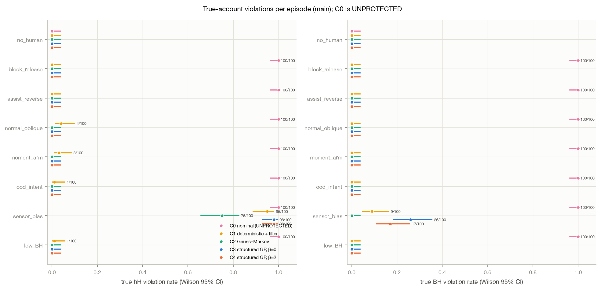

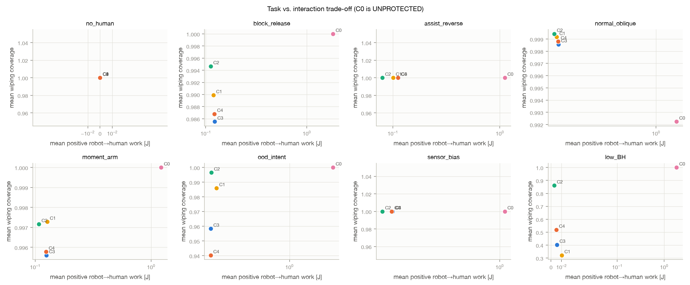

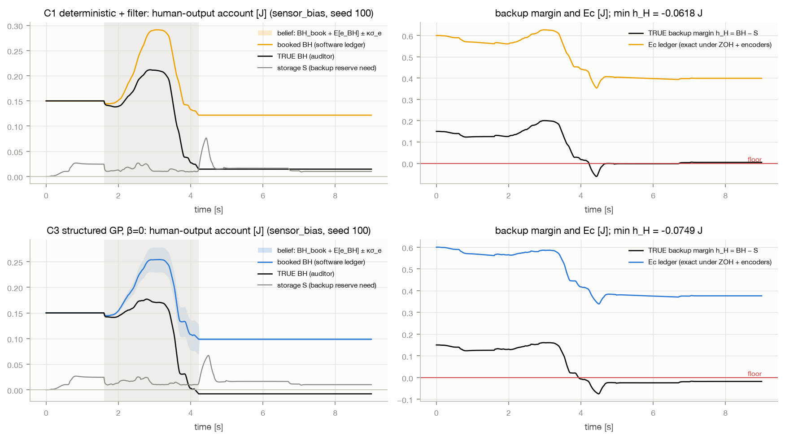

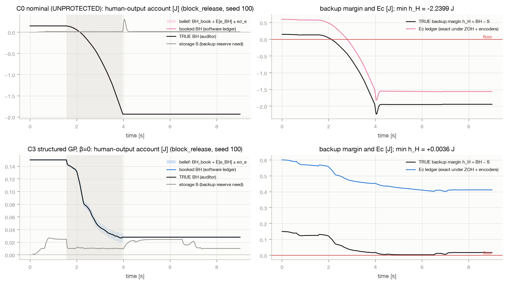

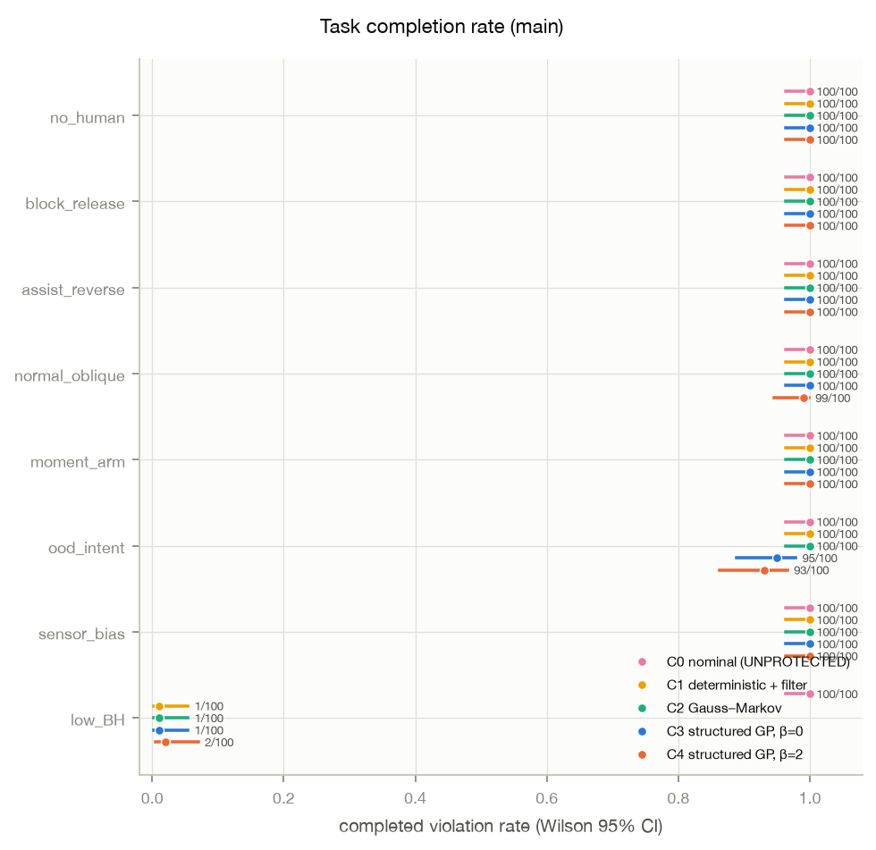

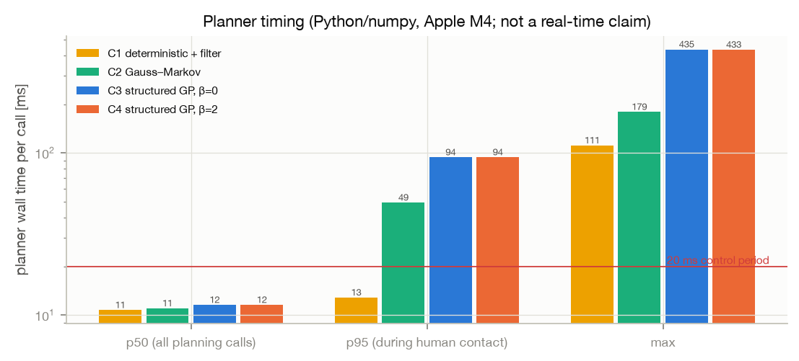

## 6. Targeted ablations (50 paired held-out seeds each unless stated; tables T7-T13)

**6.1 Temporal covariance and constraint moments (T7).**
Variants: C3 (full cross-time covariance, first-order constraint moments), C3_indep (deliberately
independent-step latent covariance) and C3_mc (Monte Carlo constraint moments), on block/release,
assist/reverse and OOD intent.
* **Safety:** none of the 450 episodes violated any account.
* **Task metrics:** differences are small and not consistently in one direction.
* **MC constraint moments:** these remove the finite-difference linearisation (planner p95 ≈ 57 vs
  98 ms under load). They completed fewer OOD episodes (43/50 vs 48/50).

Offline, ignoring temporal covariance makes work predictions **≈ 3× over-confident** (T15). In this
closed loop that error does not surface, because safety is enforced by the servo filter and the
planner's tightening is rarely the binding constraint. **Retaining temporal covariance is necessary
for calibrated prediction (tier B claims) but was not decisive for closed-loop outcomes here.**

**6.2 Risk sensitivity (β = −1, 0, 2, 5; T8).** No violations for any β.
* **Selected stiffness rises monotonically with β.** Pooled σ_K = 0.662 / 0.667 / 0.671 / 0.673.
  Paired, β = 5 vs 0: +0.011 ± 0.004 (block/release), +0.008 ± 0.003 (normal/oblique).
* **Selected speed falls with β.** β = 5 vs 0: −0.004 ± 0.001.
* **Other metrics:** positive human work and force RMSE fall marginally (W_H⁺ 0.123 → 0.120 J;
  force RMSE 0.85 → 0.81 N).
* So risk aversion (β > 0, i.e. P3/P4 θ < 0) made the policy **slightly stiffer and slower, not more
  compliant**. This matches P3/P4's report that their risk-averse controllers raise feedback gains.
  The effect is ≈ 1-2% of the candidate range and **practically negligible**.
* **The empirical entropic estimator degenerates at large β.** The minimum effective sample size of
  the exponential weights fell to 2 (β = 2) and 1 (β = 5) of 48 samples in some calls. Those
  objective values carry large sampling error (delta-method s.e. logged; mean ≈ 0.015-0.017).

**6.3 Servo filter only, no planner (block/release, T9).**

| variant | worst true `h_H` | worst true BH | episodes flagged | interpretation |
|---|---|---|---|---|
| ORACLE (§5.2 filter with **true** BH) | −21 µJ | −13 µJ | 28/50 `h_H`, 19/50 BH at the strict −1 µJ threshold; **none below −0.1 mJ** | sampled-data numerical deficit of the tick-work filter, about 1e-4 of BH0 |
| filter on booked ledger, no margin | −2.4 mJ | −2.3 mJ | 32/50 | the location-induced ledger error |
| instantaneous-power filter | −80 mJ | −79 mJ | 50/50 | energy leak inside the ZOH hold |

All three complete **0/50** wipes. Without anticipation, BH is spent during the block, and afterwards
`BH ≥ S` forbids the stored energy that wiping needs. The ORACLE run validates the continuous-time
reference only numerically: it is close, not exact. The planner is what preserves the task.

**6.4 Residual on/off (T10).** No difference in safety, and negligible task differences: C3 without
residual has a slightly lower force RMSE in block/release, 0.70 vs 0.79 N. The residual's value is
only offline and in-distribution (§4).

**6.5 Task-dissipation credit (T11).**
* **Exact credit:** `min Ec ≈ 0.40-0.52 J`.
* **Conservative credit** (true μ = 0.35, booked at the interval's lower end 0.25):
  * credit stays valid (excess ≤ 2.4e-16 J);
  * about 29% of the frictional dissipation goes **unreimbursed**, and the Ec budget drains to
    `min Ec ≈ 0.006-0.05 J` (from 0.6 J);
  * block/release completion falls to 13/50 (C1) and 5/50 (C3);
  * no violations.
* **Invalid over-credit diagnostic** (true μ = 0.25 booked as 0.35):
  * the auditor flags credit exceeding true `∫D_T` by **0.50 J**;
  * Ec looks healthy (0.58 J);
  * `h_H` is violated in 37-50/50 block/release episodes, because the filter's `D̂` overstates the
    real dissipation.

The guarantees rest on a **valid** dissipation bound. Conservative bounds cost task capability.

**6.6 Moment arm × location uncertainty (T12, `moment_arm_sweep.png`).** Setup:
* the same nominal push: a 4 cm intention into the wall, ≈ 6 N normal;
* fixed `s ∈ {−0.15, 0, +0.15}` m;
* location-sensor noise = bias s.d. ∈ {0.01, 0.03, 0.06} m, consistent between truth and model;
* 30 seeds per cell, comparing C1 vs C3 vs C3_forceonly (location treated as known in the belief).

Findings:
* **The moment arm matters physically.** The same push gives max |θ| = 0.050 / 0.038 / 0.016 rad at
  `s = −0.15 / 0 / +0.15`. The push's moment combines with the moment of the off-centre task contact.
* **The true past-work error grows with location uncertainty.** At `s = −0.15`: 1.7 → 5.2 → 10.4 mJ.
  * C3's belief σ_e tracks it (≈ 4.4 → 6.5 → 9.6 mJ).
  * The force-only variant's stays ≈ 3.5 mJ.
* **`h_H` violations:**
  * C1: **20/270**.
  * C3 force-only: **12/270**, including 9/30 (and 5/30 incomplete tasks) in the worst cell,
    `s = +0.15`, σ = 6 cm.
  * C3 with force + location uncertainty: **0/270**.

Modelling force uncertainty alone is not enough; the location term is what removes the violations.

**6.7 Post-hoc: robust interval bound for sensor biases (designed after observing §5.5; fresh seeds).** **Status: post-hoc.** This variant was designed after the frozen run revealed §5.5. It is
evaluated only on fresh seeds 300-349, paired with C2/C3 on the same seeds (T16).

**Assumed calibration bounds.** `B_f = 1.0 N` and `B_s = 0.08 m` were chosen to **cover** the test
biases (0.8 N, 6 cm). This is the optimistic case in which the bounds are right; real bounds must
come from sensor calibration.

**Sensor bias** (the original failure):

| | `h_H` violations | true-BH violations | worst true `h_H` | positive work on the human |
|---|---|---|---|---|
| C2 | 33/50 | 0/50 | −52 mJ | 0.134 J |
| C2 + bound | **0/50** | 0/50 | +32 mJ | 0.072 J |
| C3 | 48/50 | 11/50 | −82 mJ | 0.156 J |
| C3 + bound | **0/50** | 0/50 | +27 mJ | 0.078 J |

All bounded runs completed the wipe.

**Cost in distribution** (block/release, assist/reverse, moment arm):
* no violations, either way;
* completion time +0.05 to +0.5 s;
* block/release coverage 0.98 → 0.94 (C3) and 1.00 → 0.98 (C2);
* force RMSE 0.37 → 0.77 N (C2) and 0.67 → 1.16 N (C3);
* minimum true backup margin rises from 3-14 mJ to 31-70 mJ (much more conservative);
* positive robot→human work drops by about 20-60%;
* one C3_robust moment-arm episode was incomplete (49/50).

**Conclusion.** A correct interval bound removes the bias failure, and the price is task capability.
This supports making calibrated bias bounds part of the ledger. It does not show what happens when
the bound itself is wrong.

**6.8 Single-process timing.** Measured with one process and one BLAS thread on block/release, seeds 300-302; system load average 9 at the start (other activity on the machine).

| controller | p50 during human contact | p95 during contact | max | p95 over all calls | wall time per 9 s episode |
|---|---|---|---|---|---|
| C1 | 5.2 ms | 5.3 ms | 5.4 ms | 5.4 ms | 3.2 s |
| C2 | 20.3 ms | 20.8 ms | 24.5 ms | 20.6 ms | 4.8 s |
| C3 | 34.0 ms | 34.5 ms | 36.6 ms | 34.5 ms | 6.9 s |
| C4 | 33.8 ms | 34.5 ms | 45.6 ms | 34.5 ms | 6.9 s |

The first call includes import overhead (max 361 ms). The control period is 20 ms. C2 is at the period; C3/C4 need about 1.7× it. All of this is Python/numpy on an Apple M4 and is **not a real-time claim**.

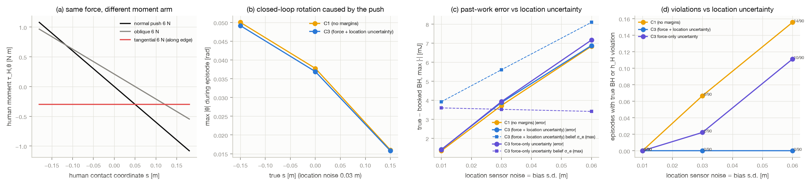

## 7. Forked-truth calibration of the predicted margins (T14, `calibration_forks.png`)

Forks were taken at every third engaged planning call (seeds 200-219, five scenarios). At each,
the **true** simulator was deep-copied and the selected candidate executed open-loop for 0.3 s, with
no filter and no re-planning. The realised `h_H`, true BH, Ec and human work were compared with the
planner's predicted distributions: 4244 forks per predictor.

* **In-distribution pool** (block/release, assist/reverse, normal/oblique, moment arm; 3303 forks):

  | | `h_H` z s.d. | coverage 50/80/90/95/99% | lower-tail exceedance (nominal 1%) | work above predicted q99.5 |
  |---|---|---|---|---|
  | C3, first order | 2.25 | 0.51 / 0.76 / 0.84 / 0.88 / 0.93 | 1.6% | 5.5% |
  | C3, MC moments | 1.64 | 0.85 at 90% | – | – |
  | C2, first order | 1.39 | 0.59 / 0.82 / 0.87 / 0.91 / 0.94 | 0.0% | 2.5% |

  C3's work PIT is U-shaped, i.e. over-confident.
* **By scenario.** Block/release is well calibrated, even conservative, for both (z s.d. 0.5-0.6).
  C3 is over-confident for the step-like intents of normal/oblique and moment arm (z s.d. ≈ 3).
* **Misspecified** (OOD intent + sensor bias, 941 forks): C3 90% coverage 0.18, lower tail 54%;
  C2 0.32 and 37%.
* **Why offline calibration does not carry over.** The offline evaluation conditions on the *true*
  robot trajectory. The closed-loop covariance omits predictor-model error (5 ms semi-implicit Euler,
  stage-Taylor intention, feedback-motion error) and the extrapolation error of step-like intents.
* **First-order vs MC mean work** over 0.3 s differs by +1.2 mJ (C3) and +4.7 mJ (C2) on average,
  against a realised |W_H| median of 7-12 mJ. First-order mean propagation is materially biased. Here
  it over-predicts work, so the expected `−tr Cov(f, v)` correction is not the dominant nonlinearity.
* **Consequence.** Gaussian tightening at κ = 2.33 does **not** deliver its nominal 1% per-call tail
  in this closed loop. It is a heuristic margin (tier B); the realised safety comes from the servo
  filter (§6.3).

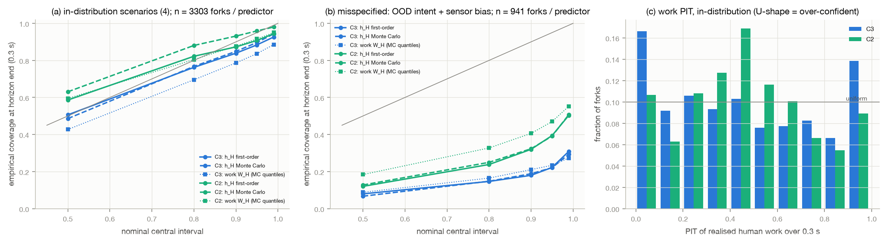

## 7b. Physics-step refinement (T13, `refinement.png`)

Setup: physics step h ∈ {1, 0.5, 0.25} ms with the servo fixed at 1 kHz; 10 seeds ×
{block/release, normal/oblique} × {C0, C1, C3}.

* **Plant energy channels.** Max |ΔS − W_a + W_H + ∫D_R + ∫D_T| falls 4.6e-7 → 3.8e-8 → 3.5e-10 J
  (C0) and 1.2e-6 → 7.2e-8 → 3.9e-9 J (C3), ≈ 4th order.
* **Independent auditor** (trapezoid on the 1 kHz log): 2.3-3.7e-4 J, independent of h because the
  log rate is fixed. This is the auditor's resolution, ≈ 0.1-0.3% of the energy flows.
* **Closed-loop account minima.**
  * C0/C1 converge (C0: |Δ min h_H| 0.07 → 0.02 mJ).
  * C3's are not pointwise convergent (|Δ| up to 0.9 mJ): tiny physics differences flip discrete
    candidate decisions.
  * Violation counts are unchanged, 0 at every h for C1/C3.
* **Credit.** The max booked-credit excess over the true `∫D_T` is ≤ 2.4e-16 J (round-off), except in
  the deliberately invalid diagnostic.

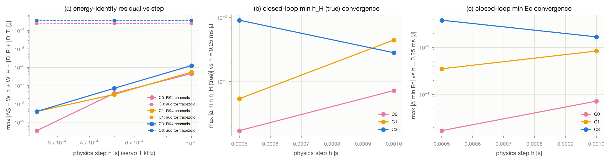

## 8. Failures and regressions (all retained, none hidden)

1. **Sensor bias outside the calibrated prior** (§5.5).
   * `h_H` is violated in 75-98/100 episodes for every filtered controller.
   * True BH is violated in C3 26/100, C4 17/100, C1 9/100.
   * The booked BH is optimistic by ≈ 80 mJ (bias × human-driven displacement), and force data cannot
     reveal it.
2. **Structured GP out of distribution** (oscillating intent).
   * Offline it is over-confident: NLPD 8.7, 90% coverage 0.54.
   * In closed loop C3/C4 complete 95/100 and 93/100 (vs 100/100 for C1/C2), with normal-force RMSE
     2.4 N.
3. **Gain mismatch ×2.** The GP is over-confident offline: 90% coverage 0.74, intention coverage 0.59,
   response slope 0.46.
4. **Closed-loop margin calibration** (forked truth).
   * C3's 0.3 s `h_H` predictions are over-confident in distribution: z s.d. 2.25, 1% lower tail
     exceeded in 1.6% of forks.
   * Under misspecification the tail is exceeded in 37-54% of forks.
   * First-order and MC mean work differ by 1-5 mJ.
5. **C2 beats C3 in closed loop** on interaction energy, force tracking and margins in every
   interaction scenario (§5.3). The structured GP's offline advantage did not transfer.
6. **C1's past-work error** produced 7/500 in-distribution `h_H` violations (worst −7 mJ) and 20/270 in
   the location sweep.
7. **Risk-sensitive objective.**
   * The effect is negligible (1-2% stiffer, slower).
   * The empirical entropic estimator degenerates at β ≥ 2: minimum ESS 1-2 of 48.
8. **The servo filter alone (no planner) fails the task** (0/50 completed): BH is spent during the
   block, and `BH ≥ S` then forbids the stored energy that wiping needs.
   * With the booked ledger and no margin it violates true BH by up to −2.3 mJ.
   * The instantaneous variant leaks −80 mJ.
   * The ORACLE shows µJ-level sampled-data deficits (worst −21 µJ), so there is **no exact
     intersample invariance**.
9. **`BH ≥ S` is conservative.**
   * Low BH (0.02 J): 1-2/100 completed, and C2 had 2 domain exits (body corner below the wall).
   * Infeasible initialisation (`h_H(0) < 0`): 0/30 completed (by construction).
10. **Conservative credit** (true μ 0.35, booked 0.25) drains Ec from 0.6 J to ≈ 0.01-0.05 J and cuts
    block/release completion to 13/50 (C1) and 5/50 (C3). The **invalid over-credit diagnostic** is
    caught by the auditor (+0.50 J excess) and produces 37-50/50 `h_H` violations.
11. **Refinement.** Closed-loop account minima of the planners are not pointwise convergent under
    step refinement (discrete decision flips). The independent auditor's resolution is about 2-4e-4 J
    (1 kHz log).
12. **Residual identifiability.** The tangential-axis residual is not identified: it is confounded
    with intention offset and OU noise.
13. **Not real time.** The planners take ≈ 30-120 ms per 20 ms period.
14. **Design defects found and fixed during the smoke stage, before freezing** (`decision_log.md`):
    * the sampled-data energy leak;
    * the "backup trap" from a violent re-approach;
    * free-body drift under the passive backup, which motivated the dissipative brake candidate.
    These would have invalidated the comparison had they not been fixed. The fixes apply to all
    controllers equally.

## 9. Remaining theoretical gaps

1. **No intersample proof.** The tick-work filter uses a second-order Taylor model with held external
   force. The remainder and the within-tick variation of the human force are not bounded, so continuous
   invariance is validated numerically only. A certified version needs:
   * a bound on `q̈` that includes the human force rate, or
   * a discrete passivity-preserving construction that books **exact** discrete work and constrains it
     a priori.
2. **Gaussian tightening is not a probabilistic certificate.** It covers neither calibration error
   (OOD intent, gain mismatch, mis-specified bias priors) nor nonlinear propagation error. A certified
   claim needs:
   * calibrated joint input uncertainty;
   * verification over a joint confidence region, or a remainder bound;
   * mission-level risk allocation over executed constraint events.
   The per-call `α = 1%` does not translate into a mission level.
3. **The planner has no recursive-feasibility argument.** Safety in this PoC rests on the servo
   filter (tier A conditions with exact accounts). The planner is a performance and anticipation layer.
4. **The past-work error model is first-order.** It:
   * drops `ε_m·(s − ŝ)`;
   * assumes the 1 kHz ledger noise is independent of the 25 Hz GP samples;
   * relies on a **force-sensor bias prior** that the force data cannot falsify (bias is confounded
     with an intention offset).
   A mis-specified bias prior, as in the `sensor_bias` scenario, therefore defeats the margin.
5. **Credit validity is audited, not proven.** The min-endpoint quadrature lower-bounds `∫D_T` only
   when there is no interior dip within the 1 ms tick.
6. **Human model limits.** The model has:
   * no inertia;
   * fixed gains (integrating over gain uncertainty multiplies the intention and destroys
     Gaussianity);
   * no grasp/release prediction (the predictor assumes contact persists over the horizon);
   * no unknown-link or multi-contact inference.
7. **`BH ≥ S` is conservative.** It reserves BH for all stored energy, including kinetic energy and
   task-wall elastic energy that the human could only receive through the robot. Less conservative
   reserves need sound reachable-set bounds, not sampled backup rollouts.
8. **The bounded patch is approximated by a Gaussian location prior.** The posterior mass outside the
   patch is logged but not otherwise handled.
9. **Prediction-model error is not bounded.** The predictor uses 5 ms semi-implicit Euler, the truth
   1 ms RK4.
10. **Not real time.** The Python planner takes about 30-80 ms per 20 ms control period during human
    contact (p95).

## 10. Recommendation: which upgrade is supported by evidence

**Supported (adopt):**
1. **A sampled-data, tick-work energy filter.** It constrains the predicted actuator work over each
   ZOH tick instead of the instantaneous power. Without it, the Ec + BH filter leaks (−80 mJ). With
   true accounts it holds to ≈ 2e-5 J. An intersample proof is still missing.
2. **An explicit past-work (BH) error belief.** It must be correlated with the location posterior
   (and the force-bias belief) and never reset at a planning call. It removed every in-distribution
   violation of the deterministic ledger (7/500 → 0/500) and every location-sweep violation
   (20/270 → 0/270). Force-only uncertainty is not enough (12/270).
3. **Calibrated bias bounds for the BH ledger.** A Gaussian prior that the data cannot falsify is not
   a safety margin. §6.7 quantifies the post-hoc interval bound and its cost.

**Not supported in the current form (do not adopt yet):**
4. **The structured latent-intention GP as the planner's predictor.** It is the better *predictor*
   offline, and it correctly predicts how the human force responds to candidate motion. In closed
   loop, however:
   * its sharper, closed-loop over-confident margins make the planner spend more of the human budget
     for no task gain;
   * it regresses on OOD intents.

   Before reuse it needs:
   * online calibration (an innovation/NLPD monitor with variance inflation or fallback);
   * covariance that includes predictor-model error;
   * an objective that values the human budget, if sharper prediction is meant to buy anything.
5. **The entropic (risk-sensitive) objective.** Its effect is negligible here and in the P3/P4
   direction (stiffer). The empirical estimator needs far more samples at β ≥ 2. Risk sensitivity
   must not be presented as a route to compliance.

**Negative results are part of the recommendation.** The four-paper synthesis (impedance-informed
latent intention + uncertain contact location + correlated energy prediction + independent energy
filter) is coherent and implementable. In this PoC, though, the safety benefit came from the energy
filter and the past-work error belief, not from the more expressive human model.

## 11. Reproduction, files and runtime

* Smallest reproduction (≈ 1 min) and the full suite (≈ 2.5 h on an Apple M4; another agent's job
  shared the machine): see `README.md`.
* Every reported closed-loop run used frozen code: `checkpoints/freeze_main_v1.json`, and for §6.7,
  `freeze_posthoc_v1.json`. Seeds were held out (≥ 100; post-hoc ≥ 300). Smoke seeds 0-29 were used
  only for debugging.
* Machine-readable outputs:
  * per-episode metrics (including the hidden truth parameters): `outputs/runs/<tag>/metrics.jsonl`;
  * summaries: `summary.json`;
  * offline predictor results: `outputs/offline/`;
  * forked-truth calibration: `outputs/calibration/`;
  * frozen models: `outputs/models/gp_frozen.json`;
  * all tables: `outputs/report_tables.md`;
  * provenance: `manifest.json`.
* Figures (`outputs/figures/`):
  * `geometry.png`, `gp_inference_example.png`, `offline_calibration.png`,
    `offline_response_to_motion.png`, `offline_residual.png`;
  * `violations_main.png`, `completion_main.png`, `tradeoff_main.png`, `runtime_main.png`;
  * `accounts_block_release_100.png`, `accounts_sensor_bias_100.png`;
  * `moment_arm_sweep.png`, `calibration_forks.png`, `refinement.png`.
* Animation: `outputs/animation/block_release_seed100_C0_C1_C2_C3.mp4` (and `.gif`). The panels show
  the same hidden human (same intention, gains, location and noise) across C0 (marked UNPROTECTED),
  C1, C2 and C3. Each panel shows:
  * the task contact force;
  * the true human contact point and the location belief band;
  * force arrows;
  * live Ec / true BH / booked BH / `h_H` bars.
* Hardware: Apple M4 (4 performance + 6 efficiency cores), 16 GB RAM, macOS 26.2, Python 3.13.5,
  numpy 2.5.4, scipy 1.18.1.

## Completion checklist (task's "before calling the PoC complete")

| requirement | evidence |
|---|---|
| location uncertainty is non-degenerate | posterior `s` s.d. ≈ 20 mm (bias floor, does not average out); moment-arm tests; closed-loop rotation and past-work error grow with `s` and location uncertainty (sweep, T12) |
| GP predictions respond to candidate robot motion | counterfactual response slope 0.84-0.95 (structured) vs ≈ 0.05 (naive) and 0 (Gauss–Markov), T15 and `offline_response_to_motion.png` |
| temporal covariance is retained | MC uses one joint function sample per rollout; first order carries `Φ_k` with cross-time covariance; offline work z s.d. 1.0-1.2 full vs 3.0-3.5 independent-step; closed-loop ablation T7 |
| the risk objective is separately ablated | C3 vs C4 (main) and the β sweep −1/0/2/5 with the measured σ_K/σ_v selection (T8) |
| accounts use executed work | booked `P_a` = `uᵀΔq` of the **applied** (filtered, saturated) command; matches RK4 to 1e-9 J; true BH from true force at the material point |
| passive-contact energy balance converges | pointwise identity tests; refinement (T13, `refinement.png`) |
| empirical results are not advertised as proofs | tiers A/B/C throughout; failures reported |

## Appendix: all result tables (generated by `scripts/build_docs.py --tables`)

### T1. Main comparison (held-out seeds 100-199, paired across controllers)

| scenario | ctrl | n | completed | true h_H viol. (Wilson 95%) | true BH viol. | Ec viol. | domain exit | W_H⁺ [J] mean (q95) | W_H net [J] | coverage | f_n RMSE [N] | peak f_H [N] | release surge [m/s] | fallbacks/ep | filter active |
|---|---|---|---|---|---|---|---|---|---|---|---|---|---|---|---|
| no_human | C0 | 100 | 100/100 | 0 (0–4%) | 0 (0–4%) | 0 | 0 | 0.000 (0.000) | 0.000 | 1.00 | 0.04 | 0.0 | – | 0.00 | 0.000 |
| no_human | C1 | 100 | 100/100 | 0 (0–4%) | 0 (0–4%) | 0 | 0 | 0.000 (0.000) | 0.000 | 1.00 | 0.06 | 0.0 | – | 0.00 | 0.000 |
| no_human | C2 | 100 | 100/100 | 0 (0–4%) | 0 (0–4%) | 0 | 0 | 0.000 (0.000) | 0.000 | 1.00 | 0.06 | 0.0 | – | 0.00 | 0.000 |
| no_human | C3 | 100 | 100/100 | 0 (0–4%) | 0 (0–4%) | 0 | 0 | 0.000 (0.000) | 0.000 | 1.00 | 0.06 | 0.0 | – | 0.00 | 0.000 |
| no_human | C4 | 100 | 100/100 | 0 (0–4%) | 0 (0–4%) | 0 | 0 | 0.000 (0.000) | 0.000 | 1.00 | 0.06 | 0.0 | – | 0.00 | 0.000 |
| block_release | C0 | 100 | 100/100 | 100 (96–100%) | 100 (96–100%) | 100 | 0 | 1.816 (2.058) | 1.816 | 1.00 | 0.32 | 23.6 | 0.355 | 0.00 | 0.000 |
| block_release | C1 | 100 | 100/100 | 0 (0–4%) | 0 (0–4%) | 0 | 0 | 0.119 (0.125) | 0.119 | 0.99 | 0.59 | 5.8 | 0.140 | 0.00 | 0.141 |
| block_release | C2 | 100 | 100/100 | 0 (0–4%) | 0 (0–4%) | 0 | 0 | 0.112 (0.116) | 0.111 | 0.99 | 0.40 | 5.6 | 0.153 | 0.00 | 0.077 |
| block_release | C3 | 100 | 100/100 | 0 (0–4%) | 0 (0–4%) | 0 | 0 | 0.123 (0.127) | 0.121 | 0.99 | 0.70 | 5.9 | 0.136 | 0.00 | 0.197 |
| block_release | C4 | 100 | 100/100 | 0 (0–4%) | 0 (0–4%) | 0 | 0 | 0.122 (0.126) | 0.121 | 0.99 | 0.69 | 5.9 | 0.137 | 0.00 | 0.201 |
| assist_reverse | C0 | 100 | 100/100 | 100 (96–100%) | 100 (96–100%) | 99 | 0 | 1.111 (1.553) | 1.102 | 1.00 | 0.34 | 25.6 | 0.373 | 0.00 | 0.000 |
| assist_reverse | C1 | 100 | 100/100 | 0 (0–4%) | 0 (0–4%) | 0 | 0 | 0.101 (0.139) | 0.058 | 1.00 | 0.29 | 15.0 | 0.227 | 0.00 | 0.037 |
| assist_reverse | C2 | 100 | 100/100 | 0 (0–4%) | 0 (0–4%) | 0 | 0 | 0.080 (0.102) | 0.027 | 1.00 | 0.26 | 14.4 | 0.233 | 0.00 | 0.026 |
| assist_reverse | C3 | 100 | 100/100 | 0 (0–4%) | 0 (0–4%) | 0 | 0 | 0.113 (0.146) | 0.062 | 1.00 | 0.31 | 15.2 | 0.222 | 0.00 | 0.040 |
| assist_reverse | C4 | 100 | 100/100 | 0 (0–4%) | 0 (0–4%) | 0 | 0 | 0.112 (0.142) | 0.060 | 1.00 | 0.31 | 15.2 | 0.224 | 0.00 | 0.039 |
| normal_oblique | C0 | 100 | 100/100 | 100 (96–100%) | 100 (96–100%) | 100 | 0 | 1.527 (1.676) | 1.527 | 0.99 | 0.85 | 19.9 | 0.299 | 0.00 | 0.000 |
| normal_oblique | C1 | 100 | 100/100 | 4 (2–10%) | 0 (0–4%) | 0 | 0 | 0.128 (0.143) | 0.115 | 1.00 | 1.34 | 9.7 | 0.175 | 0.00 | 0.191 |
| normal_oblique | C2 | 100 | 100/100 | 0 (0–4%) | 0 (0–4%) | 0 | 0 | 0.122 (0.134) | 0.108 | 1.00 | 1.32 | 9.8 | 0.185 | 0.00 | 0.170 |
| normal_oblique | C3 | 100 | 100/100 | 0 (0–4%) | 0 (0–4%) | 0 | 0 | 0.133 (0.150) | 0.116 | 1.00 | 1.41 | 9.9 | 0.170 | 0.00 | 0.227 |
| normal_oblique | C4 | 100 | 99/100 | 0 (0–4%) | 0 (0–4%) | 0 | 0 | 0.132 (0.148) | 0.116 | 1.00 | 1.42 | 9.8 | 0.172 | 0.00 | 0.223 |
| moment_arm | C0 | 100 | 100/100 | 100 (96–100%) | 100 (96–100%) | 100 | 0 | 1.221 (1.376) | 1.220 | 1.00 | 0.64 | 20.4 | 0.308 | 0.00 | 0.000 |
| moment_arm | C1 | 100 | 100/100 | 3 (1–8%) | 0 (0–4%) | 0 | 0 | 0.127 (0.150) | 0.114 | 1.00 | 1.03 | 8.4 | 0.154 | 0.00 | 0.070 |
| moment_arm | C2 | 100 | 100/100 | 0 (0–4%) | 0 (0–4%) | 0 | 0 | 0.108 (0.118) | 0.092 | 1.00 | 0.96 | 8.0 | 0.177 | 0.00 | 0.036 |
| moment_arm | C3 | 100 | 100/100 | 0 (0–4%) | 0 (0–4%) | 0 | 0 | 0.125 (0.138) | 0.110 | 1.00 | 1.08 | 8.3 | 0.146 | 0.00 | 0.085 |
| moment_arm | C4 | 100 | 100/100 | 0 (0–4%) | 0 (0–4%) | 0 | 0 | 0.124 (0.138) | 0.109 | 1.00 | 1.08 | 8.3 | 0.148 | 0.00 | 0.082 |
| ood_intent | C0 | 100 | 100/100 | 100 (96–100%) | 100 (96–100%) | 100 | 0 | 2.213 (2.602) | 2.131 | 1.00 | 0.55 | 28.7 | 0.394 | 0.00 | 0.000 |
| ood_intent | C1 | 100 | 100/100 | 1 (0–5%) | 0 (0–4%) | 0 | 0 | 0.264 (0.439) | 0.092 | 0.99 | 0.87 | 13.8 | 0.186 | 0.00 | 0.101 |
| ood_intent | C2 | 100 | 100/100 | 0 (0–4%) | 0 (0–4%) | 0 | 0 | 0.240 (0.382) | 0.062 | 1.00 | 0.62 | 13.7 | 0.217 | 0.00 | 0.058 |
| ood_intent | C3 | 100 | 95/100 | 0 (0–4%) | 0 (0–4%) | 0 | 0 | 0.237 (0.365) | 0.067 | 0.96 | 2.43 | 13.8 | 0.206 | 0.00 | 0.091 |
| ood_intent | C4 | 100 | 93/100 | 0 (0–4%) | 0 (0–4%) | 0 | 0 | 0.237 (0.375) | 0.074 | 0.94 | 2.47 | 13.8 | 0.193 | 0.00 | 0.089 |
| sensor_bias | C0 | 100 | 100/100 | 100 (96–100%) | 100 (96–100%) | 100 | 0 | 1.092 (1.469) | 1.085 | 1.00 | 0.34 | 25.6 | 0.375 | 0.00 | 0.000 |
| sensor_bias | C1 | 100 | 100/100 | 95 (89–98%) | 9 (5–16%) | 0 | 0 | 0.157 (0.214) | 0.108 | 1.00 | 0.29 | 16.2 | 0.249 | 0.00 | 0.028 |
| sensor_bias | C2 | 100 | 100/100 | 75 (66–82%) | 0 (0–4%) | 0 | 0 | 0.131 (0.187) | 0.068 | 1.00 | 0.27 | 15.6 | 0.256 | 0.00 | 0.021 |
| sensor_bias | C3 | 100 | 100/100 | 98 (93–99%) | 26 (18–35%) | 0 | 0 | 0.156 (0.196) | 0.124 | 1.00 | 0.31 | 16.3 | 0.245 | 0.00 | 0.033 |
| sensor_bias | C4 | 100 | 100/100 | 98 (93–99%) | 17 (11–26%) | 0 | 0 | 0.154 (0.195) | 0.122 | 1.00 | 0.31 | 16.3 | 0.245 | 0.00 | 0.032 |
| low_BH | C0 | 100 | 100/100 | 100 (96–100%) | 100 (96–100%) | 100 | 0 | 1.834 (2.112) | 1.834 | 1.00 | 0.32 | 23.8 | 0.358 | 0.00 | 0.000 |
| low_BH | C1 | 100 | 1/100 | 1 (0–5%) | 0 (0–4%) | 0 | 0 | 0.010 (0.014) | 0.009 | 0.32 | 3.83 | 2.4 | 0.083 | 0.00 | 0.277 |
| low_BH | C2 | 100 | 1/100 | 0 (0–4%) | 0 (0–4%) | 0 | 2 | 0.003 (0.006) | 0.001 | 0.86 | 1.91 | 2.3 | 0.103 | 0.00 | 0.414 |
| low_BH | C3 | 100 | 1/100 | 0 (0–4%) | 0 (0–4%) | 0 | 0 | 0.006 (0.007) | 0.004 | 0.40 | 3.46 | 2.2 | 0.098 | 0.00 | 0.228 |
| low_BH | C4 | 100 | 2/100 | 0 (0–4%) | 0 (0–4%) | 0 | 0 | 0.005 (0.007) | 0.003 | 0.52 | 3.19 | 2.2 | 0.098 | 0.00 | 0.300 |

### T2. Pooled episode-level violation rates (any of true Ec/BH/h_H)

| controller | in-distribution scenarios (5) | OOD intent | sensor bias | low BH |
|---|---|---|---|---|
| C0 | 400/500 (Wilson 76.3–83.3%; one-sided 95% upper 82.90%) | 100/100 (Wilson 96.3–100.0%; one-sided 95% upper 100.00%) | 100/100 (Wilson 96.3–100.0%; one-sided 95% upper 100.00%) | 100/100 (Wilson 96.3–100.0%; one-sided 95% upper 100.00%) |
| C1 | 7/500 (Wilson 0.7–2.9%; one-sided 95% upper 2.61%) | 1/100 (Wilson 0.2–5.4%; one-sided 95% upper 4.66%) | 95/100 (Wilson 88.8–97.8%; one-sided 95% upper 98.01%) | 1/100 (Wilson 0.2–5.4%; one-sided 95% upper 4.66%) |
| C2 | 0/500 (Wilson 0.0–0.8%; one-sided 95% upper 0.60%) | 0/100 (Wilson 0.0–3.7%; one-sided 95% upper 2.95%) | 75/100 (Wilson 65.7–82.5%; one-sided 95% upper 81.98%) | 0/100 (Wilson 0.0–3.7%; one-sided 95% upper 2.95%) |
| C3 | 0/500 (Wilson 0.0–0.8%; one-sided 95% upper 0.60%) | 0/100 (Wilson 0.0–3.7%; one-sided 95% upper 2.95%) | 98/100 (Wilson 93.0–99.4%; one-sided 95% upper 99.64%) | 0/100 (Wilson 0.0–3.7%; one-sided 95% upper 2.95%) |
| C4 | 0/500 (Wilson 0.0–0.8%; one-sided 95% upper 0.60%) | 0/100 (Wilson 0.0–3.7%; one-sided 95% upper 2.95%) | 98/100 (Wilson 93.0–99.4%; one-sided 95% upper 99.64%) | 0/100 (Wilson 0.0–3.7%; one-sided 95% upper 2.95%) |

### T3. Paired differences vs C3 (mean ± s.e. over common seeds)

| scenario | comparison | Δ W_H⁺ [J] | Δ coverage | Δ f_n RMSE [N] | Δ min h_H (true) [J] | Δ du_rms |
|---|---|---|---|---|---|---|
| no_human | C0-C3 | +0.0000 ± 0.0000 | +0.0000 ± 0.0000 | -0.0190 ± 0.0000 | +0.0073 ± 0.0000 | +0.0002 ± 0.0000 |
| no_human | C1-C3 | +0.0000 ± 0.0000 | +0.0000 ± 0.0000 | +0.0000 ± 0.0000 | +0.0000 ± 0.0000 | +0.0000 ± 0.0000 |
| no_human | C2-C3 | +0.0000 ± 0.0000 | +0.0000 ± 0.0000 | +0.0000 ± 0.0000 | +0.0000 ± 0.0000 | +0.0000 ± 0.0000 |
| no_human | C4-C3 | +0.0000 ± 0.0000 | +0.0000 ± 0.0000 | +0.0000 ± 0.0000 | +0.0000 ± 0.0000 | +0.0000 ± 0.0000 |
| block_release | C0-C3 | +1.6929 ± 0.0149 | +0.0145 ± 0.0016 | -0.3814 ± 0.0331 | -1.8817 ± 0.0191 | -0.0056 ± 0.0002 |
| block_release | C1-C3 | -0.0034 ± 0.0003 | +0.0044 ± 0.0019 | -0.1132 ± 0.0315 | -0.0002 ± 0.0001 | -0.0026 ± 0.0002 |
| block_release | C2-C3 | -0.0108 ± 0.0003 | +0.0091 ± 0.0016 | -0.2987 ± 0.0327 | +0.0024 ± 0.0001 | -0.0027 ± 0.0002 |
| block_release | C4-C3 | -0.0007 ± 0.0001 | +0.0013 ± 0.0010 | -0.0074 ± 0.0211 | -0.0000 ± 0.0001 | -0.0003 ± 0.0001 |
| assist_reverse | C0-C3 | +0.9972 ± 0.0281 | +0.0000 ± 0.0000 | +0.0327 ± 0.0060 | -1.2159 ± 0.0326 | -0.0039 ± 0.0002 |
| assist_reverse | C1-C3 | -0.0128 ± 0.0013 | +0.0000 ± 0.0000 | -0.0242 ± 0.0043 | +0.0004 ± 0.0006 | -0.0017 ± 0.0002 |
| assist_reverse | C2-C3 | -0.0334 ± 0.0020 | +0.0000 ± 0.0000 | -0.0550 ± 0.0050 | +0.0193 ± 0.0012 | -0.0015 ± 0.0002 |
| assist_reverse | C4-C3 | -0.0013 ± 0.0004 | +0.0000 ± 0.0000 | -0.0045 ± 0.0043 | +0.0006 ± 0.0002 | +0.0000 ± 0.0001 |
| normal_oblique | C0-C3 | +1.3946 ± 0.0110 | -0.0063 ± 0.0014 | -0.5645 ± 0.0237 | -1.5305 ± 0.0131 | -0.0082 ± 0.0002 |
| normal_oblique | C1-C3 | -0.0048 ± 0.0005 | +0.0006 ± 0.0003 | -0.0735 ± 0.0177 | -0.0061 ± 0.0004 | -0.0019 ± 0.0003 |
| normal_oblique | C2-C3 | -0.0112 ± 0.0005 | +0.0009 ± 0.0003 | -0.0915 ± 0.0204 | -0.0000 ± 0.0002 | -0.0018 ± 0.0003 |
| normal_oblique | C4-C3 | -0.0010 ± 0.0002 | +0.0002 ± 0.0002 | +0.0034 ± 0.0081 | +0.0000 ± 0.0001 | -0.0004 ± 0.0002 |
| moment_arm | C0-C3 | +1.0964 ± 0.0087 | +0.0044 ± 0.0020 | -0.4457 ± 0.0122 | -1.2588 ± 0.0115 | -0.0049 ± 0.0002 |
| moment_arm | C1-C3 | +0.0020 ± 0.0007 | +0.0017 ± 0.0008 | -0.0498 ± 0.0084 | -0.0063 ± 0.0004 | -0.0018 ± 0.0001 |
| moment_arm | C2-C3 | -0.0173 ± 0.0005 | +0.0016 ± 0.0008 | -0.1240 ± 0.0072 | +0.0069 ± 0.0003 | -0.0012 ± 0.0001 |
| moment_arm | C4-C3 | -0.0008 ± 0.0002 | +0.0002 ± 0.0001 | -0.0040 ± 0.0049 | +0.0002 ± 0.0001 | +0.0001 ± 0.0001 |
| ood_intent | C0-C3 | +1.9762 ± 0.0243 | +0.0416 ± 0.0127 | -1.8801 ± 0.1475 | -2.2644 ± 0.0275 | -0.0123 ± 0.0003 |
| ood_intent | C1-C3 | +0.0266 ± 0.0029 | +0.0276 ± 0.0127 | -1.5640 ± 0.1492 | -0.0108 ± 0.0010 | -0.0057 ± 0.0004 |
| ood_intent | C2-C3 | +0.0025 ± 0.0032 | +0.0382 ± 0.0127 | -1.8097 ± 0.1493 | +0.0046 ± 0.0011 | -0.0060 ± 0.0004 |
| ood_intent | C4-C3 | -0.0003 ± 0.0018 | -0.0181 ± 0.0142 | +0.0410 ± 0.1178 | -0.0008 ± 0.0006 | -0.0001 ± 0.0003 |
| sensor_bias | C0-C3 | +0.9362 ± 0.0268 | +0.0000 ± 0.0000 | +0.0310 ± 0.0041 | -1.1243 ± 0.0320 | -0.0049 ± 0.0001 |
| sensor_bias | C1-C3 | +0.0010 ± 0.0015 | +0.0000 ± 0.0000 | -0.0214 ± 0.0016 | +0.0086 ± 0.0009 | -0.0018 ± 0.0001 |
| sensor_bias | C2-C3 | -0.0250 ± 0.0017 | +0.0000 ± 0.0000 | -0.0455 ± 0.0023 | +0.0372 ± 0.0015 | -0.0007 ± 0.0001 |
| sensor_bias | C4-C3 | -0.0022 ± 0.0003 | +0.0000 ± 0.0000 | -0.0019 ± 0.0006 | +0.0015 ± 0.0002 | +0.0001 ± 0.0000 |
| low_BH | C0-C3 | +1.8281 ± 0.0159 | +0.5975 ± 0.0257 | -3.1392 ± 0.0343 | -2.0305 ± 0.0200 | -0.0164 ± 0.0010 |
| low_BH | C1-C3 | +0.0047 ± 0.0002 | -0.0810 ± 0.0308 | +0.3711 ± 0.0359 | -0.0010 ± 0.0001 | -0.0052 ± 0.0010 |
| low_BH | C2-C3 | -0.0025 ± 0.0002 | +0.4583 ± 0.0324 | -1.5454 ± 0.1325 | -0.0001 ± 0.0000 | +0.0070 ± 0.0014 |
| low_BH | C4-C3 | -0.0005 ± 0.0001 | +0.1160 ± 0.0257 | -0.2714 ± 0.0490 | -0.0000 ± 0.0000 | +0.0044 ± 0.0010 |

### T2b. Violation magnitudes (true minima): numerical deficits vs material failures

| scenario | ctrl | h_H < −1 µJ | < −0.1 mJ | < −1 mJ | worst h_H [mJ] | BH < −1 µJ | < −0.1 mJ | worst BH [mJ] |
|---|---|---|---|---|---|---|---|---|
| normal_oblique | C1 | 4 | 4 | 3 | -7.007 | 0 | 0 | +21.157 |
| moment_arm | C1 | 3 | 3 | 2 | -2.896 | 0 | 0 | +17.361 |
| ood_intent | C1 | 1 | 1 | 0 | -0.846 | 0 | 0 | +17.666 |
| sensor_bias | C1 | 95 | 95 | 95 | -75.530 | 9 | 9 | -12.816 |
| sensor_bias | C2 | 75 | 75 | 74 | -51.892 | 0 | 0 | +1.893 |
| sensor_bias | C3 | 98 | 98 | 98 | -78.220 | 26 | 25 | -18.909 |
| sensor_bias | C4 | 98 | 98 | 98 | -77.440 | 17 | 16 | -13.286 |
| low_BH | C1 | 1 | 0 | 0 | -0.043 | 0 | 0 | +6.064 |

### T4. Planner behaviour and timing (main)

| scenario | ctrl | mean σ_v sel. | mean σ_K sel. | mean σ_F sel. | backup frac | brake frac | p50 [ms] | p95 engaged [ms] | max [ms] | obj s.e. | min ESS |
|---|---|---|---|---|---|---|---|---|---|---|---|
| no_human | C1 | – | – | – | – | – | 10.4 | 0.0 | 26 | – | – |
| no_human | C2 | – | – | – | – | – | 10.4 | 0.0 | 64 | – | – |
| no_human | C3 | – | – | – | – | – | 10.3 | 0.0 | 435 | – | – |
| no_human | C4 | – | – | – | – | – | 10.3 | 0.0 | 433 | – | – |
| block_release | C1 | 0.24 | 0.76 | 1.00 | 0.000 | 0.000 | 10.7 | 14.4 | 33 | 0.0000 | 1.0 |
| block_release | C2 | 0.23 | 0.79 | 1.00 | 0.000 | 0.000 | 10.9 | 56.4 | 97 | 0.0168 | 48.0 |
| block_release | C3 | 0.25 | 0.73 | 1.00 | 0.000 | 0.000 | 13.2 | 136.7 | 375 | 0.0149 | 48.0 |
| block_release | C4 | 0.25 | 0.74 | 1.00 | 0.000 | 0.000 | 13.2 | 137.4 | 344 | 0.0171 | 4.6 |
| assist_reverse | C1 | 0.60 | 0.62 | 1.00 | 0.000 | 0.000 | 10.8 | 14.6 | 32 | 0.0000 | 1.0 |
| assist_reverse | C2 | 0.57 | 0.59 | 1.00 | 0.000 | 0.000 | 11.0 | 56.2 | 104 | 0.0129 | 48.0 |
| assist_reverse | C3 | 0.61 | 0.60 | 1.00 | 0.000 | 0.000 | 11.5 | 106.0 | 335 | 0.0076 | 48.0 |
| assist_reverse | C4 | 0.61 | 0.60 | 1.00 | 0.000 | 0.000 | 11.5 | 106.4 | 407 | 0.0086 | 1.4 |
| normal_oblique | C1 | 0.31 | 0.71 | 1.00 | 0.000 | 0.000 | 10.9 | 14.9 | 111 | 0.0000 | 1.0 |
| normal_oblique | C2 | 0.30 | 0.75 | 1.00 | 0.000 | 0.000 | 11.5 | 58.3 | 152 | 0.0184 | 48.0 |
| normal_oblique | C3 | 0.32 | 0.66 | 1.00 | 0.000 | 0.000 | 11.5 | 99.5 | 227 | 0.0174 | 48.0 |
| normal_oblique | C4 | 0.32 | 0.66 | 1.00 | 0.000 | 0.000 | 11.5 | 99.6 | 210 | 0.0200 | 1.7 |
| moment_arm | C1 | 0.32 | 0.71 | 1.00 | 0.000 | 0.000 | 10.7 | 14.6 | 40 | 0.0000 | 1.0 |
| moment_arm | C2 | 0.28 | 0.75 | 1.00 | 0.000 | 0.000 | 10.9 | 55.1 | 93 | 0.0189 | 48.0 |
| moment_arm | C3 | 0.31 | 0.68 | 1.00 | 0.000 | 0.003 | 11.8 | 106.6 | 181 | 0.0171 | 48.0 |
| moment_arm | C4 | 0.31 | 0.69 | 1.00 | 0.000 | 0.002 | 11.8 | 106.7 | 200 | 0.0218 | 2.2 |
| ood_intent | C1 | 0.41 | 0.60 | 1.00 | 0.000 | 0.002 | 10.9 | 14.6 | 39 | 0.0000 | 1.0 |
| ood_intent | C2 | 0.38 | 0.63 | 1.00 | 0.000 | 0.000 | 11.1 | 55.1 | 92 | 0.0238 | 48.0 |
| ood_intent | C3 | 0.43 | 0.57 | 1.00 | 0.020 | 0.075 | 11.7 | 103.3 | 239 | 0.0257 | 48.0 |
| ood_intent | C4 | 0.43 | 0.57 | 1.00 | 0.012 | 0.072 | 11.7 | 103.0 | 239 | 0.0297 | 1.1 |
| sensor_bias | C1 | 0.65 | 0.64 | 1.00 | 0.000 | 0.000 | 10.8 | 15.0 | 58 | 0.0000 | 1.0 |
| sensor_bias | C2 | 0.62 | 0.62 | 1.00 | 0.000 | 0.000 | 11.3 | 59.3 | 179 | 0.0127 | 48.0 |
| sensor_bias | C3 | 0.65 | 0.59 | 1.00 | 0.000 | 0.000 | 11.3 | 100.0 | 168 | 0.0074 | 48.0 |
| sensor_bias | C4 | 0.65 | 0.59 | 1.00 | 0.000 | 0.000 | 11.3 | 100.0 | 185 | 0.0080 | 1.5 |
| low_BH | C1 | 0.06 | 0.93 | 0.95 | 0.000 | 0.000 | 10.7 | 14.6 | 72 | 0.0000 | 1.0 |
| low_BH | C2 | 0.00 | 0.61 | 1.00 | 0.005 | 0.000 | 11.0 | 55.3 | 115 | 0.0453 | 48.0 |
| low_BH | C3 | 0.03 | 0.74 | 0.97 | 0.000 | 0.000 | 11.3 | 100.2 | 239 | 0.0282 | 48.0 |
| low_BH | C4 | 0.03 | 0.73 | 0.97 | 0.000 | 0.000 | 11.3 | 100.0 | 225 | 0.0273 | 3.1 |

### T5. Energy audit (main): max residuals over all episodes

| ctrl | max |ΔS−W_a+W_H+∫D_R+∫D_T| RK4 channels [J] | auditor trapezoid [J] | max credit excess [J] | wall time per episode [s] |
|---|---|---|---|---|
| C0 | 4.88e-07 | 2.92e-04 | 1.80e-16 | 1.5 |
| C1 | 1.72e-06 | 4.14e-04 | 2.40e-16 | 7.4 |
| C2 | 1.22e-06 | 4.79e-04 | 2.40e-16 | 12.0 |
| C3 | 3.31e-06 | 4.57e-04 | 2.40e-16 | 17.4 |
| C4 | 2.17e-06 | 4.57e-04 | 2.40e-16 | 17.4 |

### T6. Infeasible initialisation (h_H(0) < 0; outside the backup set; theorem NOT applicable)

| scenario | ctrl | n | completed | true h_H viol. (Wilson 95%) | true BH viol. | Ec viol. | domain exit | W_H⁺ [J] mean (q95) | W_H net [J] | coverage | f_n RMSE [N] | peak f_H [N] | release surge [m/s] | fallbacks/ep | filter active |
|---|---|---|---|---|---|---|---|---|---|---|---|---|---|---|---|
| infeasible_init | C0 | 30 | 30/30 | 30 (89–100%) | 30 (89–100%) | 30 | 0 | 1.786 (2.031) | 1.786 | 1.00 | 0.31 | 22.5 | 0.343 | 0.00 | 0.000 |
| infeasible_init | C1 | 30 | 0/30 | 30 (89–100%) | 0 (0–11%) | 0 | 0 | 0.001 (0.002) | -0.001 | 0.08 | 5.61 | 1.4 | 0.024 | 1.00 | 0.048 |
| infeasible_init | C2 | 30 | 0/30 | 30 (89–100%) | 0 (0–11%) | 0 | 3 | 0.002 (0.004) | -0.000 | 0.02 | 9.02 | 1.3 | 0.015 | 63.40 | 0.062 |
| infeasible_init | C3 | 30 | 0/30 | 30 (89–100%) | 0 (0–11%) | 0 | 2 | 0.002 (0.004) | -0.001 | 0.01 | 9.21 | 1.2 | 0.009 | 2.87 | 0.050 |
| infeasible_init | C4 | 30 | 0/30 | 30 (89–100%) | 0 (0–11%) | 0 | 2 | 0.002 (0.003) | -0.002 | 0.01 | 8.84 | 1.2 | 0.011 | 2.23 | 0.055 |

### T7. Temporal covariance and constraint-moment ablations (seeds 100-149)

| scenario | ctrl | n | completed | true h_H viol. (Wilson 95%) | true BH viol. | Ec viol. | domain exit | W_H⁺ [J] mean (q95) | W_H net [J] | coverage | f_n RMSE [N] | peak f_H [N] | release surge [m/s] | fallbacks/ep | filter active |
|---|---|---|---|---|---|---|---|---|---|---|---|---|---|---|---|
| block_release | C3 | 50 | 50/50 | 0 (0–7%) | 0 (0–7%) | 0 | 0 | 0.123 (0.127) | 0.122 | 0.98 | 0.79 | 6.0 | 0.137 | 0.00 | 0.197 |
| block_release | C3_indep | 50 | 50/50 | 0 (0–7%) | 0 (0–7%) | 0 | 0 | 0.122 (0.126) | 0.119 | 0.99 | 0.67 | 6.0 | 0.140 | 0.00 | 0.174 |
| block_release | C3_mc | 50 | 50/50 | 0 (0–7%) | 0 (0–7%) | 0 | 0 | 0.123 (0.126) | 0.122 | 0.99 | 0.75 | 6.0 | 0.136 | 0.00 | 0.218 |
| assist_reverse | C3 | 50 | 50/50 | 0 (0–7%) | 0 (0–7%) | 0 | 0 | 0.112 (0.151) | 0.062 | 1.00 | 0.32 | 15.6 | 0.222 | 0.00 | 0.040 |
| assist_reverse | C3_indep | 50 | 50/50 | 0 (0–7%) | 0 (0–7%) | 0 | 0 | 0.107 (0.143) | 0.054 | 1.00 | 0.32 | 15.5 | 0.233 | 0.00 | 0.039 |
| assist_reverse | C3_mc | 50 | 50/50 | 0 (0–7%) | 0 (0–7%) | 0 | 0 | 0.113 (0.152) | 0.063 | 1.00 | 0.32 | 15.7 | 0.221 | 0.00 | 0.040 |
| ood_intent | C3 | 50 | 48/50 | 0 (0–7%) | 0 (0–7%) | 0 | 0 | 0.227 (0.331) | 0.064 | 0.95 | 2.49 | 13.6 | 0.209 | 0.00 | 0.094 |
| ood_intent | C3_indep | 50 | 49/50 | 0 (0–7%) | 0 (0–7%) | 0 | 0 | 0.224 (0.337) | 0.054 | 0.97 | 2.17 | 13.4 | 0.225 | 0.00 | 0.071 |
| ood_intent | C3_mc | 50 | 43/50 | 0 (0–7%) | 0 (0–7%) | 0 | 0 | 0.231 (0.347) | 0.085 | 0.90 | 2.69 | 13.6 | 0.167 | 0.00 | 0.107 |

### T8. Risk-sensitivity sweep (β = −1, 0, 2, 5) (seeds 100-149)

| scenario | ctrl | n | completed | true h_H viol. (Wilson 95%) | true BH viol. | Ec viol. | domain exit | W_H⁺ [J] mean (q95) | W_H net [J] | coverage | f_n RMSE [N] | peak f_H [N] | release surge [m/s] | fallbacks/ep | filter active |
|---|---|---|---|---|---|---|---|---|---|---|---|---|---|---|---|
| block_release | C4neg | 50 | 50/50 | 0 (0–7%) | 0 (0–7%) | 0 | 0 | 0.124 (0.127) | 0.122 | 0.98 | 0.81 | 6.0 | 0.135 | 0.00 | 0.192 |
| block_release | C3 | 50 | 50/50 | 0 (0–7%) | 0 (0–7%) | 0 | 0 | 0.123 (0.127) | 0.122 | 0.98 | 0.79 | 6.0 | 0.137 | 0.00 | 0.197 |
| block_release | C4 | 50 | 50/50 | 0 (0–7%) | 0 (0–7%) | 0 | 0 | 0.122 (0.126) | 0.121 | 0.98 | 0.78 | 6.0 | 0.137 | 0.00 | 0.201 |
| block_release | C4b5 | 50 | 50/50 | 0 (0–7%) | 0 (0–7%) | 0 | 0 | 0.121 (0.125) | 0.120 | 0.99 | 0.73 | 5.9 | 0.139 | 0.00 | 0.193 |
| assist_reverse | C4neg | 50 | 50/50 | 0 (0–7%) | 0 (0–7%) | 0 | 0 | 0.113 (0.152) | 0.063 | 1.00 | 0.33 | 15.7 | 0.221 | 0.00 | 0.041 |
| assist_reverse | C3 | 50 | 50/50 | 0 (0–7%) | 0 (0–7%) | 0 | 0 | 0.112 (0.151) | 0.062 | 1.00 | 0.32 | 15.6 | 0.222 | 0.00 | 0.040 |
| assist_reverse | C4 | 50 | 50/50 | 0 (0–7%) | 0 (0–7%) | 0 | 0 | 0.111 (0.148) | 0.061 | 1.00 | 0.32 | 15.6 | 0.223 | 0.00 | 0.040 |
| assist_reverse | C4b5 | 50 | 50/50 | 0 (0–7%) | 0 (0–7%) | 0 | 0 | 0.108 (0.146) | 0.058 | 1.00 | 0.31 | 15.6 | 0.226 | 0.00 | 0.038 |
| normal_oblique | C4neg | 50 | 50/50 | 0 (0–7%) | 0 (0–7%) | 0 | 0 | 0.133 (0.150) | 0.115 | 1.00 | 1.43 | 9.7 | 0.171 | 0.00 | 0.225 |
| normal_oblique | C3 | 50 | 50/50 | 0 (0–7%) | 0 (0–7%) | 0 | 0 | 0.133 (0.151) | 0.115 | 1.00 | 1.40 | 9.7 | 0.171 | 0.00 | 0.227 |
| normal_oblique | C4 | 50 | 50/50 | 0 (0–7%) | 0 (0–7%) | 0 | 0 | 0.132 (0.152) | 0.115 | 1.00 | 1.41 | 9.7 | 0.172 | 0.00 | 0.227 |
| normal_oblique | C4b5 | 50 | 50/50 | 0 (0–7%) | 0 (0–7%) | 0 | 0 | 0.131 (0.153) | 0.115 | 1.00 | 1.37 | 9.7 | 0.175 | 0.00 | 0.209 |

| scenario | ctrl | mean σ_K selected | mean σ_v selected | mean σ_F selected | coverage | W_H⁺ [J] | du_rms |
|---|---|---|---|---|---|---|---|
| block_release | C4neg | 0.727 | 0.246 | 0.999 | 0.980 | 0.124 | 0.0102 |
| block_release | C3 | 0.731 | 0.245 | 1.000 | 0.982 | 0.123 | 0.0101 |
| block_release | C4 | 0.739 | 0.243 | 1.000 | 0.983 | 0.122 | 0.0094 |
| block_release | C4b5 | 0.742 | 0.241 | 1.000 | 0.987 | 0.121 | 0.0091 |
| assist_reverse | C4neg | 0.600 | 0.599 | 1.000 | 1.000 | 0.113 | 0.0078 |
| assist_reverse | C3 | 0.603 | 0.594 | 1.000 | 1.000 | 0.112 | 0.0076 |
| assist_reverse | C4 | 0.602 | 0.594 | 1.000 | 1.000 | 0.111 | 0.0079 |
| assist_reverse | C4b5 | 0.603 | 0.590 | 1.000 | 1.000 | 0.108 | 0.0076 |
| normal_oblique | C4neg | 0.658 | 0.326 | 0.998 | 0.999 | 0.133 | 0.0117 |
| normal_oblique | C3 | 0.666 | 0.324 | 0.998 | 0.999 | 0.133 | 0.0121 |
| normal_oblique | C4 | 0.671 | 0.322 | 0.999 | 0.999 | 0.132 | 0.0117 |
| normal_oblique | C4b5 | 0.673 | 0.321 | 0.999 | 1.000 | 0.131 | 0.0114 |

### T9. Servo filter: tick-work vs instantaneous vs ORACLE (truth access) (seeds 100-149)

| scenario | ctrl | n | completed | true h_H viol. (Wilson 95%) | true BH viol. | Ec viol. | domain exit | W_H⁺ [J] mean (q95) | W_H net [J] | coverage | f_n RMSE [N] | peak f_H [N] | release surge [m/s] | fallbacks/ep | filter active |
|---|---|---|---|---|---|---|---|---|---|---|---|---|---|---|---|
| block_release | C0 | 50 | 50/50 | 50 (93–100%) | 50 (93–100%) | 50 | 0 | 1.846 (2.072) | 1.846 | 1.00 | 0.32 | 23.9 | 0.359 | 0.00 | 0.000 |
| block_release | F | 50 | 0/50 | 32 (50–76%) | 32 (50–76%) | 0 | 23 | 0.150 (0.152) | 0.150 | 0.24 | 8.56 | 6.6 | 0.007 | 0.00 | 0.777 |
| block_release | Finst | 50 | 0/50 | 50 (93–100%) | 50 (93–100%) | 0 | 50 | 0.207 (0.221) | 0.202 | 0.26 | 7.97 | 7.9 | 0.044 | 0.00 | 0.706 |
| block_release | ORACLE | 50 | 0/50 | 28 (42–69%) | 19 (26–52%) | 0 | 12 | 0.150 (0.150) | 0.150 | 0.24 | 8.56 | 6.6 | 0.005 | 0.00 | 0.777 |

### T10. Residual on/off (seeds 100-149)

| scenario | ctrl | n | completed | true h_H viol. (Wilson 95%) | true BH viol. | Ec viol. | domain exit | W_H⁺ [J] mean (q95) | W_H net [J] | coverage | f_n RMSE [N] | peak f_H [N] | release surge [m/s] | fallbacks/ep | filter active |
|---|---|---|---|---|---|---|---|---|---|---|---|---|---|---|---|
| block_release | C3 | 50 | 50/50 | 0 (0–7%) | 0 (0–7%) | 0 | 0 | 0.123 (0.127) | 0.122 | 0.98 | 0.79 | 6.0 | 0.137 | 0.00 | 0.197 |
| block_release | C3_nores | 50 | 50/50 | 0 (0–7%) | 0 (0–7%) | 0 | 0 | 0.122 (0.126) | 0.121 | 0.99 | 0.70 | 6.0 | 0.139 | 0.00 | 0.208 |
| assist_reverse | C3 | 50 | 50/50 | 0 (0–7%) | 0 (0–7%) | 0 | 0 | 0.112 (0.151) | 0.062 | 1.00 | 0.32 | 15.6 | 0.222 | 0.00 | 0.040 |
| assist_reverse | C3_nores | 50 | 50/50 | 0 (0–7%) | 0 (0–7%) | 0 | 0 | 0.108 (0.145) | 0.056 | 1.00 | 0.31 | 15.6 | 0.227 | 0.00 | 0.038 |

### T11. Task-dissipation credit: exact (μ_true = μ_credit = 0.3), conservative (μ_true = 0.35, credit 0.25), INVALID over-credit diagnostic (μ_true = 0.25, credit 0.35)

| credit | scenario | ctrl | n | completed | mean min Ec [J] | max credit excess over true ∫D_T [J] | Ec viol. | h_H viol. | coverage |
|---|---|---|---|---|---|---|---|---|---|
| exact | block_release | C1 | 50 | 50 | 0.404 | 2.40e-16 | 0 | 0 | 0.99 |
| exact | block_release | C3 | 50 | 50 | 0.405 | 2.40e-16 | 0 | 0 | 0.98 |
| exact | no_human | C1 | 50 | 50 | 0.520 | 2.40e-16 | 0 | 0 | 1.00 |
| exact | no_human | C3 | 50 | 50 | 0.520 | 2.40e-16 | 0 | 0 | 1.00 |
| conservative | block_release | C1 | 50 | 13 | 0.006 | 2.40e-16 | 0 | 0 | 0.90 |
| conservative | block_release | C3 | 50 | 5 | 0.023 | 2.40e-16 | 0 | 0 | 0.91 |
| conservative | no_human | C1 | 50 | 50 | 0.049 | 2.40e-16 | 0 | 0 | 1.00 |
| conservative | no_human | C3 | 50 | 50 | 0.049 | 2.40e-16 | 0 | 0 | 1.00 |
| invalid | block_release | C1 | 50 | 50 | 0.583 | 4.99e-01 | 0 | 50 | 0.99 |
| invalid | block_release | C3 | 50 | 50 | 0.583 | 5.00e-01 | 0 | 37 | 0.98 |
| invalid | no_human | C1 | 50 | 50 | 0.583 | 5.01e-01 | 0 | 0 | 1.00 |
| invalid | no_human | C3 | 50 | 50 | 0.583 | 5.01e-01 | 0 | 0 | 1.00 |

### T12. Moment-arm × location-uncertainty sweep (moment_arm scenario, 30 seeds per cell)

| cell | n | completed | h_H viol. | BH viol. | mean max |BH err| [mJ] | mean max belief σ_e [mJ] | mean max |θ| [rad] | W_H⁺ [J] |
|---|---|---|---|---|---|---|---|---|
| s=-0.15,u=0.01,C1 | 30 | 30 | 0 | 0 | 1.73 | 0.00 | 0.050 | 0.148 |
| s=-0.15,u=0.01,C3 | 30 | 30 | 0 | 0 | 1.80 | 4.41 | 0.050 | 0.143 |
| s=-0.15,u=0.01,C3_forceonly | 30 | 30 | 0 | 0 | 1.79 | 3.98 | 0.050 | 0.144 |
| s=-0.15,u=0.03,C1 | 30 | 30 | 0 | 0 | 5.19 | 0.00 | 0.050 | 0.143 |
| s=-0.15,u=0.03,C3 | 30 | 30 | 0 | 0 | 5.37 | 6.51 | 0.049 | 0.129 |
| s=-0.15,u=0.03,C3_forceonly | 30 | 30 | 0 | 0 | 5.41 | 3.81 | 0.050 | 0.136 |
| s=-0.15,u=0.06,C1 | 30 | 30 | 0 | 0 | 10.44 | 0.00 | 0.049 | 0.134 |
| s=-0.15,u=0.06,C3 | 30 | 30 | 0 | 0 | 10.48 | 9.63 | 0.047 | 0.104 |
| s=-0.15,u=0.06,C3_forceonly | 30 | 30 | 0 | 0 | 10.76 | 3.47 | 0.048 | 0.117 |
| s=0.0,u=0.01,C1 | 30 | 30 | 0 | 0 | 1.59 | 0.00 | 0.038 | 0.127 |
| s=0.0,u=0.01,C3 | 30 | 30 | 0 | 0 | 1.66 | 4.02 | 0.038 | 0.128 |
| s=0.0,u=0.01,C3_forceonly | 30 | 30 | 0 | 0 | 1.66 | 3.56 | 0.038 | 0.129 |
| s=0.0,u=0.03,C1 | 30 | 30 | 4 | 0 | 4.13 | 0.00 | 0.038 | 0.125 |
| s=0.0,u=0.03,C3 | 30 | 30 | 0 | 0 | 4.26 | 6.25 | 0.037 | 0.116 |
| s=0.0,u=0.03,C3_forceonly | 30 | 30 | 1 | 0 | 4.35 | 3.47 | 0.037 | 0.124 |
| s=0.0,u=0.06,C1 | 30 | 30 | 6 | 0 | 6.43 | 0.00 | 0.038 | 0.124 |
| s=0.0,u=0.06,C3 | 30 | 30 | 0 | 0 | 6.33 | 9.34 | 0.035 | 0.101 |
| s=0.0,u=0.06,C3_forceonly | 30 | 30 | 1 | 0 | 6.65 | 3.33 | 0.037 | 0.115 |
| s=0.15,u=0.01,C1 | 30 | 30 | 0 | 0 | 0.71 | 0.00 | 0.016 | 0.116 |
| s=0.15,u=0.01,C3 | 30 | 30 | 0 | 0 | 0.77 | 3.34 | 0.016 | 0.124 |
| s=0.15,u=0.01,C3_forceonly | 30 | 30 | 0 | 0 | 0.76 | 3.25 | 0.016 | 0.123 |
| s=0.15,u=0.03,C1 | 30 | 30 | 2 | 0 | 1.84 | 0.00 | 0.016 | 0.118 |
| s=0.15,u=0.03,C3 | 30 | 30 | 0 | 0 | 2.02 | 4.05 | 0.016 | 0.125 |
| s=0.15,u=0.03,C3_forceonly | 30 | 30 | 1 | 0 | 2.01 | 3.29 | 0.016 | 0.126 |
| s=0.15,u=0.06,C1 | 30 | 28 | 8 | 0 | 3.64 | 0.00 | 0.016 | 0.124 |
| s=0.15,u=0.06,C3 | 30 | 30 | 0 | 0 | 3.81 | 5.31 | 0.016 | 0.122 |
| s=0.15,u=0.06,C3_forceonly | 30 | 25 | 9 | 0 | 4.08 | 3.44 | 0.017 | 0.134 |

### T13. Physics-step refinement (servo 1 kHz; 10 seeds × 2 scenarios)

| ctrl | max residual RK4 channels h=1, 0.5, 0.25 ms [J] | max residual auditor trapezoid [J] |
|---|---|---|
| C0 | 4.6e-07, 3.8e-08, 3.5e-10 | 2.3e-04, 2.5e-04, 2.4e-04 |
| C1 | 5.5e-07, 3.3e-08, 3.9e-09 | 3.7e-04, 3.7e-04, 3.7e-04 |
| C3 | 1.2e-06, 7.2e-08, 3.9e-09 | 3.6e-04, 3.7e-04, 3.6e-04 |

### T16. POST-HOC robust bias bound (fresh seeds 300-349; designed after the frozen run)

| scenario | ctrl | n | completed | true h_H viol. (Wilson 95%) | true BH viol. | Ec viol. | domain exit | W_H⁺ [J] mean (q95) | W_H net [J] | coverage | f_n RMSE [N] | peak f_H [N] | release surge [m/s] | fallbacks/ep | filter active |
|---|---|---|---|---|---|---|---|---|---|---|---|---|---|---|---|
| sensor_bias | C2 | 50 | 50/50 | 33 (52–78%) | 0 (0–7%) | 0 | 0 | 0.134 (0.177) | 0.056 | 1.00 | 0.28 | 16.5 | 0.262 | 0.00 | 0.020 |
| sensor_bias | C2_robust | 50 | 50/50 | 0 (0–7%) | 0 (0–7%) | 0 | 0 | 0.072 (0.097) | -0.013 | 1.00 | 0.27 | 15.2 | 0.244 | 0.00 | 0.023 |
| sensor_bias | C3 | 50 | 50/50 | 48 (87–99%) | 11 (13–35%) | 0 | 0 | 0.156 (0.197) | 0.115 | 1.00 | 0.32 | 17.2 | 0.249 | 0.00 | 0.031 |
| sensor_bias | C3_robust | 50 | 50/50 | 0 (0–7%) | 0 (0–7%) | 0 | 0 | 0.078 (0.096) | 0.033 | 1.00 | 0.31 | 15.8 | 0.232 | 0.00 | 0.037 |
| block_release | C2 | 50 | 50/50 | 0 (0–7%) | 0 (0–7%) | 0 | 0 | 0.112 (0.116) | 0.111 | 1.00 | 0.37 | 5.7 | 0.154 | 0.00 | 0.076 |
| block_release | C2_robust | 50 | 50/50 | 0 (0–7%) | 0 (0–7%) | 0 | 0 | 0.087 (0.090) | 0.085 | 0.98 | 0.77 | 5.1 | 0.143 | 0.00 | 0.114 |
| block_release | C3 | 50 | 50/50 | 0 (0–7%) | 0 (0–7%) | 0 | 0 | 0.123 (0.127) | 0.122 | 0.98 | 0.67 | 6.0 | 0.134 | 0.00 | 0.202 |
| block_release | C3_robust | 50 | 50/50 | 0 (0–7%) | 0 (0–7%) | 0 | 0 | 0.093 (0.100) | 0.092 | 0.94 | 1.16 | 5.3 | 0.134 | 0.00 | 0.169 |
| assist_reverse | C2 | 50 | 50/50 | 0 (0–7%) | 0 (0–7%) | 0 | 0 | 0.078 (0.101) | 0.023 | 1.00 | 0.28 | 15.0 | 0.236 | 0.00 | 0.026 |
| assist_reverse | C2_robust | 50 | 50/50 | 0 (0–7%) | 0 (0–7%) | 0 | 0 | 0.035 (0.054) | -0.027 | 1.00 | 0.29 | 13.5 | 0.212 | 0.00 | 0.037 |
| assist_reverse | C3 | 50 | 50/50 | 0 (0–7%) | 0 (0–7%) | 0 | 0 | 0.114 (0.153) | 0.059 | 1.00 | 0.34 | 16.0 | 0.223 | 0.00 | 0.040 |
| assist_reverse | C3_robust | 50 | 50/50 | 0 (0–7%) | 0 (0–7%) | 0 | 0 | 0.045 (0.058) | -0.014 | 1.00 | 0.33 | 14.3 | 0.201 | 0.00 | 0.051 |
| moment_arm | C2 | 50 | 50/50 | 0 (0–7%) | 0 (0–7%) | 0 | 0 | 0.110 (0.126) | 0.092 | 1.00 | 0.89 | 7.6 | 0.178 | 0.00 | 0.034 |
| moment_arm | C2_robust | 50 | 50/50 | 0 (0–7%) | 0 (0–7%) | 0 | 0 | 0.078 (0.085) | 0.058 | 1.00 | 0.95 | 7.2 | 0.160 | 0.00 | 0.057 |
| moment_arm | C3 | 50 | 50/50 | 0 (0–7%) | 0 (0–7%) | 0 | 0 | 0.128 (0.148) | 0.111 | 1.00 | 1.03 | 7.9 | 0.146 | 0.00 | 0.095 |
| moment_arm | C3_robust | 50 | 49/50 | 0 (0–7%) | 0 (0–7%) | 0 | 1 | 0.087 (0.097) | 0.066 | 0.98 | 1.14 | 7.4 | 0.127 | 0.00 | 0.099 |

### T14. Forked-truth calibration of predicted margins at the horizon end (0.3 s), by scenario group

| group | predictor | quantity | n forks | z mean | z s.d. | coverage 50/80/90/95/99% | lower-tail exceed. (nominal 1%) |
|---|---|---|---|---|---|---|---|
| in_distribution_pooled | C3 | hH_lin | 3303 | +0.49 | 2.25 | 51/76/84/88/93 | 1.6% |
| in_distribution_pooled | C3 | hH_mc | 3303 | +0.17 | 1.64 | 49/77/85/90/94 | 1.8% |
| in_distribution_pooled | C3 | BH_lin | 3303 | +0.61 | 2.29 | 50/76/85/88/93 | 0.5% |
| in_distribution_pooled | C3 | Ec_lin | 3303 | +0.37 | 2.81 | 44/69/77/83/89 | 4.3% |
| in_distribution_pooled | C3 | W_H (MC quantiles) | 3303 | – | – | 43/70/79/84/89 | upper > q99.5: 5.5%, lower < q0.5: 6.0% |
| in_distribution_pooled | C3 | first-order − MC mean work [mJ] | – | +1.25 | – | median +1.27, q05 -0.99, q95 +3.45 | – |
| in_distribution_pooled | C2 | hH_lin | 3303 | +0.65 | 1.39 | 59/82/87/91/94 | 0.0% |
| in_distribution_pooled | C2 | hH_mc | 3303 | +0.03 | 0.94 | 63/88/93/96/98 | 0.0% |
| in_distribution_pooled | C2 | BH_lin | 3303 | +0.68 | 1.30 | 59/82/88/91/94 | 0.0% |
| in_distribution_pooled | C2 | Ec_lin | 3303 | +0.69 | 1.72 | 60/79/84/88/92 | 0.3% |
| in_distribution_pooled | C2 | W_H (MC quantiles) | 3303 | – | – | 59/80/88/92/95 | upper > q99.5: 2.5%, lower < q0.5: 2.5% |
| in_distribution_pooled | C2 | first-order − MC mean work [mJ] | – | +5.14 | – | median +5.00, q05 +0.19, q95 +10.84 | – |
| block_release | C3 | hH_lin | 807 | -0.01 | 0.60 | 76/97/99/100/100 | 0.0% |
| block_release | C3 | hH_mc | 807 | -0.31 | 0.59 | 67/95/99/100/100 | 0.0% |
| block_release | C3 | BH_lin | 807 | +0.04 | 0.57 | 76/98/99/100/100 | 0.0% |
| block_release | C3 | Ec_lin | 807 | -0.19 | 1.13 | 63/88/93/95/97 | 3.3% |
| block_release | C3 | W_H (MC quantiles) | 807 | – | – | 57/86/93/95/98 | upper > q99.5: 2.0%, lower < q0.5: 0.1% |
| block_release | C3 | first-order − MC mean work [mJ] | – | +1.04 | – | median +1.05, q05 -0.28, q95 +2.35 | – |
| block_release | C2 | hH_lin | 807 | +0.30 | 0.52 | 80/97/98/99/99 | 0.0% |
| block_release | C2 | hH_mc | 807 | -0.38 | 0.44 | 75/98/100/100/100 | 0.0% |
| block_release | C2 | BH_lin | 807 | +0.27 | 0.46 | 81/98/99/100/100 | 0.0% |
| block_release | C2 | Ec_lin | 807 | +0.23 | 0.65 | 79/94/96/98/99 | 0.1% |
| block_release | C2 | W_H (MC quantiles) | 807 | – | – | 65/82/87/91/94 | upper > q99.5: 5.6%, lower < q0.5: 0.0% |
| block_release | C2 | first-order − MC mean work [mJ] | – | +4.46 | – | median +4.44, q05 +0.79, q95 +8.41 | – |
| assist_reverse | C3 | hH_lin | 879 | +0.61 | 1.54 | 44/73/82/88/93 | 2.7% |
| assist_reverse | C3 | hH_mc | 879 | +0.39 | 1.27 | 45/75/85/90/95 | 2.3% |
| assist_reverse | C3 | BH_lin | 879 | +0.80 | 1.56 | 43/71/83/89/94 | 0.3% |
| assist_reverse | C3 | Ec_lin | 879 | +0.90 | 2.71 | 31/59/68/77/87 | 4.0% |
| assist_reverse | C3 | W_H (MC quantiles) | 879 | – | – | 31/59/72/80/87 | upper > q99.5: 4.7%, lower < q0.5: 8.0% |
| assist_reverse | C3 | first-order − MC mean work [mJ] | – | +1.21 | – | median +1.36, q05 -2.09, q95 +3.88 | – |
| assist_reverse | C2 | hH_lin | 879 | +0.74 | 1.15 | 44/72/81/87/94 | 0.1% |
| assist_reverse | C2 | hH_mc | 879 | +0.28 | 1.04 | 47/79/88/94/98 | 0.0% |
| assist_reverse | C2 | BH_lin | 879 | +0.80 | 1.13 | 39/71/81/87/93 | 0.0% |
| assist_reverse | C2 | Ec_lin | 879 | +1.03 | 1.73 | 40/62/72/80/87 | 0.0% |
| assist_reverse | C2 | W_H (MC quantiles) | 879 | – | – | 37/65/80/87/93 | upper > q99.5: 1.6%, lower < q0.5: 5.3% |
| assist_reverse | C2 | first-order − MC mean work [mJ] | – | +5.93 | – | median +6.23, q05 -1.65, q95 +12.76 | – |
| normal_oblique | C3 | hH_lin | 947 | +0.77 | 2.90 | 37/62/73/79/86 | 2.2% |
| normal_oblique | C3 | hH_mc | 947 | +0.38 | 2.11 | 37/63/74/82/89 | 2.6% |
| normal_oblique | C3 | BH_lin | 947 | +0.97 | 2.75 | 36/64/74/79/86 | 1.3% |
| normal_oblique | C3 | Ec_lin | 947 | +0.52 | 3.47 | 36/59/69/74/82 | 6.8% |
| normal_oblique | C3 | W_H (MC quantiles) | 947 | – | – | 37/63/72/78/83 | upper > q99.5: 7.3%, lower < q0.5: 9.4% |
| normal_oblique | C3 | first-order − MC mean work [mJ] | – | +1.44 | – | median +1.46, q05 -0.93, q95 +3.73 | – |
| normal_oblique | C2 | hH_lin | 947 | +0.95 | 1.72 | 52/76/82/86/90 | 0.0% |
| normal_oblique | C2 | hH_mc | 947 | +0.18 | 1.02 | 65/87/92/95/97 | 0.0% |
| normal_oblique | C2 | BH_lin | 947 | +1.00 | 1.55 | 53/75/82/86/91 | 0.0% |
| normal_oblique | C2 | Ec_lin | 947 | +0.92 | 2.07 | 57/76/82/85/89 | 0.1% |
| normal_oblique | C2 | W_H (MC quantiles) | 947 | – | – | 68/90/94/96/97 | upper > q99.5: 0.2%, lower < q0.5: 2.6% |
| normal_oblique | C2 | first-order − MC mean work [mJ] | – | +5.22 | – | median +4.97, q05 +0.65, q95 +10.83 | – |
| moment_arm | C3 | hH_lin | 670 | +0.52 | 3.01 | 48/76/84/90/93 | 1.2% |
| moment_arm | C3 | hH_mc | 670 | +0.15 | 2.00 | 47/76/84/88/93 | 1.9% |
| moment_arm | C3 | BH_lin | 670 | +0.55 | 3.31 | 50/75/85/89/93 | 0.1% |
| moment_arm | C3 | Ec_lin | 670 | +0.14 | 3.14 | 51/76/83/89/93 | 2.5% |
| moment_arm | C3 | W_H (MC quantiles) | 670 | – | – | 49/73/79/83/86 | upper > q99.5: 8.4%, lower < q0.5: 5.5% |
| moment_arm | C3 | first-order − MC mean work [mJ] | – | +1.30 | – | median +1.30, q05 -0.86, q95 +3.36 | – |
| moment_arm | C2 | hH_lin | 670 | +0.56 | 1.72 | 61/86/90/93/95 | 0.0% |
| moment_arm | C2 | hH_mc | 670 | -0.02 | 0.94 | 68/89/93/96/97 | 0.1% |
| moment_arm | C2 | BH_lin | 670 | +0.56 | 1.61 | 66/87/91/92/94 | 0.0% |
| moment_arm | C2 | Ec_lin | 670 | +0.45 | 1.89 | 66/88/91/92/94 | 1.0% |
| moment_arm | C2 | W_H (MC quantiles) | 670 | – | – | 69/86/90/93/95 | upper > q99.5: 3.0%, lower < q0.5: 1.8% |
| moment_arm | C2 | first-order − MC mean work [mJ] | – | +4.82 | – | median +4.76, q05 +0.13, q95 +9.82 | – |
| bias_ood | C3 | hH_lin | 941 | -1.89 | 7.16 | 8/15/18/22/31 | 53.5% |
| bias_ood | C3 | hH_mc | 941 | -2.12 | 7.10 | 7/15/19/22/29 | 55.8% |
| bias_ood | C3 | BH_lin | 941 | -1.64 | 7.15 | 8/15/19/23/32 | 52.7% |
| bias_ood | C3 | Ec_lin | 941 | +6.61 | 25.35 | 9/15/20/23/30 | 32.7% |
| bias_ood | C3 | W_H (MC quantiles) | 941 | – | – | 9/16/21/23/27 | upper > q99.5: 35.8%, lower < q0.5: 36.9% |
| bias_ood | C3 | first-order − MC mean work [mJ] | – | +0.90 | – | median +1.08, q05 -2.88, q95 +3.89 | – |
| bias_ood | C2 | hH_lin | 941 | -0.68 | 4.40 | 12/24/32/39/50 | 36.8% |
| bias_ood | C2 | hH_mc | 941 | -1.00 | 3.74 | 13/25/32/39/51 | 38.5% |
| bias_ood | C2 | BH_lin | 941 | -0.53 | 4.48 | 12/25/33/40/52 | 35.1% |
| bias_ood | C2 | Ec_lin | 941 | +3.36 | 8.58 | 17/32/41/47/56 | 10.5% |
| bias_ood | C2 | W_H (MC quantiles) | 941 | – | – | 18/33/41/47/55 | upper > q99.5: 14.2%, lower < q0.5: 30.5% |
| bias_ood | C2 | first-order − MC mean work [mJ] | – | +3.37 | – | median +3.51, q05 -3.04, q95 +9.14 | – |

### T15. Offline predictor evaluation (conditional on the robot trajectory; 0.3 s horizon)

| split | predictor | n | force RMSE [N] (h1 / h15) | NLPD | coverage 90/99% | work RMSE [mJ] | work z s.d. | work cov. 90% | indep-step work z s.d. | response slope trans / rot |
|---|---|---|---|---|---|---|---|---|---|---|
| val | S | 250 | 0.91 (0.34 / 1.35) | 1.19 | 0.90 / 0.98 | 17.7 | 1.17 | 0.84 | 3.33 | 0.84 / 0.84 |
| val | S0 | 250 | 1.03 (0.39 / 1.48) | 1.34 | 0.86 / 0.96 | 22.7 | 1.41 | 0.77 | 4.03 | 0.76 / 0.78 |
| val | N | 250 | 1.86 (0.48 / 2.96) | 1.83 | 0.77 / 0.93 | 60.0 | 1.08 | 0.82 | – | 0.06 / 0.17 |
| val | GM | 250 | 1.81 (0.57 / 2.66) | 1.98 | 0.85 / 0.93 | 66.9 | 1.76 | 0.57 | – | 0.00 / 0.00 |
| val | HOLD | – | 1.86 | – | – | – | – | – | – | 0 / 0 |
| test_g0 | S | 250 | 1.00 (0.34 / 1.53) | 1.27 | 0.90 / 0.97 | 17.4 | 1.23 | 0.84 | 3.49 | 0.95 / 0.89 |
| test_g0 | S0 | 250 | 0.96 (0.32 / 1.48) | 1.22 | 0.90 / 0.97 | 17.1 | 1.22 | 0.84 | 3.54 | 0.84 / 0.84 |
| test_g0 | N | 250 | 1.66 (0.44 / 2.64) | 1.74 | 0.80 / 0.94 | 50.0 | 1.12 | 0.84 | – | 0.02 / 0.05 |
| test_g0 | GM | 250 | 1.51 (0.44 / 2.23) | 1.68 | 0.88 / 0.96 | 47.1 | 1.47 | 0.69 | – | 0.00 / 0.00 |
| test_g0 | HOLD | – | 1.58 | – | – | – | – | – | – | 0 / 0 |
| test_id | S | 300 | 0.83 (0.30 / 1.23) | 1.10 | 0.93 / 0.98 | 14.7 | 1.03 | 0.90 | 2.96 | 0.87 / 0.85 |
| test_id | S0 | 300 | 0.97 (0.32 / 1.42) | 1.24 | 0.88 / 0.97 | 20.6 | 1.32 | 0.79 | 3.61 | 0.77 / 0.79 |
| test_id | N | 300 | 1.73 (0.39 / 2.72) | 1.65 | 0.81 / 0.94 | 63.4 | 1.08 | 0.86 | – | 0.05 / 0.11 |
| test_id | GM | 300 | 1.69 (0.41 / 2.48) | 1.82 | 0.87 / 0.94 | 66.5 | 1.67 | 0.61 | – | 0.00 / 0.00 |
| test_id | HOLD | – | 1.77 | – | – | – | – | – | – | 0 / 0 |
| test_heldout | S | 190 | 3.89 (0.74 / 6.10) | 8.68 | 0.54 / 0.69 | 120.2 | 4.97 | 0.32 | 13.28 | 0.88 / 0.81 |
| test_heldout | S0 | 190 | 3.72 (0.72 / 5.82) | 8.05 | 0.53 / 0.68 | 113.2 | 4.74 | 0.34 | 12.87 | 0.80 / 0.77 |
| test_heldout | N | 190 | 4.12 (0.71 / 6.64) | 4.31 | 0.60 / 0.78 | 150.2 | 2.50 | 0.48 | – | 0.13 / -0.12 |
| test_heldout | GM | 190 | 2.88 (0.57 / 4.31) | 3.18 | 0.70 / 0.84 | 76.9 | 2.71 | 0.42 | – | 0.00 / 0.00 |
| test_heldout | HOLD | – | 3.12 | – | – | – | – | – | – | 0 / 0 |
| test_mismatch | S | 189 | 1.77 (0.49 / 2.65) | 2.48 | 0.74 / 0.86 | 39.3 | 2.30 | 0.52 | 6.03 | 0.46 / 0.45 |
| test_mismatch | S0 | 189 | 2.09 (0.66 / 3.06) | 3.34 | 0.70 / 0.82 | 49.6 | 2.95 | 0.42 | 7.51 | 0.40 / 0.42 |
| test_mismatch | N | 189 | 2.46 (0.65 / 3.89) | 2.80 | 0.69 / 0.86 | 53.7 | 1.58 | 0.65 | – | 0.22 / 0.32 |
| test_mismatch | GM | 189 | 2.83 (0.86 / 4.02) | 3.30 | 0.75 / 0.86 | 81.2 | 2.85 | 0.38 | – | 0.00 / 0.00 |
| test_mismatch | HOLD | – | 2.94 | – | – | – | – | – | – | 0 / 0 |

| split | intention RMSE [mm] | mean posterior s.d. [mm] (prior 102) | z s.d. | 95% cov. | s posterior RMSE [mm] | sensor-only s RMSE [mm] | median max |corr(w, ã)| |
|---|---|---|---|---|---|---|---|
| val | 17.3 | 14.9 | 0.88 | 0.96 | 22.1 | 20.7 | 0.19 |
| test_g0 | 19.6 | 14.8 | 0.97 | 0.93 | 24.3 | 24.1 | 0.19 |
| test_id | 19.4 | 14.9 | 1.00 | 0.92 | 21.6 | 20.8 | 0.19 |
| test_heldout | 21.8 | 14.7 | 1.07 | 0.91 | 30.1 | 22.8 | 0.19 |
| test_mismatch | 46.6 | 14.8 | 2.54 | 0.59 | 25.4 | 26.1 | 0.19 |
